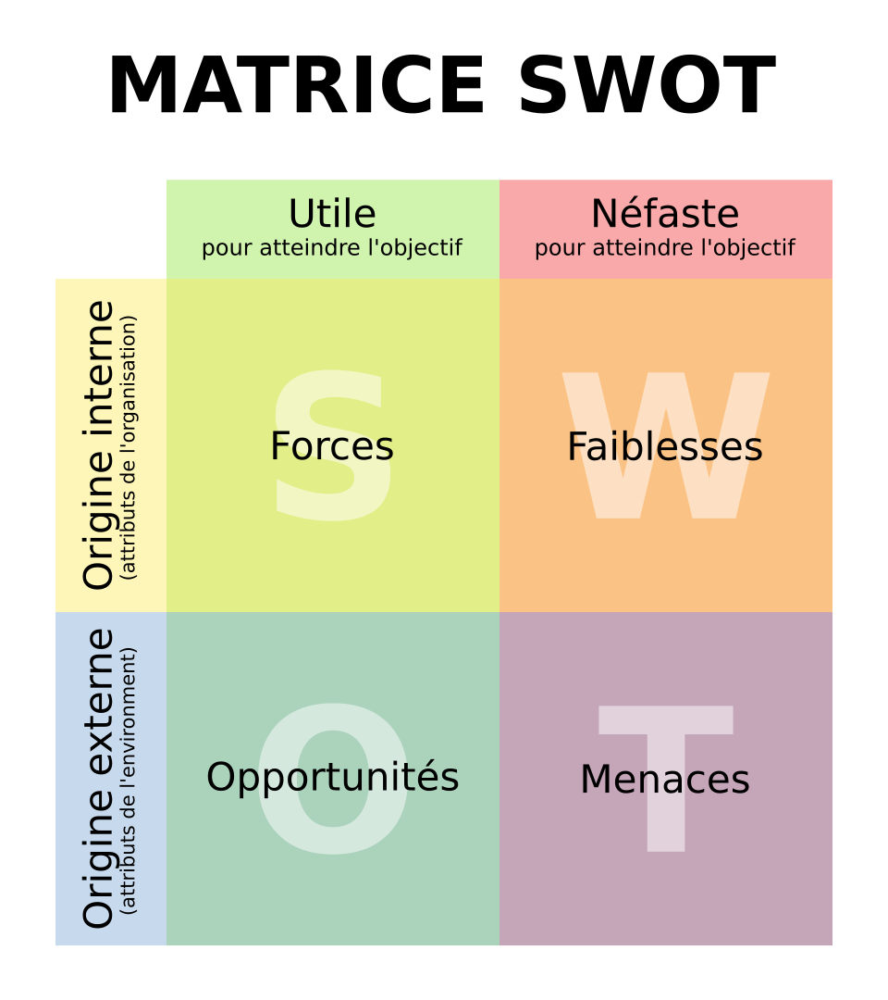
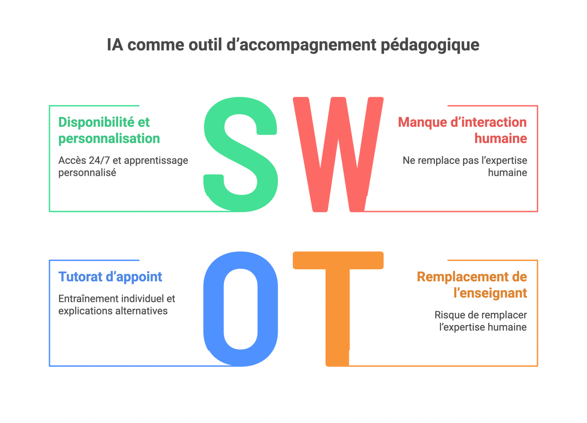
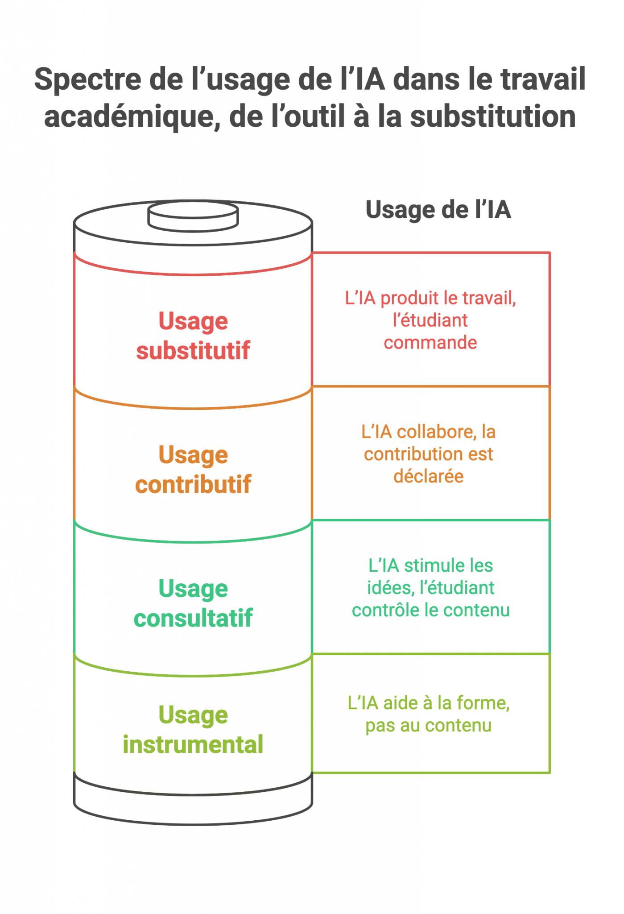

# Discussion sur l'IA

## Question  

 

### "Pour ou contre l'apprentissage de/avec l'IA ?"

 

Axes de discussion possibles :

 - Impact sur l'apprentissage et le cerveau
 - Sécurité des données et confidentialité
 - Propriété intellectuelle & droits d'auteurs
 - Monde du travail et emplois
 - Gestion de l'énergie et émission de CO2
 - Utilisation responsable et éthique
 - Souveraineté numérique

## Méthode Jigsaw

Effectue une analyse SWOT sur l'utilisation de l'IA.

Déroulé en 3 phases:

1. **Groupes de base (3-4 personnes)** : lecture d'articles

2. **Groupes experts par catégorie S-W-O-T** : carte mentale

3. **Retour dans les groupes de base** : slides & matrice SWOT

4. **Présentations par groupe** (5-7min/groupe)

5. **Debriefing & conclusion**

## Analyse SWOT

L'analyse SWOT est une méthode d'évaluation stratégique qui permet d'identifier :

 - les **Points Forts** (Strengths), 
 - les **Faiblesses** (Weaknesses), 
 - les **Opportunités** (Opportunities) et 
 - les **Menaces** (Threats) 
 
liés à un sujet ou projet donné. Elle permet de dresser un état des lieux et de structurer la réflexion.

## Analyse SWOT

{width=100%}

## Phase 1 : Groupes de base (10-15min)

   - Formation des groupes de travail (3-4 personnes)
   - Ecrire sur 2 post-it : 1 attente & 1 crainte par rapport à l'IA
   - Se répartir les catégories SWOT entre membre du groupe.
   - Lire le texte correspondants à sa catégorie

## Phase 2 : Groupes experts par catégorie (10-15min)

   - Quitter son groupe de base et se regrouper entre experts 
   - Chaque personne présente ses idées, notes, etc.
   - Récolte et organisation des points (forces, faiblesses, opportunités, menaces) en une **carte mentale**

**A faire**: dessiner une **carte mentale** représentant les points clés de l'article.

## Phase 2 : Carte mentale (mindmap)

{width="60%"}

## Phase 3 : Retour dans les groupes de bases (10-15min)

 - Attribuer les rôles: présentateur, facilitateur, secrétaire.
 - Débrifer et discuter des différents élément obtenu.  
 - Chacun présent les points récolté en groupes d'experts.
 - Créer une matrice SWOT sur l'utilisation de l'IA (min. 3 arguments/case dont 1 lié à l'enseignement)
 - Préparer une présentation de 5-6 diapositives
 - Déposer la présentation sur Moodle.

## Phase 4 : Présentation des résultats 

  - Chaque groupe présente ses résultats devant la classe (5min/groupe)
  - Question & réponse (2min/groupe)
  - Discussion globale et comparaison de tous les  arguments.
  - Synthèse sur les enjeux de l'IA

# Impacts de l'IA sur l'apprentissage

## Illusion de maîtrise & nécessité de la pensée critique

- Illusion de maîtrise chez les étudiant ("feeling of knowing")
- Utilisation passive de l'IA
-  Manque d'effort cognitif

## Illusion de maîtrise & nécessité de la pensée critique

Processus où l'IA pourrait poser problème :

- L’analyse critique des sources (verifier les sources)
- La structuration de la pensée argumentée (réponse clé en main)
- La réflexion métacognitive sur l’apprentissage (comment puis-je m'améliorer?)
- Le danger est de confondre “réponse obtenue” et “savoir acquis”!

## Illusion de maîtrise & nécessité de la pensée critique

Processus où l'IA pourrait poser problème :

{width=80%}

## IA comme outil d’accompagnement pédagogique (tuteur virtuel)

IA génératives possèdent en effet le potentiel d’offrir une forme d’assistance, mais il y a des risques :

- Anthropomorphisation et dépendance émotionnelle (prêter des intentions ou une intelligence à une IA)
- Réduction des interactions humaines (moins solliciter l’enseignant ou ses camarades)
- Baisse de la tolérance à la frustration (IA répond immédiatement)
- Disparition du conflit cognitif (IA évite la contradiction)

Tuteur IA a utiliser comme complément (pas comme substitut).

## Analyse SWOT de l'IA

## IA et production scolaire : assistance ou substitution

- Risques cognitifs et “délégation” du travail intellectuel (gain de temps vs perte d'opportunité d'apprendre)
- Passivité intellectuelle et non-intériorisation des savoirs.
- Perte de l’entraînement de compétences fondamentales (IA = raccourci cognitif)
- La “fabrique du plausible” et le risque d’erreurs non détectées (vraisemblance)
- Atteinte à l’intégrité de l’apprentissage

## IA et production scolaire

Usages légitimes vs. problèmatiques (frontère floue).

Types d'usage :

- **Instrumental**: IA utilisé comme outil technique (correcteur de grammaire)
- **Consultatif**: stimuler les idées sans se substituer à l'auteur ("sparing-partner")
- **Contributif**: IA collabore et génère une part significative du contenu (doit être préciser si autorisé)
- **Substitutif**: l’IA est le producteur principal du travail.

## IA et production scolaire

{width=70%}

## IA et production scolaire 

L’important est de poser explicitement les limites dans chaque contexte (chaque cours, chaque institution) : 

*Qu’est-ce qui est permis, qu’est-ce qui ne l’est pas.* 

## Références

L'IA à l'Université de Lausanne

[Impacts de l'IA sur l'apprentissage et l'enseignement : Entre soutien et illusion](https://wp.unil.ch/iaunil/impacts-de-lia-sur-lapprentissage-et-lenseignement/)