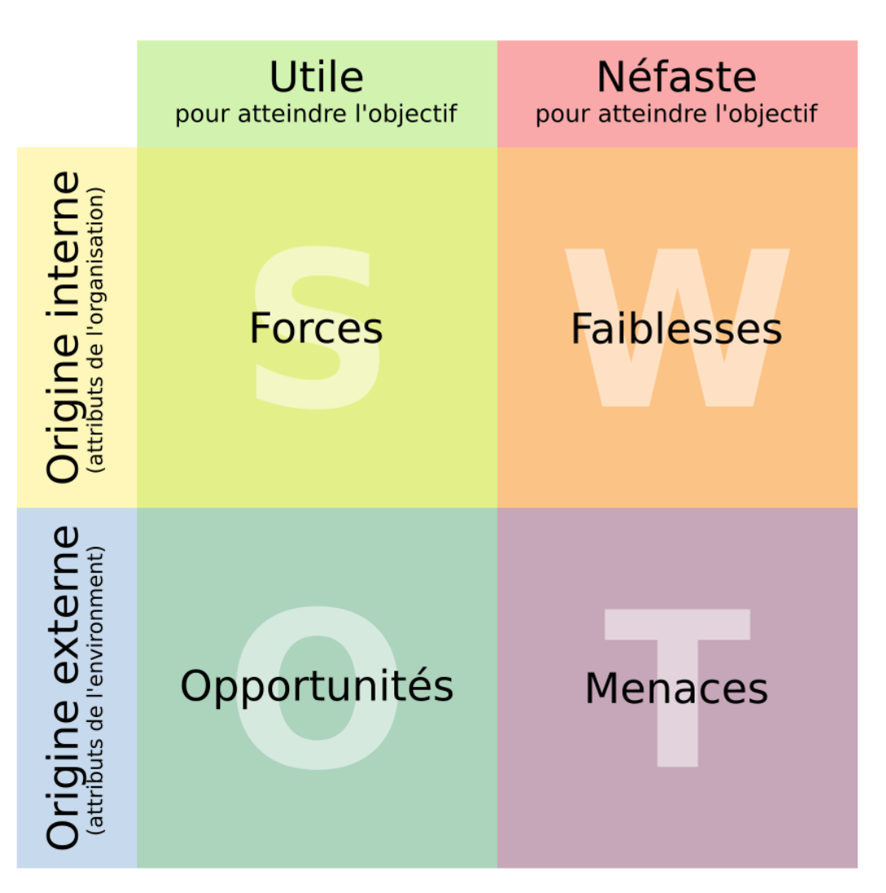
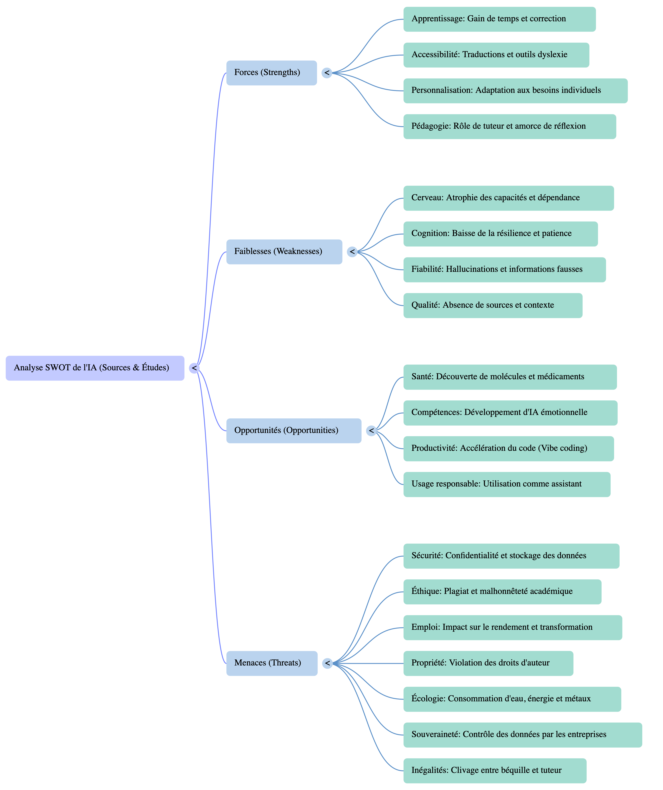
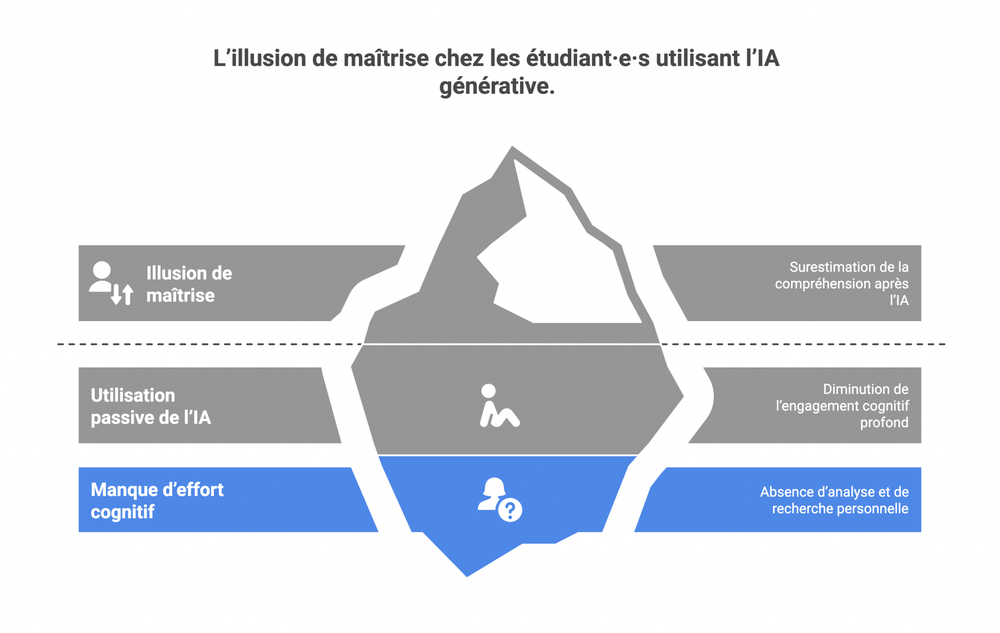
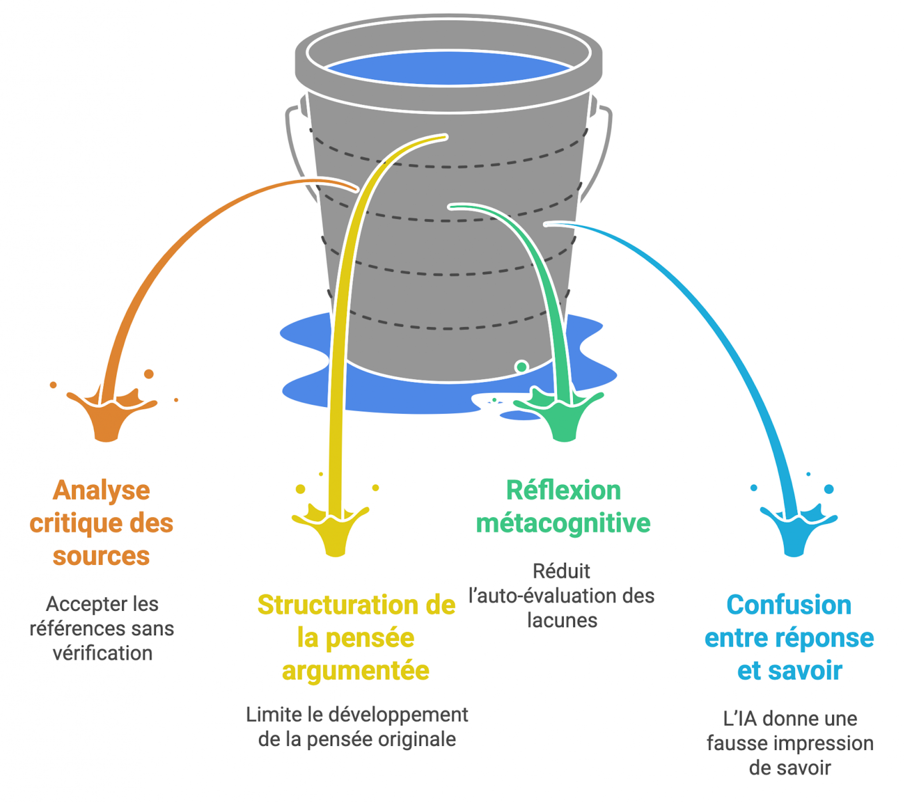
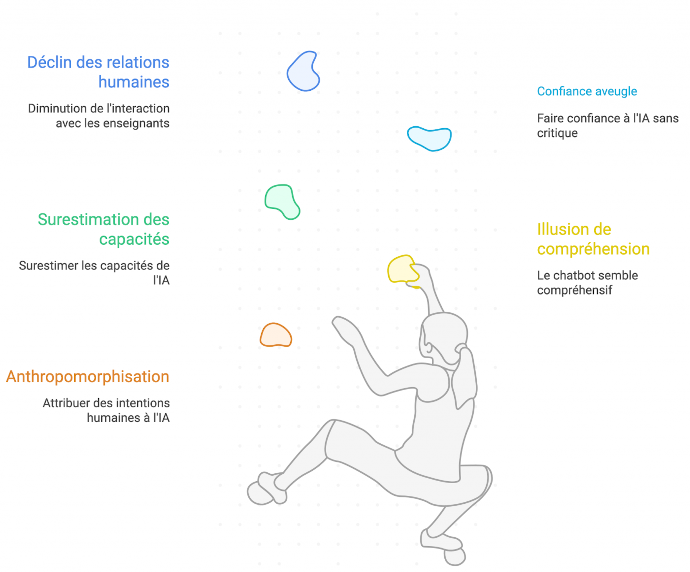

# Discussion sur l'IA

## Questions sur l'IA et l'apprentissage

### "Pour ou contre l'apprentissage de/avec l'IA ?"

Axes de discussion possibles :

 - Impact sur l'apprentissage et le cerveau
 - Sécurité des données et confidentialité
 - Propriété intellectuelle & droits d'auteurs
 - Monde du travail et emplois
 - Gestion de l'énergie et émission de CO2
 - Utilisation responsable et éthique
 - Souveraineté numérique
 - Dépendance à l'IA

::: notes

Il n'y a pas de réponse binaire « pour » ou « contre » ; l'objectif est de nuancer et d'argumenter. 

**Impact sur l'apprentissage et le cerveau**

- Rôle de l'effort cognitif : la mémoire à long terme se construit par l'effort (effortful learning). Si l'IA fait le travail, la rétention est moindre.
- Illusion de maîtrise (« feeling of knowing ») : l'élève croit comprendre alors qu'il a juste lu la réponse (voir la partie dédiée du cours).
- Développement de l'autonomie et de la pensée critique : l'IA peut-elle les affaiblir en supprimant le « conflit cognitif » ?

**Sécurité des données et confidentialité**

- Les données saisies dans certaines IA peuvent servir à entraîner les modèles ou être conservées.
- RGPD (règlement général sur la protection des données) : protection des données personnelles des élèves (âge, santé, résultats…).
- Question : faut-il saisir des informations sensibles (noms, identifiants, données de la famille) ?
- Outils avec/sans entraînement sur les données utilisateur ; privilégier des outils conformes RGPD et des solutions scolaires.

**Propriété intellectuelle & droits d'auteurs**

- Les modèles sont entraînés sur d'innombrables œuvres (livres, images, code) souvent protégées par le droit d'auteur.
- Statut juridique incertain : qui est l'auteur d'un contenu généré ? (l'utilisateur du prompt, l'IA, l'entreprise éditeuse ?)
- Risque de plagiat et d'attribution ; en Suisse/Europe, les œuvres purement générées ne sont (encore) pas protégeables comme œuvres humaines.

**Monde du travail et emplois**

- Automatisation de tâches répétitives ou intellectuelles : transformation (voire suppression) de certains emplois.
- Création de nouveaux métiers (ex. : « prompt engineer », validation/humain-en-boucle).
- Nécessité de formation continue et d'adaptation des compétences tout au long de la vie.
- Question pour la classe : quels de nos cours/ métiers seront touchés dans 10 ans ?
- Risque d'automatisation : certains métiers vont disparaître.
- Adaptation nécessaire : investir dans l'éducation et la formation, développer des compétences transversales (pensée critique, créativité, etc.).

**Gestion de l'énergie et émission de CO2**

- L'entraînement d'un grand modèle est très énergivore (électricité, eau pour le refroidissement des data centers).
- Empreinte carbone significative d'un grand modèle (ex. : comparable à celle d'un vol long-courrier ou de véhicules sur leur cycle de vie).
- Tensions : innovation technologique vs. objectifs climatiques ; nécessité de sobriété numérique.

**Utilisation responsable et éthique**

- Biais des IA : reproduction de stéréotypes et de discriminations présents dans les données d'entraînement.
- Deepfakes et désinformation : risque d'images/textes/réels irrémédiables à distinguer.
- En éducation : risque de triche et d'inéquité entre élèves (qui a accès à l'IA ?).
- Nécessité de règles et de bonnes pratiques (transparence de l'usage, vérification des sources).
- Autonomie vs. dépendance : utiliser l'IA comme complément, pas comme substitut.

**Souveraineté numérique**

- Dépendance à quelques grands groupes (GAFAM) : concentration du pouvoir technologique et économique.
- Hébergement des données à l'étranger (hors UE/Suisse) : quel droit s'applique ?
- Émergence d'alternatives européennes (ex. : Mistral, Llama) et de politiques de souveraineté (ex. : Cloud Act américain).
- Question : que se passe-t-il si un fournisseur étranger change de politique ou ferme son service ?

:::

## Méthode Jigsaw

Effectue une analyse SWOT sur l'utilisation de l'IA.

Déroulé en 3 phases:

1. **Groupes de base (3-4 personnes)** : lecture d'articles

2. **Groupes experts par catégorie S-W-O-T** : carte mentale

3. **Retour dans les groupes de base** : slides & matrice SWOT

4. **Présentations par groupe** (5-7min/groupe)

5. **Debriefing & conclusion**

::: notes

La méthode Jigsaw (ou « puzzle ») est une technique de pédagogie coopérative : chaque élève devient responsable d'un morceau du savoir (ici une catégorie SWOT) puis doit l'enseigner à son groupe d'origine. Cela crée une interdépendance positive : personne ne peut réussir sans l'apport des autres.

- Prévoir un article/texte différent par catégorie (S, W, O et T) à distribuer en amont.
- L'énoncé affiche 5 étapes, mais le sous-titre en mentionne 3 : ce sont les 3 grandes phases de regroupement (base → experts → base), les points 4 et 5 correspondant à la mise en commun finale en classe entière.
- Durée totale indicative : compter 45-60 minutes pour l'ensemble de l'activité (phases 1 à 3), puis une session dédiée aux présentations (phase 4).
- Bien insister sur le fait que chaque expert doit être capable de transmettre l'essentiel de son texte : c'est ce qui garantit l'engagement individuel.

:::

## Analyse SWOT

L'analyse SWOT est une méthode d'évaluation stratégique qui permet d'identifier :

 - les **Points Forts** (Strengths), 
 - les **Faiblesses** (Weaknesses), 
 - les **Opportunités** (Opportunities) et 
 - les **Menaces** (Threats) 
 
liés à un sujet ou projet donné. Elle permet de dresser un état des lieux et de structurer la réflexion.

::: notes

Définition à faire lire (ou récapituler) avant de lancer l'activité Jigsaw : chaque élève doit maîtriser l'acronyme et la signification de chaque terme.

- **S / Strengths** : ce qui est favorable et *interne*« au sujet.
- **W / Weaknesses** : ce qui est défavorable et *interne*.
- **O / Opportunities** : ce qui est favorable et *externe*.
- **T / Threats** : ce qui est défavorable et *externe*.

Le croisement interne/externe est souvent ce que les élèves confondent le plus : une force/faiblesse dépend de nous, une opportunité/menace vient du contexte extérieur. Exemple avec l'IA : l'automatisation est-elle une *menace* (le marché évolue) ou une *faiblesse* (nos compétences ne suivent pas) ? C'est ce type de nuance qu'il faut faire émerger.

:::

## Matrice SWOT

{width=55%}

::: notes

Cette matrice illustre visuellement les deux critères de classement du SWOT : l'axe horizontal (utile / néfaste pour atteindre l'objectif) et l'axe vertical (origine interne / origine externe). Les quatre cases colorées (S en vert, W en orange, O en bleu-vert, T en violet) reprennent les mêmes couleurs que dans le reste du support pour aider les élèves à s'y retrouver.

À l'oral, proposer une lecture croisée : *forces + opportunités* (comment s'appuyer sur ce qui va bien) et *faiblesses + menaces* (où faut-il se protéger). C'est ce croisement qui débouche sur des recommandations concrètes, pas seulement un inventaire.

Rappeler que la matrice est un outil d'aide à la réflexion, pas une fin en soi : elle structure la discussion, elle ne la remplace pas.

:::

## Phase 1 : Groupes de base (10-15min) 

   - Formation des groupes de travail (3-4 personnes)
   - Ecrire sur 2 post-it : 1 attente & 1 crainte par rapport à l'IA
   - Se répartir les catégories SWOT entre membre du groupe.
   - Lire le texte correspondants à sa catégorie

::: notes

Objectif de cette phase : poser le cadre et faire émerger les représentations personnelles avant l'analyse collective. Les deux post-its (une attente, une crainte) servent de « thermomètre » de départ, à reconfronter avec les conclusions de fin d'activité.

- Former des groupes hétérogènes et limités à 3-4 personnes pour garantir la participation de tous.
- Les post-its se posent *avant* la lecture : ils capturent les représentations a priori.
- Répartir les 4 catégories SWOT entre les membres (une catégorie par élève, ou deux pour les groupes de 4).
- Chaque élève ne lit *que* le texte de sa propre catégorie — c'est le principe même du jigsaw : personne ne maîtrise tout au départ.
- Timing serré (10-15 min) : ne pas hésiter à couper la lecture si besoin, quitte à terminer en phase 2.

:::

## Phase 2 : Groupes experts par catégorie (10-15min)

   - Quitter son groupe de base et se regrouper entre experts
   - Chaque personne présente ses idées, notes, etc.
   - Récolte et organisation des points (forces, faiblesses, opportunités, menaces) en une **carte mentale**

**A faire**: dessiner une **carte mentale** représentant les points clés de l'article.

::: notes

C'est le cœur du dispositif jigsaw : les élèves quittent leur groupe hétérogène pour former des groupes homogènes (tous les « S » ensemble, tous les « W » ensemble, etc.). Chacun devient alors « expert » de sa catégorie et doit mettre en commun ce qu'il a lu.

- Circuler entre les groupes d'experts pour vérifier que chacun a bien compris son texte avant de collaborer.
- La carte mentale est l'outil de synthèse visuelle : elle oblige à hiérarchiser (idée centrale → branches → sous-points) plutôt qu'à recopier le texte.
- Chaque élève doit repartir avec sa propre carte (ou une copie), car il devra la présenter seul dans son groupe de base à la phase 3.

:::

## Phase 2 : Carte mentale (mindmap)

{width="65%"}

::: notes

Cette image est un exemple/corrigé de carte mentale que les groupes d'experts pourraient produire, avec les 4 branches SWOT (Forces, Faiblesses, Opportunités, Menaces) et pour chacune 4 à 7 sous-thèmes concrets liés à l'IA :

- **Forces** : pédagogie (rôle de tuteur), personnalisation, accessibilité (ex. outils dyslexie), gain de temps.
- **Faiblesses** : qualité/absence de sources, fiabilité (hallucinations), impact cognitif, dépendance.
- **Opportunités** : usage responsable, gains de productivité, développement de compétences, avancées en santé (découverte de molécules).
- **Menaces** : inégalités d'accès, souveraineté des données, impact écologique, propriété intellectuelle, emploi, éthique, sécurité des données.

À montrer *après* que les groupes ont produit leur propre carte, pour comparer leurs idées à cette structure type — pas avant, pour ne pas brider leur réflexion. On peut aussi s'en servir comme grille de correction/relance si un groupe est resté trop pauvre sur une branche. 

:::

## Phase 3 : Retour dans les groupes de bases (10-15min)

 - Attribuer les rôles: présentateur, facilitateur, secrétaire.
 - Débrifer et discuter des différents élément obtenu.
 - Chacun présent les points récolté en groupes d'experts.
 - Créer une matrice SWOT sur l'utilisation de l'IA (min. 3 arguments/case dont 1 lié à l'enseignement)
 - Préparer une présentation de 5-6 diapositives
 - Déposer la présentation sur Moodle.

::: notes

Retour dans le groupe hétérogène initial : chaque élève y ramène son expertise et doit la transmettre aux autres, qui n'ont pas lu le même texte que lui.

- L'attribution explicite des rôles (présentateur, facilitateur, secrétaire) évite que la charge de travail retombe toujours sur les mêmes élèves.
- Exiger au moins 3 arguments par case, dont 1 lié spécifiquement à l'enseignement/l'école, pour éviter les SWOT trop génériques recopiées d'internet.
- Le format « 5-6 diapositives » cadre le travail de synthèse à venir en phase 4 ; rappeler le dépôt sur Moodle comme trace évaluable.
- C'est le moment le plus dense de l'activité : prévoir une marge de temps (le 10-15 min est souvent optimiste).

:::

## Phase 4 : Présentation des résultats

  - Chaque groupe présente ses résultats devant la classe (5min/groupe)
  - Question & réponse (2min/groupe)
  - Discussion globale et comparaison de tous les  arguments.
  - Synthèse sur les enjeux de l'IA

::: notes

Phase de mise en commun collective : chaque groupe expose sa matrice SWOT, ce qui permet de comparer les priorités retenues par les différents groupes sur un même sujet.

- Minuter strictement les 5 min de présentation + 2 min de questions pour que tous les groupes passent (prévoir ~7 min × nombre de groupes).
- Encourager la classe à repérer les points communs et les divergences entre les matrices : cela nourrit la discussion globale.
- Terminer par une synthèse orale ou écrite (par le prof ou co-construite) qui reprend les grands enjeux abordés en phase 1 (RGPD, emploi, écologie, éthique, etc.) et fait le lien avec la suite du cours sur les impacts de l'IA sur l'apprentissage.

:::

# Impacts de l'IA sur l'apprentissage

## Illusion de maîtrise & nécessité de la pensée critique

- Illusion de maîtrise chez les étudiant ("feeling of knowing")
- Utilisation passive de l'IA
-  Manque d'effort cognitif

::: notes

Transition entre l'atelier SWOT et la partie plus théorique du cours : on quitte le débat général sur l'IA pour se concentrer spécifiquement sur son impact cognitif en contexte d'apprentissage.

- **Illusion de maîtrise / « feeling of knowing »** : sentiment subjectif de comprendre ou de savoir, qui peut être élevé même quand la compréhension réelle est faible — l'élève confond avoir *lu* une bonne réponse avec l'avoir *comprise* ou *retenue*.
- **Utilisation passive** : l'élève reçoit une réponse toute faite sans la retravailler, contrairement à une recherche active (livre, discussion) qui oblige à reformuler.
- **Manque d'effort cognitif** : rappel du principe d'« effortful learning » vu en introduction — sans effort de récupération/production, la trace mnésique reste fragile.

Ces trois points seront développés un par un sur les diapositives suivantes, avec des schémas à l'appui.

:::

## Illusion de maîtrise

L'illusion de maîtrise chez les étudiants utilisant l'IA générative

{width="90%"}

::: notes

Le schéma représente un iceberg pour illustrer que l'illusion de maîtrise n'est que la partie visible d'un problème plus profond :

- **Au-dessus de la ligne de flottaison** (gris clair) : ce qu'on observe en surface — « illusion de maîtrise » (l'élève se sent compétent) et, en miroir à droite, la « surestimation de la compréhension après l'IA ».
- **Juste sous la surface** : « utilisation passive de l'IA », qui se traduit par une « diminution de l'engagement cognitif profond ».
- **Tout en bas** (bleu, la partie immergée et cachée) : la vraie cause racine — le « manque d'effort cognitif », correspondant à une « absence d'analyse et de recherche personnelle ».

L'intérêt pédagogique du schéma : montrer aux élèves que le symptôme visible (se sentir compétent) n'est que la conséquence d'une cause invisible et plus fondamentale (ne pas avoir fourni l'effort cognitif nécessaire). Cela permet de justifier pourquoi il faut agir sur la cause (l'effort, l'engagement actif) plutôt que sur le symptôme.

:::

## Illusion de maîtrise & nécessité de la pensée critique

Processus où l'IA pourrait poser problème :

- L’analyse critique des sources (verifier les sources)
- La structuration de la pensée argumentée (réponse clé en main)
- La réflexion métacognitive sur l’apprentissage (comment puis-je m'améliorer?)
- Le danger est de confondre “réponse obtenue” et “savoir acquis”!

::: notes

Trois compétences intellectuelles fondamentales, potentiellement court-circuitées par un usage non réfléchi de l'IA :

- **Analyse critique des sources** : si l'IA fournit directement une synthèse, l'élève n'a plus l'occasion de comparer, vérifier et trier ses sources.
- **Structuration de la pensée argumentée** : une réponse « clé en main » évite à l'élève l'exercice de construire lui-même un raisonnement (introduction, arguments, exemples, conclusion).
- **Réflexion métacognitive** : sans effort personnel, il devient difficile de savoir *où* se situent ses propres lacunes (« comment puis-je m'améliorer ? »), car l'IA a comblé le manque avant même qu'il soit identifié.

Point clé à faire passer : la phrase finale résume tout l'enjeu du chapitre — « réponse obtenue » ≠ « savoir acquis ». Un élève peut avoir une bonne réponse dans son travail sans que rien n'ait été appris durablement.

:::

## Illusion de maîtrise

L'IA entrave la pensée critique des étudiant-e•s

{width=50%}

::: notes

Métaphore visuelle du seau percé : le seau (rempli d'eau bleue) représente le savoir/la pensée critique de l'élève, qui « fuit » par plusieurs trous à cause d'un usage problématique de l'IA. Chaque jet coloré correspond à l'un des points de la diapositive précédente :

- **Analyse critique des sources** (orange) : accepter les références sans vérification.
- **Structuration de la pensée argumentée** (jaune) : cela limite le développement de la pensée originale.
- **Réflexion métacognitive** (vert) : réduit l'auto-évaluation des lacunes.
- **Confusion entre réponse et savoir** (bleu) : l'IA donne une fausse impression de savoir.

L'image reprend donc, sous une forme plus mémorable et imagée, les 4 mêmes idées : à utiliser comme rappel visuel plutôt que pour introduire du contenu nouveau. On peut demander aux élèves de reformuler chaque « fuite » avec leurs propres mots avant de révéler le texte.

:::

## IA comme outil d’accompagnement pédagogique (tuteur virtuel)

IA génératives peut offrir une forme d’assistance, mais :

- Anthropomorphisation et dépendance émotionnelle (prêter des intentions ou une intelligence à une IA)
- Réduction des interactions humaines (moins solliciter l’enseignant ou ses camarades)
- Baisse de la tolérance à la frustration (réponses immédiates)
- Disparition du conflit cognitif (IA évite la contradiction)

Tuteur IA a utiliser comme complément (pas comme substitut).

::: notes

On aborde ici un deuxième registre de risques, plus relationnel/émotionnel que purement cognitif :

- **Anthropomorphisation** : tendance à parler à l'IA « comme à une personne », voire à lui prêter des émotions ou des intentions — ce qui peut créer un attachement disproportionné à un outil qui n'a ni compréhension ni continuité réelle.
- **Réduction des interactions humaines** : le risque que l'élève se tourne systématiquement vers l'IA plutôt que vers l'enseignant ou ses pairs, avec une perte des bénéfices sociaux de l'apprentissage (explication par un pair, débat, etc.).
- **Baisse de la tolérance à la frustration** : une IA répond instantanément, alors que la recherche, l'essai-erreur et l'attente font partie intégrante de l'apprentissage.
- **Disparition du conflit cognitif** : une IA a tendance à valider/accompagner plutôt qu'à contredire fermement — or c'est justement le conflit cognitif (se tromper, être contredit) qui déclenche l'apprentissage en profondeur (cf. Piaget).

Message central à faire retenir : l'IA-tuteur peut être utile, mais seulement en complément d'un enseignant humain, jamais en remplacement.

:::

## IA comme tuteur virtuel

Dépendance émotionnelle envers l'IA chez les élèves.

{width=70%}

::: notes

L'illustration montre une personne en train d'escalader un mur de bloc (bouldering), une métaphore de la progression scolaire : chaque prise colorée représente un risque associé à l'usage d'une IA-tuteur, nommé à gauche/droite de l'image :

- **Anthropomorphisation** : attribuer des intentions humaines à l'IA.
- **Surestimation des capacités** : surestimer ce que l'IA sait réellement faire.
- **Illusion de compréhension** : le chatbot *semble* compréhensif, sans l'être réellement.
- **Confiance aveugle** : faire confiance à l'IA sans esprit critique.
- **Déclin des relations humaines** : diminution de l'interaction avec les enseignants.

L'image renforce l'idée que s'appuyer sur de « fausses prises » (une aide qui n'est pas ce qu'elle paraît être) peut faire chuter l'élève dans sa progression réelle, même si l'ascension semble avancer plus vite à court terme.

:::

## Analyse SWOT de l'IA

IA comme outil d'accompagnement pédagogique

{width=80%}

::: notes

Contrairement à la matrice SWOT vierge vue en atelier, celle-ci est un exemple concret et déjà rempli, appliqué spécifiquement au rôle de l'IA comme tuteur virtuel :

- **Forces** : disponibilité et personnalisation — accès 24/7, apprentissage personnalisé.
- **Faiblesses** : manque d'interaction humaine — ne remplace pas l'expertise humaine.
- **Opportunités** : tutorat d'appoint — entraînement individuel, explications alternatives à celles du cours.
- **Menaces** : remplacement de l'enseignant — risque que l'IA soit perçue comme un substitut plutôt qu'un complément à l'expertise humaine.

Utile comme synthèse visuelle avant de conclure la partie « tuteur virtuel » : on peut demander aux élèves de comparer ce SWOT à celui qu'ils ont produit eux-mêmes en atelier Jigsaw sur l'IA en général.

:::

## IA et production scolaire : assistance ou substitution

- Risques cognitifs et “délégation” du travail intellectuel (gain de temps vs perte d'opportunité d'apprendre)
- Passivité intellectuelle et non-intériorisation des savoirs.
- Perte de l’entraînement de compétences fondamentales (IA = raccourci cognitif)
- La “fabrique du plausible” et le risque d’erreurs non détectées (vraisemblance)
- Atteinte à l’intégrité de l’apprentissage

::: notes

Troisième volet du chapitre : après l'impact cognitif général et le rôle de tuteur, on s'intéresse maintenant à l'usage de l'IA dans la *production* de travaux scolaires (rédactions, devoirs, projets).

- **Délégation du travail intellectuel** : gain de temps immédiat, mais perte de l'opportunité d'apprentissage que représentait justement la difficulté de la tâche.
- **Passivité intellectuelle** : recopier/adapter une production de l'IA n'entraîne pas la même intériorisation des savoirs qu'une production personnelle.
- **Perte de l'entraînement des compétences fondamentales** : rédiger, argumenter, structurer sont des compétences qui s'acquièrent par la pratique répétée — un raccourci systématique empêche cet entraînement.
- **« Fabrique du plausible »** : notion clé — l'IA générative produit du texte statistiquement vraisemblable, pas nécessairement vrai. Le risque est que des erreurs (hallucinations) passent inaperçues car le texte est bien écrit et convaincant.
- **Atteinte à l'intégrité de l'apprentissage** : au-delà de la triche classique, il s'agit ici d'un préjudice que l'élève se cause à lui-même, même sans intention de tricher.

:::

## IA et production scolaire

Usages légitimes vs. problèmatiques (frontère floue).

Types d'usage :

- **Instrumental**: IA utilisé comme outil technique (correcteur de grammaire)
- **Consultatif**: stimuler les idées sans se substituer à l'auteur ("sparing-partner")
- **Contributif**: IA collabore et génère une part significative du contenu (doit être préciser si autorisé)
- **Substitutif**: l’IA est le producteur principal du travail.

::: notes

Cette typologie en 4 niveaux est l'outil central pour dépasser le débat stérile « pour/contre » et raisonner en termes de degré d'implication de l'IA dans la production :

- **Instrumental** : l'IA reste un outil au même titre qu'un correcteur orthographique classique — elle n'intervient pas sur le fond, seulement sur la forme.
- **Consultatif** : l'IA joue un rôle de « sparring-partner » pour faire émerger des idées, mais l'auteur reste maître du contenu final et le reformule entièrement.
- **Contributif** : l'IA génère une part substantielle du contenu ; cet usage doit être déclaré/autorisé explicitement, car la frontière avec la triche devient ténue.
- **Substitutif** : l'IA produit l'essentiel du travail, l'élève se contente de la « commander » — usage généralement considéré comme problématique en contexte scolaire.

Point à insister : la frontière entre usages légitimes et problématiques n'est pas universelle, elle dépend du contexte fixé par chaque enseignant/institution (cf. diapositive suivante).

:::

## Usage de l'IA dans le travail scolaire

De l'outil à la substitution...

{width=35%}

::: notes

La visualisation reprend la même typologie sous forme de jauge/pile à 4 niveaux, du bas (vert, usage instrumental) vers le haut (rouge, usage substitutif) :

- **Usage instrumental** (vert) : l'IA aide à la forme, pas au contenu.
- **Usage consultatif** (vert clair) : l'IA stimule les idées, l'étudiant contrôle le contenu.
- **Usage contributif** (orange) : l'IA collabore, la contribution est déclarée.
- **Usage substitutif** (rouge) : l'IA produit le travail, l'étudiant commande.

La forme en « pile/batterie » est volontairement évocatrice : plus on monte dans les niveaux (plus la « jauge » se remplit), plus l'autonomie de l'élève diminue et plus le risque (couleur rouge) augmente. C'est un bon support pour faire s'auto-positionner les élèves sur leurs propres pratiques.

:::

## IA et production scolaire

L’important est de poser explicitement les limites dans chaque contexte (chaque cours, chaque institution) :

*Qu’est-ce qui est permis? Qu’est-ce qui ne l’est pas?*

Exemples :

*«Utiliser ChatGPT pour vous aider à trouver des idées (usage consultatif), mais réécrit avec vos mots et interdit de le laisser tel quel (pas d’usage substitutif). »*

*Sous condition de joindre en annexe le brouillon sorti de l’IA et d’écrire une réflexion sur comment l’IA a été utilisée.*

::: notes

Diapositive de conclusion pratique : la typologie précédente n'a de valeur que si elle est traduite en règles concrètes et communiquées clairement aux élèves *avant* le travail, pas découverte après coup en cas de litige.

- Chaque enseignant devrait annoncer explicitement, pour chaque évaluation/devoir, quel(s) niveau(x) d'usage (instrumental, consultatif, contributif, substitutif) sont autorisés.
- L'exemple donné illustre une politique « consultatif oui, substitutif non » assortie d'une exigence de reformulation personnelle.
- La piste de la transparence (joindre le brouillon IA + une réflexion sur son usage) est particulièrement intéressante en classe : elle transforme l'usage de l'IA en objet d'apprentissage métacognitif plutôt qu'en zone grise à sanctionner.
- Ouvrir la discussion : demander aux élèves ce qu'ils changeraient/proposeraient comme règle pour ce cours d'informatique.

:::

## Références

L'IA à l'Université de Lausanne

[Impacts de l'IA sur l'apprentissage et l'enseignement : Entre soutien et illusion](https://wp.unil.ch/iaunil/impacts-de-lia-sur-lapprentissage-et-lenseignement/)

::: notes

Slide de clôture : l'article de l'UNIL cité ici est la source principale ayant inspiré la structure de ce chapitre (illusion de maîtrise, IA comme tuteur virtuel, usages en production scolaire). Le mentionner explicitement permet aux élèves curieux d'aller approfondir, et légitimise le contenu du cours auprès d'un public qui pourrait douter de la rigueur du sujet.

:::