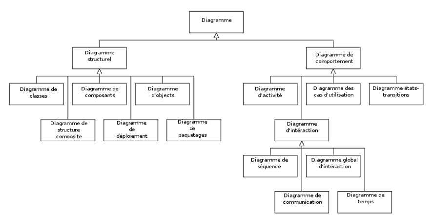

## Objectifs

- Comprendre les concepts des bases de données relationnelles.
- Découvrir les bases de la modélisation avec le diagramme de classes UML.
- Comprendre la structure et les relations entre les tables.
- Connaître les types de données dans une base de données.
- Connaître l'utilité des clés primaires et étrangères.


::: notes
**Objectifs du cours**
..
:::


# UML et diagramme de classes

## UML - Unified Modeling Language

- Langage **graphique** pour modéliser un système
- **Standard** depuis 1997 (OMG)
- 2 catégories: diagrammes de **strucutre** et de **comportement**
- Plusieurs types de diagrammes : cas d'utilisation, séquences, activités, classes, etc.
- Pour modeliser une base de donner, on utiliser le **diagramme de classes**

::: notes
- UML est né de la fusion des méthodes de Grady Booch, James Rumbaugh et Ivar Jacobson au milieu des années 90. Il est standardisé par l'OMG (*Object Management Group*) depuis 1997.
- UML n'est pas un langage de programmation : c'est une **notation** commune pour dessiner et discuter un système avant de le construire (ou pour le documenter).
- Il existe 14 types de diagrammes. Les plus connus : diagramme de cas d'utilisation (qui fait quoi), de séquence (qui envoie quel message à qui, dans quel ordre), d'activité (déroulement d'un processus), de classes (structure des données).
- Pour une base de données, c'est le **diagramme de classes** qui nous intéresse : il décrit les données et leurs liens, indépendamment du logiciel (PostgreSQL, SQLite, …).
:::

## Types de diagrammes UML




## Diagramme de classes

```{mermaid}
%%| echo: false
%%{init: {"fontSize": 24, "htmlLabels": false, "flowchart": {"htmlLabels": false, "rankSpacing": 100, "nodeSpacing": 40}}}%%
classDiagram
    direction LR
    class maitres {
        nom : VARCHAR
        prenom : VARCHAR
        noter(eleve, note)
    }
    class cours {
        libelle_cours : VARCHAR
        max_eleves : INTEGER
        inscrire(eleve)
    }
    maitres "1" -- "0..*" cours : enseigne
```

- **Classe** : nom, **attributs** (nom : type), **opérations**
- **Association** : lien entre deux classes, avec un nom
- **Multiplicités** : combien d'objets sont liés

::: notes
- Une **classe** décrit une catégorie d'objets qui ont les mêmes caractéristiques. Elle est dessinée en 3 compartiments : le nom, les attributs, les opérations.
- Un **attribut** est une propriété de chaque objet (ici chaque cours a un libellé et un nombre maximum d'élèves), avec son type.
- Une **opération** (méthode) est une action que l'objet sait faire : un maître peut *noter* un élève, on peut *inscrire* un élève à un cours. Ces opérations sont ajoutées ici pour l'exemple. Pour une base de données, on ne les dessine pas : une table ne contient que des données. C'est pourquoi le 3e compartiment n'apparaît pas dans le schéma de l'école.
- Une **association** relie deux classes ; son nom est souvent un verbe (« enseigne »).
- Les **multiplicités** se lisent à l'extrémité opposée : un maître enseigne `0..*` cours, un cours est donné par `1` maître.
:::

## Multiplicités

| Multiplicité    | Signification       | Exemple                                    |
|-----------------|---------------------|--------------------------------------------|
| `1..1` ou `1`   | exactement un       | 1 élève est dans `1` groupe                |
| `0..1`          | zéro ou un          | 1 personne a `0..1` passeport              |
| `0..*` ou `*`   | zéro ou plusieurs   | 1 élèves a `0` ou plusieurs notes.           |
| `1..*`          | au moins un         | 1 maîtres enseigne un ou pluseurs cours    |

::: notes
- La multiplicité indique combien d'objets de la classe **à cette extrémité** peuvent être liés à **un** objet de l'autre classe.
- Exemple : `maitres "1" -- "0..*" cours`. Le `0..*` est placé du côté de *cours* : un maître enseigne zéro, un ou plusieurs cours (dans la base, 2 maîtres n'enseignent aucun cours). Le `1` est placé du côté de *maitres* : un cours est donné par exactement un maître.
- Pour trouver la multiplicité, on se pose la question dans les deux sens : « un élève est dans combien de groupes ? » (1) puis « un groupe contient combien d'élèves ? » (0..*).
:::

## De la description au schéma

On part d'une **description métier** (en français) :

| Texte                              | Diagramme |
|------------------------------------|---------------------|
| les **noms** importants            | des **classes**     |
| leurs **propriétés**               | des **attributs**   |
| les **verbes** qui les relient     | des **associations** |
| les **quantités**                  | des **multiplicités** |

Puis on ajoute les **identifiants** ou **clés**.

::: notes
- Le travail de modélisation commence toujours par une discussion avec les personnes du métier (ici : la direction, le secrétariat de l'école), qui décrivent leur activité avec leurs propres mots.
- On souligne dans ce texte les noms, les propriétés, les verbes et les quantités. C'est une méthode simple qui donne une très bonne première version du diagramme.
- Le diagramme est ensuite affiné (relations plusieurs-à-plusieurs, clés), jusqu'à pouvoir être traduit en tables SQL.
- Nous allons reconstruire ainsi, pas à pas, le schéma de la base *École*.
:::

## Example : description de l'école {.smaller}

- L'école emploie des maîtres. On connaît leur nom, leur prénom, leur sexe et leur date de naissance.
- Les élèves (nom, prénom, sexe, date de naissance, nationalité) sont répartis en groupes. Un groupe a un numéro (101, 102, …) et un degré pédagogique (1 à 4).
- Chaque groupe a un maître de groupe.
- Chaque maître enseigne des cours. Un cours a un libellé et un nombre maximum d'élèves.
- Un élève s'inscrit à plusieurs cours. Pour chaque inscription, on garde la date d'inscription et la moyenne de bulletin.
- Pendant l'année, un élève obtient des notes (valeur, date) dans les cours auxquels il est inscrit.
- Chaque cours a lieu une ou plusieurs fois par semaine dans une salle (nom, nombre de places, nombre de lignes et de colonnes, type de salle), un jour, à une période et un semestre donnés.

::: notes
- C'est la description que pourrait donner le secrétariat de l'école. Elle ne parle ni de tables, ni de clés : seulement de l'activité de l'école.
- Faire lire le texte aux élèves et leur demander de souligner les noms (en couleur), les verbes, et les mots de quantité (chaque, plusieurs, une ou plusieurs fois).
:::

## Étape 1 : les classes

Les **noms** importants : **maître**, **élève**, **groupe**, **cours**, **note**, **salle**

```{mermaid}
%%| echo: false
%%{init: {"fontSize": 24, "htmlLabels": false, "flowchart": {"htmlLabels": false, "rankSpacing": 100, "nodeSpacing": 40}}}%%
classDiagram
    direction TB
    class maitres
    class groupes
    class eleves
    class cours
    class notes
    class salles
```

- Un nom avec **ses propres propriétés** → une classe
- Un nom qui décrit autre chose (nom, date, numéro, …) → un attribut

::: notes
- On garde comme classes les noms qui désignent des « choses » sur lesquelles on veut stocker plusieurs informations : un maître, un élève, un groupe, un cours, une note, une salle.
- Les autres noms (*nom*, *prénom*, *date de naissance*, *libellé*, *numéro*, …) ne sont pas des classes : ils décrivent une classe, ce sont des attributs.
- Cas à discuter : *inscription* (« pour chaque inscription, on garde… ») et le créneau horaire (jour, période, semestre). Nous y reviendrons à l'étape 4.
- En UML, on nomme habituellement une classe au singulier avec une majuscule (`Eleve`). Ici, on utilise directement le nom des tables de la base (*eleves*), pour retrouver le schéma de la base à la fin.
:::

## Étape 2 : les attributs {.smaller}

Les **propriétés** de chaque classe, avec leur type :

```{mermaid}
%%| echo: false
%%{init: {"fontSize": 24, "htmlLabels": false, "flowchart": {"htmlLabels": false, "rankSpacing": 100, "nodeSpacing": 40}}}%%
classDiagram
    direction TB
    class maitres {
        nom : VARCHAR
        prenom : VARCHAR
        sexe : CHAR
        date_naissance : DATE
    }
    class groupes {
        numero : VARCHAR
        degre_pedagogique : INTEGER
    }
    class eleves {
        nom : VARCHAR
        prenom : VARCHAR
        sexe : CHAR
        date_naissance : DATE
        nationalite : VARCHAR
    }
```

```{mermaid}
%%| echo: false
%%{init: {"fontSize": 24, "htmlLabels": false, "flowchart": {"htmlLabels": false, "rankSpacing": 100, "nodeSpacing": 40}}}%%
classDiagram
    direction TB
    class cours {
        libelle_cours : VARCHAR
        max_eleves : INTEGER
    }
    class notes {
        note : DECIMAL
        date_note : DATE
    }
    class salles {
        salle : VARCHAR
        max_eleves : INTEGER
        lignes : INTEGER
        colonnes : INTEGER
        type_salle : VARCHAR
    }
```

::: notes
- Chaque propriété citée dans le texte devient un attribut de la classe qu'elle décrit.
- On choisit un type pour chaque attribut (voir « Types de données ») : texte, nombre entier, nombre décimal, date.
- Il manque encore des informations du texte : la date d'inscription, la moyenne de bulletin, le jour, la période et le semestre. Elles ne décrivent aucune de ces classes seules : nous les placerons à l'étape 4.
- Pas encore de clés à cette étape : on décrit le métier, pas encore les tables.
:::

## Étape 3 : associations & multiplicités

- Les **association** (verbes) relient les classes
- Les **multiplicités** (quantités) indiquent le nombre d'instances d'une classe qui peuvent être associées à une instance d'une autre classe.

```{mermaid}
%%| echo: false
%%{init: {"fontSize": 24, "htmlLabels": false, "flowchart": {"htmlLabels": false, "rankSpacing": 100, "nodeSpacing": 40}}}%%
classDiagram
    direction LR
    class maitres
    class groupes
    class cours
    class eleves
    class salles
    class notes
    maitres "1" -- "0..*" groupes : est maître de groupe
    maitres "1" -- "0..*" cours : enseigne
    groupes "1" -- "0..*" eleves : regroupe
    cours "0..*" -- "0..*" eleves : s'inscrit
    cours "0..*" -- "0..*" salles : a lieu dans
    eleves "1" -- "0..*" notes : obtient
    cours "1" -- "0..*" notes : concerne
```

::: notes
Pour chaque verbe, on pose la question dans les deux sens :

- *est maître de groupe* : un groupe a combien de maîtres de groupe ? (1) Un maître est maître de combien de groupes ? (0..*)
- *regroupe* : un élève est dans combien de groupes ? (1) Un groupe contient combien d'élèves ? (0..*)
- *enseigne* : un cours est donné par combien de maîtres ? (1) Un maître enseigne combien de cours ? (0..*)
- *s'inscrit* : un élève s'inscrit à **plusieurs** cours, et un cours compte **plusieurs** élèves → `0..*` des deux côtés.
- *obtient* / *concerne* : une note appartient à 1 élève et à 1 cours.
- *a lieu dans* : un cours a lieu dans plusieurs salles (une ou plusieurs fois par semaine), et une salle accueille plusieurs cours → `0..*` des deux côtés.

Les associations `0..*` – `0..*` posent problème : on les traite à l'étape suivante.
:::

## Étape 4 : classes intermédiaires {.smaller}

Le relation avec une multiplicité `*`–`*` ne peut pas être représenter directement dans une base de données → une **classe intermédiaire**

Avant :

```{mermaid}
%%| echo: false
%%{init: {"fontSize": 24, "htmlLabels": false, "flowchart": {"htmlLabels": false, "rankSpacing": 100, "nodeSpacing": 40}}}%%
classDiagram
    direction LR
    class eleves
    class cours
    eleves "0..*" -- "0..*" cours : s'inscrit
```

Après : *eleves* – *cours* → **inscriptions** (date, moyenne de bulletin)

```{mermaid}
%%| echo: false
%%{init: {"fontSize": 24, "htmlLabels": false, "flowchart": {"htmlLabels": false, "rankSpacing": 100, "nodeSpacing": 40}}}%%
classDiagram
    direction LR
    class eleves
    class cours
    class inscriptions {
        date_inscription : DATE
        moyenne_bulletin : DECIMAL
    }
    class notes {
        note : DECIMAL
        date_note : DATE
    }
    eleves "1" -- "0..*" inscriptions : s'inscrit
    cours "1" -- "0..*" inscriptions : compte
    inscriptions "1" -- "0..*" notes : reçoit
```

Ici, on reconnecte aussi la classe "notes" à la classe "inscriptions".

::: notes
- Une association plusieurs-à-plusieurs ne peut pas être stockée dans une base relationnelle : il faudrait mettre une **liste** de cours dans chaque ligne d'élève (et inversement), ce qu'une table ne permet pas.
- Solution : on crée une classe intermédiaire, dont chaque objet représente **un lien** : une inscription = un élève dans un cours.
- L'association `0..*` – `0..*` est remplacée par deux associations `1` – `0..*` : un élève a `0..*` inscriptions, un cours compte `0..*` inscriptions, et chaque inscription concerne `1` élève et `1` cours.
- Bonus : des informations « orphelines » de l'étape 2 trouvent leur place. La date d'inscription et la moyenne de bulletin ne décrivent ni l'élève seul, ni le cours seul : elles décrivent une **inscription**.
- Les notes sont maintenant liées à une inscription (et non plus à l'élève et au cours séparément) : on ne peut donner une note qu'à un élève **inscrit** au cours, comme le demande le texte.
- En UML strict, on dessinerait une **classe d'association** : une classe reliée par un trait pointillé à l'association `0..*` – `0..*`. Mermaid ne sait pas bien la dessiner, et elle est de toute façon traduite par une table intermédiaire : on la modélise donc directement comme une classe normale.
:::

## Étape 4 : classes intermédiaires {.smaller}

Même raisonnement pour *cours* – *salles*

Avant :

```{mermaid}
%%| echo: false
%%{init: {"fontSize": 24, "htmlLabels": false, "flowchart": {"htmlLabels": false, "rankSpacing": 100, "nodeSpacing": 40}}}%%
classDiagram
    direction LR
    class cours
    class salles
    cours "0..*" -- "0..*" salles : a lieu dans
```

Après : *cours* – *salles* → **seances** (jour, période, semestre)

```{mermaid}
%%| echo: false
%%{init: {"fontSize": 24, "htmlLabels": false, "flowchart": {"htmlLabels": false, "rankSpacing": 100, "nodeSpacing": 40}}}%%
classDiagram
    direction LR
    class cours
    class seances {
        jour : VARCHAR
        periode : INTEGER
        semestre : INTEGER
    }
    class salles
    cours "1" -- "1..*" seances : a lieu en
    seances "0..*" -- "1" salles : accueille
```

::: notes
- Un cours a lieu dans plusieurs salles (une ou plusieurs fois par semaine) et une salle accueille plusieurs cours : c'est à nouveau une association plusieurs-à-plusieurs.
- Classe intermédiaire : une **séance** = un cours dans une salle, à un créneau donné.
- Multiplicités : un cours a lieu en `1..*` séances (au moins une fois par semaine), une salle accueille `0..*` séances (certaines salles peuvent rester vides). Chaque séance concerne `1` cours et `1` salle.
- Les dernières informations « orphelines » de l'étape 2 trouvent leur place : le jour, la période et le semestre ne décrivent ni le cours seul, ni la salle seule, mais une **séance**.
:::

## Étape 5 : les identifiants & références {.smaller}

- Chaque classe reçoit un **identifiant** unique appelé **clé primaire** (PK) : souvent un simple numéro (*no_eleve*, *no_cours*, …)
- Lorsqu'il y a une association `1`–`*` : on ajoute une référence, applelée **clé étrangère** (FK), dans la classe ayant la multiplicité `*`.
- Lorsqu'il y a une association `*`–`*` : on ajoute une **classe intermédaire**, avec comme clé primaire composées des identifiants des deux classes.

```{mermaid}
%%| echo: false
%%{init: {"fontSize": 24, "htmlLabels": false, "flowchart": {"htmlLabels": false, "rankSpacing": 100, "nodeSpacing": 40}}}%%
classDiagram
    direction LR
    class groupes {
        PK no_groupe : INTEGER$
        numero : VARCHAR
    }
    class eleves {
        PK no_eleve : INTEGER$
        FK no_groupe : INTEGER
        nom : VARCHAR
    }
    class inscriptions {
        PK, FK no_eleve : INTEGER$
        PK, FK no_cours : INTEGER$
        moyenne_bulletin : DECIMAL
    }
    class cours {
        PK no_cours : INTEGER$
        libelle_cours : VARCHAR
    }
    groupes "1" -- "0..*" eleves : regroupe
    eleves "1" -- "0..*" inscriptions : s'inscrit
    cours "1" -- "0..*" inscriptions : compte
```

::: notes
- **Clé primaire** : on ajoute un identifiant à chaque classe (un numéro), car aucun attribut du métier n'est sûr d'être unique (voir « Clé primaire »).
- **Clé étrangère** : pour une association `1` – `0..*`, on place la FK du côté `0..*`. Un élève appartient à **un** groupe : on stocke *no_groupe* dans *eleves* (une seule valeur par ligne). L'inverse serait impossible : un groupe devrait stocker la liste de ses élèves.
- **Classe intermédiaire** : *inscriptions* reçoit une FK vers chaque classe reliée (*no_eleve*, *no_cours*), et le couple forme la clé primaire composite : un élève ne s'inscrit qu'une fois à un cours.
- Même raisonnement pour *seances* : FK *no_salle* et *no_cours*, et la clé primaire (*no_salle*, *jour*, *periode*, *semestre*) garantit qu'une salle n'accueille qu'un cours à la fois.
- *notes* reçoit la FK composite (*no_eleve*, *no_cours*) vers *inscriptions*, et sa propre clé *no_note*.
:::

## Résultat : le schéma complet

```{mermaid}
%%| echo: false
%%| file: schema/schema_uml.mermaid
```

::: notes
- En suivant les 5 étapes, on retrouve exactement le schéma de la base *École* présenté au début du cours.
- Récapitulatif de la méthode :
  1. les noms → classes ;
  2. les propriétés → attributs ;
  3. les verbes et les quantités → associations et multiplicités ;
  4. les associations plusieurs-à-plusieurs → classes intermédiaires ;
  5. les clés primaires et étrangères.
- Ce diagramme se traduit ensuite directement en `CREATE TABLE` : une classe = une table, un attribut = une colonne, une association = une clé étrangère.
:::

## Exercice : Gestion de bibliothèque

Modéliser en UML le système suivant :

- Une **bibliothèque** possède un nom et une adresse.
- Une bibliothèque contient des **livres**. Un livre a un titre, un auteur et un ISBN.
- Un livre est emprunté par un **membre**, possédant un nom, ainsi qu'un numéro de membre.
- Un membre peut emprunter plusieurs livres, mais un livre n'est emprunté que par un seul membre à la fois (ou aucun).

Dessinez le diagramme de classes correspondant (classes, attributs, associations et multiplicités).

::: notes
- Cet exercice d'initiation modélise un système de gestion de bibliothèque simple. Il permet de pratiquer les classes, les attributs, les opérations (méthodes) et les associations avec multiplicités.
- Appliquer la méthode : souligner les noms (classes), les propriétés (attributs), les verbes (associations) et les quantités (multiplicités).
- Ici, on modélise en UML « pur » (pas encore de tables) : on peut donc ajouter des opérations, par ex. *emprunter* et *rendre*.
- Piège : « un seul membre à la fois (ou aucun) » → multiplicité `0..1` du côté du membre.
:::

## Exercice : solution

```{mermaid}
%%| echo: false
%%{init: {"fontSize": 24, "htmlLabels": false, "flowchart": {"htmlLabels": false, "rankSpacing": 100, "nodeSpacing": 40}}}%%
classDiagram
    direction LR
    class Bibliotheque {
        nom : String
        adresse : String
    }
    class Livre {
        titre : String
        auteur : String
        isbn : String
    }
    class Membre {
        nom : String
        numero : Integer
        emprunter(livre)
        rendre(livre)
    }
    Bibliotheque "1" -- "0..*" Livre : contient
    Livre "0..*" -- "0..1" Membre : est emprunté par
```

::: notes
- **Classes** : *Bibliotheque*, *Livre*, *Membre* (les trois noms qui ont leurs propres propriétés).
- **Attributs** : nom et adresse pour la bibliothèque ; titre, auteur et ISBN pour le livre ; nom et numéro pour le membre. L'ISBN est un texte (il peut contenir des tirets et la lettre X).
- **Opérations** : un membre peut *emprunter* et *rendre* un livre.
- **Associations et multiplicités** :
  - *contient* : une bibliothèque contient `0..*` livres, un livre appartient à `1` bibliothèque.
  - *est emprunté par* : un membre emprunte `0..*` livres, un livre est emprunté par `0..1` membre (au plus un à la fois, ou aucun).
- Pour aller plus loin : pour garder l'**historique** des emprunts (qui a emprunté quel livre, quand), l'association devient plusieurs-à-plusieurs → une classe intermédiaire *Emprunt* (date d'emprunt, date de retour), comme *inscriptions* dans l'école.
- Variante : la bibliothèque « contient » des livres qui n'existent pas sans elle ; on peut le dessiner avec une **composition** (losange plein du côté de la bibliothèque).
:::


# Bases de données relationnelles

## Définition

- Collection **organisée** d'informations **structurées**
- Gérée par un **DBMS** (système de gestion de base de données)
- Données + DBMS + applications = **système de base de données**

::: aside
Source : <https://www.oracle.com/ch-fr/database/what-is-database>
:::

::: notes
- Une base de données est une collection organisée d'informations structurées, généralement stockées électroniquement dans un système informatique.
- Une base de données est généralement contrôlée par un système de gestion de base de données (DBMS, *Database Management System*), par exemple PostgreSQL ou SQLite.
- L'ensemble que constituent les données et le DBMS, ainsi que les applications qui leur sont associées, est nommé système de base de données, ou simplement base de données.
:::


## Pourquoi pas Excel ?

- Filtres **impossibles sur plusieurs feuilles**
    - → tout garder sur une seule feuille
- **Redondance** de l'information
- **Trous** dans les données (NULL)
- **Mises à jour** difficiles

::: notes
- Sur Excel, il est possible de créer plusieurs feuilles pour séparer l'information, mais il est impossible d'utiliser les filtres sur plusieurs feuilles en même temps.
- On doit donc garder toutes les informations liées sur une même feuille.

Conséquences :

- **Redondance de l'information** : si on gère une école dans une seule feuille, le nom et le prénom du maître de groupe sont répétés sur la ligne de chacun de ses élèves.
- **Trous dans les données** : si un élève n'a pas de note, il n'y a pas de valeur dans la cellule correspondante.
- **Mise à jour difficile des informations redondantes** : si le maître de groupe change, il faut modifier toutes les lignes où il apparaît.
:::

## Pourquoi pas Excel ?

- **Un seul utilisateur** à la fois
- **Aucune contrainte** possible, par exemple pour éviter :
  - note inférieure à 1 ou suppérieure à 6
  - note d'un élève non inscrit au cours
  - prix négatif (< 0)
  - numéro de téléphone non valide (avec des lettres)
  
Une base de données permet d'imposer toutes ces règles.

::: notes

**Pourquoi pas Excel ?**

- Un seul utilisateur peut utiliser un fichier Excel à la fois.
- Il est impossible d'imposer des contraintes fiables dans Excel, par exemple :
  - Empêcher une note inférieure à 1 ou supérieure à 6.
  - Empêcher d'attribuer une note à un élève qui n'est pas inscrit au cours, ou de supprimer un élève qui a encore des notes.
  - Empêcher de supprimer un élève qui a encore des notes.
  - Empêcher de modifier un prix négatif (< 0).
  - Empêcher de modifier un numéro de téléphone non valide (avec des lettres).

- Une base de données permet d'imposer toutes ces règles : nous les retrouverons dans la base *École*.

:::

## Quelques types de bases de données

- **Relationnelles / SQL** : données structurées (tables + relations). Données stockées par ligne.
- **NoSQL (Not Only SQL)** : données peu structurées (semi-structurées)
    - **Documents** : données stockées dans des documents (JSON, XML, …)
    - **Clé-valeur** : données stockées dans des paires clé-valeur
    - **Colonnes** : données stockées par colonnes
    - **Graphes** : réseaux, liens multiples entre entités

::: notes
- **Bases de données relationnelles** : tables avec lignes et colonnes, et relations entre les tables.
- **Bases de données NoSQL** (= non relationnelles) : données moins structurées et standardisées ; utilisées lorsqu'on ne peut pas stocker l'information en lignes et colonnes.
- **Bases de données orientées graphe** : par exemple pour stocker des amitiés / follows sur Facebook, Instagram, …
:::

## Notre exemple : la base *École*

```{mermaid}
%%| echo: false
%%{init: {"htmlLabels": false, "flowchart": {"htmlLabels": false, "rankSpacing": 100, "nodeSpacing": 40}}}%%
classDiagram
    direction LR
    class maitres
    class groupes
    class eleves
    class salles
    class cours
    class seances
    class inscriptions
    class notes
    maitres "1" -- "0..*" groupes : est maître de groupe
    groupes "1" -- "0..*" eleves : regroupe
    maitres "1" -- "0..*" cours : enseigne
    cours "1" -- "1..*" seances : a lieu en
    salles "1" -- "0..*" seances : accueille
    eleves "1" -- "0..*" inscriptions : s'inscrit
    cours "1" -- "0..*" inscriptions : compte
    inscriptions "1" -- "0..*" notes : reçoit
```

::: notes
La base *École* sert de fil rouge pour tout le cours. Elle contient 8 tables :

- **maitres** (112) : les enseignants.
- **groupes** (36) : les groupes d'élèves (101, 102, …), chacun avec un maître de groupe.
- **eleves** (840) : chaque élève appartient à un groupe.
- **salles** (82) : les salles de cours.
- **cours** (589) : chaque cours est donné par un maître.
- **seances** (2 798) : l'horaire — quel cours a lieu dans quelle salle, quel jour, à quelle période, quel semestre.
- **inscriptions** (11 042) : quel élève suit quel cours, avec la moyenne de bulletin.
- **notes** (32 767) : les notes des épreuves de l'année.

Les scripts de création sont dans `schema/` (versions PostgreSQL et SQLite).
:::

## Schéma complet

```{mermaid}
%%| echo: false
%%| file: schema/schema_uml.mermaid
```

::: notes
- C'est un **diagramme de classes UML** : chaque classe correspond à une **table**. Le premier compartiment donne son nom, le deuxième ses attributs avec leur type. Le troisième compartiment d'UML, réservé aux opérations (méthodes), n'est pas affiché : une table n'en a pas.
- Les clés sont indiquées par un préfixe devant l'attribut : PK = clé primaire (aussi **soulignée**), FK = clé étrangère.
- Les lignes entre les classes sont des **associations** ; les **multiplicités** à chaque extrémité indiquent combien d'objets sont liés : `1` = exactement un, `0..*` = zéro ou plusieurs, `1..*` = au moins un. Par ex. un groupe regroupe `0..*` élèves, un élève appartient à `1` groupe.
- Ce schéma est **normalisé** : chaque information n'est stockée qu'à un seul endroit.
:::

## Vocabulaire {.smaller}

- **Table** : `eleves`
- **Attributs** : les colonnes (en-tête)
- **Tuples** : les lignes

| no_eleve | nom      | prenom    | sexe | date_naissance | nationalite | no_groupe |
|---------:|----------|-----------|:----:|----------------|-------------|----------:|
| 1195001  | Flores   | Marc      | M    | 2003-11-17     | SUISSE      | 105        |
| 1201969  | Thompson | Georges   | M    | 2003-01-21     | SUISSE      | 102        |
| 1205960  | Murray   | Pierre    | M    | 2002-10-19     | SUISSE      | 101        |
| 1210082  | Wells    | Jerome    | M    | 2002-10-07     | ITALIE      | 101        |
| 1230002  | Burns    | Arnaud    | M    | 2003-03-31     | PORTUGAL    | 104        |
| 1231226  | Lee      | Gabrielle | F    | 2002-07-31     | SUISSE      | 103        |

::: notes
- **Nom de la table** : ici *eleves* (840 lignes au total).
- **Attributs** (colonnes) : chaque attribut a un nom et un type (`INTEGER`, `VARCHAR`, `DATE`, …).
- **Tuples** (lignes) : chaque ligne représente un élève.
- Ce sont les 6 premières lignes de la table.
:::


## Relations


- Information **répartie** dans plusieurs tables
- **Relation** = lien entre deux tables

Par exemple, pour éviter de répéter les informations du groupe pour chaque élève :
- *eleves* stocke le *no_groupe*
- Les informations liées au groupe sont stockées **une seule fois** dans une autre table *groupes*.


```{mermaid}
%%| echo: false
%%{init: {"htmlLabels": false, "flowchart": {"htmlLabels": false, "rankSpacing": 100, "nodeSpacing": 40}}}%%
classDiagram
    direction LR
    class groupes {
        PK no_groupe : INTEGER$
        FK no_maitre : INTEGER
        numero : VARCHAR
        degre_pedagogique : INTEGER
    }
    class eleves {
        PK no_eleve : INTEGER$
        FK no_groupe : INTEGER
        nom : VARCHAR
        prenom : VARCHAR
        sexe : CHAR
        date_naissance : DATE
        nationalite : VARCHAR
    }
    groupes "1" -- "0..*" eleves : regroupe
```


::: notes
- L'information est répartie dans plusieurs tables ; les relations entre les tables permettent de garder un lien entre elles.
- Les informations sur les groupes (numéro, degré, maître de groupe) sont dans la table *groupes*, mais nous voulons savoir dans quel groupe est chaque élève.
- Dans la table *eleves*, seul le *no_groupe* est stocké pour chaque élève.
- Le lien est conservé sans répéter le numéro, le degré et le maître de groupe sur la ligne de chaque élève.
- La redondance est évitée : le degré pédagogique d'un élève se déduit de son groupe. S'il était aussi stocké dans *eleves*, il faudrait le modifier à deux endroits et on risquerait des incohérences.
:::


## Types de données {.smaller}

| Type           | Contenu                      | Colonne            | Valeur     |
|----------------|------------------------------|--------------------|------------|
| `INTEGER`      | nombre entier                | `no_eleve`         | 1195001    |
| `DECIMAL`      | nombre décimal               | `note`             | 4.50       |
| `VARCHAR`      | texte (longueur variable)    | `nom`              | 'Thompson' |
| `CHAR`         | texte (longueur fixe)        | `sexe`             | 'F'        |
| `DATE`         | date                         | `date_naissance`   | 2003-01-21 |

::: notes
- Chaque attribut a un **type** qui définit les valeurs qu'il peut contenir. Le DBMS refuse une valeur du mauvais type (par ex. du texte dans une colonne `INTEGER`).
- `INTEGER` : nombre entier (identifiants, nombre de places, degré, …).
- `NUMERIC(3,2)` : nombre décimal **exact**, 3 chiffres au total dont 2 après la virgule (max. 9.99) — idéal pour les notes.
- `DECIMAL(3,2)` : exactement le même type que `NUMERIC(3,2)` (synonyme dans la norme SQL). Dans notre base, *moyenne_bulletin* est déclarée en `NUMERIC(3,2)` ; on aurait pu écrire `DECIMAL(3,2)`.
- `REAL` : nombre à virgule flottante, **approximatif** (comme le `float` de Python : `0.1 + 0.2` ne vaut pas exactement `0.3`). Utile pour des mesures ou des calculs, à éviter pour les notes ou l'argent. Il n'est pas utilisé dans notre base : *moyenne* est un exemple de moyenne calculée : la moyenne de 4.5, 5 et 4.5 stockée en `REAL` donne 4.6666665 (le dernier chiffre n'est pas exact).
- `VARCHAR(50)` : texte de 50 caractères au maximum ; `CHAR(1)` : exactement 1 caractère.
- `DATE` : date au format `AAAA-MM-JJ`.
:::

## Contraintes sur les attributs

- **NOT NULL** : jamais vide
- **UNIQUE** : valeurs toutes différentes
- **DEFAULT** : valeur par défaut
- **CHECK** : condition à respecter
- **PRIMARY KEY** : Clé primaire, identifie une ligne
- **FOREIGN KEY** : Clé étrangère, référence une autre table.

::: notes
Pour assurer la cohérence de la base de données, il est possible de définir les contraintes suivantes pour chaque attribut :

- **NOT NULL** : l'attribut ne peut pas être vide (par ex. tout élève a un nom).
- **UNIQUE** : chaque valeur doit être unique (par ex. deux salles ne peuvent pas avoir le même nom `salle`, deux cours le même `libelle_cours`).
- **DEFAULT** : valeur par défaut (par ex. `date_creation` est la date du jour par défaut).
- **CHECK** : la valeur doit respecter une condition (par ex. `age >= 18` pour `age`).
- **Clé primaire** : cet attribut / ces attributs permettent d'identifier de manière unique une ligne de la table.
- **Clé étrangère** : cet attribut / ces attributs doivent faire référence à un / des attributs (clé primaire ou au moins unique) d'une autre table.
- On peut aussi donner une valeur par **défaut** (`DEFAULT CURRENT_DATE` pour `date_note`).
:::

## Contraintes en SQL

```sql
CREATE TABLE eleves (
    no_eleve        INTEGER      PRIMARY KEY,
    nom             VARCHAR(50)  NOT NULL,
    prenom          VARCHAR(50)  NOT NULL,
    sexe            CHAR(1)      NOT NULL CHECK (sexe IN ('F', 'M', 'X')),
    date_naissance  DATE         NOT NULL,
    nationalite     VARCHAR(50)  NOT NULL DEFAULT 'SUISSE',
    no_groupe       INTEGER      NOT NULL,
    FOREIGN KEY (no_groupe) REFERENCES groupes (no_groupe)
);
```

- Type + contraintes **pour chaque attribut**
- `FOREIGN KEY ... REFERENCES` = clé étrangère

::: notes
- C'est l'instruction réelle qui crée la table *eleves* dans le script `DB_Ecole_Postgresql.sql`.
- Chaque ligne définit un attribut : son nom, son type, puis ses contraintes.
- `PRIMARY KEY` : *no_eleve* identifie l'élève.
- `NOT NULL` : tous les attributs sont obligatoires.
- `CHECK (sexe IN ('F', 'M'))` : le DBMS refuse toute autre valeur.
- `DEFAULT 'SUISSE'` : si on insère un élève sans préciser sa nationalité, le DBMS met `'SUISSE'`.
- `FOREIGN KEY (no_groupe) REFERENCES groupes (no_groupe)` : clé étrangère, l'élève doit appartenir à un groupe existant. On peut aussi écrire la forme courte `REFERENCES groupes (no_groupe)` directement sur l'attribut.
:::

## Clé primaire

:::: {.columns}

::: {.column width="60%"}
Pour identifier **une ligne de manière unique**, on utilise une **clé primaire**.

- ✅ *no_maitre*
- ❌ *nom* seul
- ❌ *prenom* seul
- ⚠️ *nom* + *prenom* (composite)
:::

::: {.column width="40%"}
```{mermaid}
%%| echo: false
%%{init: {"htmlLabels": false, "flowchart": {"htmlLabels": false, "rankSpacing": 100, "nodeSpacing": 40}}}%%
classDiagram
    direction LR
    class maitres {
        PK no_maitre : INTEGER$
        nom : VARCHAR
        prenom : VARCHAR
        sexe : CHAR
        date_naissance : DATE
    }
```
:::

::::

::: notes
- Une clé primaire permet d'identifier de manière unique une ligne de la table.
- Par exemple, pour identifier un maître de manière unique :
  - avec son *no_maitre* : c'est le choix fait dans la base ;
  - le *nom* seul ne suffit pas : il y a 4 maîtres qui s'appellent Coleman, 3 Scott ;
  - le *prenom* seul ne suffit pas non plus ;
  - *nom* + *prenom* fonctionne aujourd'hui pour les maîtres, mais ce n'est pas sûr à 100 % : chez les élèves, il y a déjà 11 homonymes (par ex. deux Marcel Baker). Une clé formée de plusieurs attributs s'appelle une **clé primaire composite**.
- Dans le diagramme de classes UML, la clé primaire est **soulignée** et précédée de PK.
:::

## Clé primaire composite

:::: {.columns}

::: {.column width="55%"}
- Clé formée de **plusieurs attributs**
- *inscriptions* : (*no_eleve*, *no_cours*)
- → un élève s'inscrit **une seule fois** à un cours
:::

::: {.column width="45%"}
```{mermaid}
%%| echo: false
%%{init: {"htmlLabels": false, "flowchart": {"htmlLabels": false, "rankSpacing": 100, "nodeSpacing": 40}}}%%
classDiagram
    direction LR
    class inscriptions {
        PK, FK no_eleve : INTEGER$
        PK, FK no_cours : INTEGER$
        date_inscription : DATE
        moyenne_bulletin : DECIMAL
    }
```
:::

::::

::: notes
- Dans *inscriptions*, ni *no_eleve* ni *no_cours* ne suffit seul : un élève suit plusieurs cours, et un cours compte plusieurs élèves.
- C'est le **couple** (*no_eleve*, *no_cours*) qui est unique : un élève ne peut pas être inscrit deux fois au même cours.
- Autre exemple : dans *seances*, la clé primaire est (*no_salle*, *jour*, *periode*, *semestre*) — une salle n'accueille qu'un seul cours à la fois.
- À l'inverse, *notes* utilise une clé générée automatiquement (*no_note*, `GENERATED ALWAYS AS IDENTITY`), car un élève peut avoir plusieurs notes dans le même cours.
:::

## Clé étrangère


- Référence une **valeur existante** d'une autre table
- *cours.no_maitre* → *maitres.no_maitre*
- Cible : clé primaire ou unique
- Peut être composite (formé de plusieurs colonnes)

```{mermaid}
%%| echo: false
%%{init: {"htmlLabels": false, "flowchart": {"htmlLabels": false, "rankSpacing": 100, "nodeSpacing": 40}}}%%
classDiagram
    direction LR
    class maitres {
        PK no_maitre : INTEGER$
        nom : VARCHAR
        prenom : VARCHAR
    }
    class cours {
        PK no_cours : INTEGER$
        FK no_maitre : INTEGER
        libelle_cours : VARCHAR
        max_eleves : INTEGER
    }
    maitres "1" -- "0..*" cours : enseigne
```


::: notes
- Une clé étrangère est une contrainte qui force un attribut à faire référence à une valeur d'attribut existante dans une autre table.
- Par exemple, *cours.no_maitre* a une contrainte de clé étrangère et l'attribut référencé est *maitres.no_maitre*.
- C'est-à-dire que je ne peux pas avoir un cours sans maître existant dans la table *maitres*, ni supprimer un maître qui donne encore des cours.
- L'attribut référencé doit être unique ou une clé primaire.
- On peut aussi avoir une **clé étrangère composite** : dans *notes*, le couple (*no_eleve*, *no_cours*) référence *inscriptions*. Une note ne peut donc être attribuée qu'à un élève **inscrit** au cours.
:::
