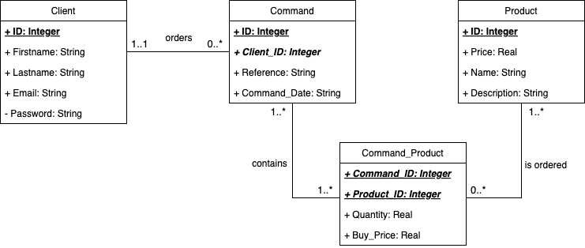
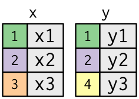
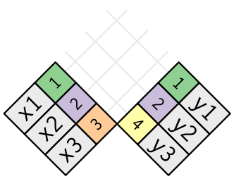
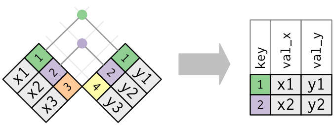
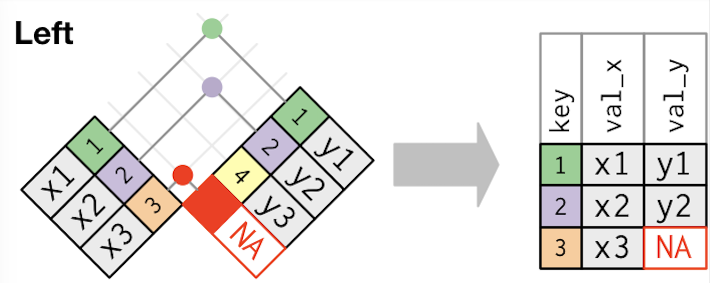
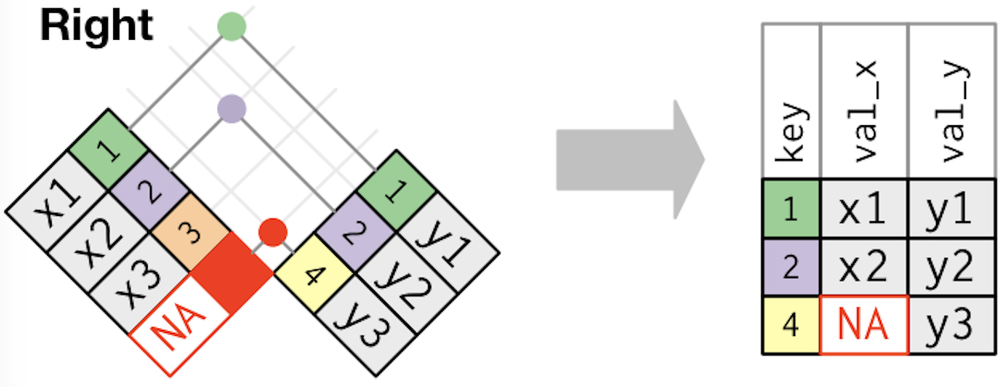
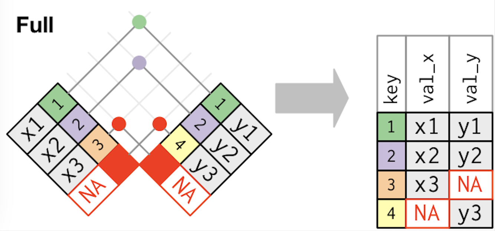

## Objectifs

- Comprendre les concepts fondamentaux des bases de données relationnelles.
- Découvrir les bases du langage de requêtes SQL.
- Savoir obtenir et analyser des données à l'aide de SQL.
- Découvrir les bonnes pratiques pour optimiser vos requêtes.
- Utiliser SQL dans Excel via Power Query.

::: notes
**Objectifs du cours**

- Comprendre les concepts fondamentaux des bases de données relationnelles  
  Identifier les notions clés : tables, colonnes, relations, clés primaires et étrangères, normalisation, etc.

- Découvrir les bases du langage de requêtes SQL  
  Apprendre à écrire des requêtes simples avec les commandes principales : `SELECT`, `FROM`, `WHERE`, `ORDER BY`, `GROUP BY`, etc.

- Savoir obtenir et analyser des données à l'aide de SQL  
  Extraire des informations pertinentes à partir de grandes quantités de données : filtres, tris, agrégats, jointures.

- Découvrir les bonnes pratiques pour optimiser vos requêtes  
  Comprendre l’impact des index, éviter les requêtes coûteuses, écrire un SQL lisible et performant.

- Utiliser SQL dans Excel via Power Query  
  Intégrer SQL dans un outil de travail quotidien : importer, transformer et analyser les données sans quitter Excel.
:::

# Bases de données relationnelles

## Pourquoi apprendre SQL ?

- **Langage universel des données**  
  → Présent dans toutes les entreprises, outils BI et bases de données (Excel, Power BI, Google BigQuery, SAP…).

- **Compétence essentielle en analyse de données**  
  → Extraction, filtrage et préparation des données avant toute analyse Python, Excel ou Power BI.

- **Productivité & autonomie**  
  → Accéder aux données sans dépendre d’un informaticien.

- **Transparence & reproductibilité**  
  → Les requêtes documentent clairement les calculs et peuvent être réutilisées dans les rapports automatisés.


::: notes

SQL n’est pas un langage de développeur, mais **le langage d’accès à la donnée**.  
Un analyste ou manager capable d’écrire ses propres requêtes devient **plus rapide**, **plus précis**, et **plus crédible**.


**Pourquoi apprendre SQL ?**

- **Langage universel des données**  
  Présent dans presque tous les outils d’analyse et de gestion : Excel, Power BI, Google BigQuery, SAP, etc.

- **Compétence clé en analyse de données**  
  Indispensable pour extraire, filtrer et préparer les données avant de les analyser avec Python, Excel ou Power BI.

- **Gain de productivité et autonomie**  
  Permet d’accéder directement aux données, sans dépendre d’un service informatique.

- **Transparence et reproductibilité**  
  Les requêtes servent de documentation claire, et peuvent être rejouées dans des rapports automatisés.

:::


## Structure d'une base de données

- Organise l'information en **tables** liées par des **relations**.
- Chaque table contient des **lignes** (enregistrements) et des **colonnes** (champs).
- Les relations structurent les données de manière logique.
- Cela évite les doublons et garantit la cohérence des données.
- Utilise le langage **SQL** pour interagir avec les données.


::: notes

Une base de données relationnelle organise l'information en tables liées entre elles par des relations. 
Chaque table contient des lignes (enregistrements) et des colonnes (champs).

- Une base de données relationnelle est un système de gestion de données qui organise les informations en **tables** (ou relations).
- Chaque table est composée de **lignes** (ou enregistrements) et de **colonnes** (ou champs).
- Les tables peuvent être liées entre elles par des **relations**, permettant de structurer les données de manière logique et efficace.
- Les bases de données relationnelles utilisent le langage SQL (Structured Query Language) pour interagir avec les données.

Par exemple : une table "Clients" reliée à une table "Commandes". Un client peut avoir plusieurs commandes, mais chaque commande appartient à un seul client. Ces relations permettent d'éviter la duplication et garantissent la cohérence des données.

:::

## Concepts clés
- **Tables** : Structures composées de lignes et de colonnes.
- **Champs (Colonnes)** : Caractéristiques des données.
- **Enregistrements (Lignes)** : Occurrences des données.
- **Clé primaire** : Un champ ou un ensemble de champs qui identifie de manière unique chaque ligne.
- **Clé étrangère** : Un champ qui fait référence à la clé primaire d'une autre table, établissant une relation entre les deux.
- **Relations** : Liens entre les tables (basés sur les clés).
- **Schéma** : La structure globale de la base de données.


::: notes

**Concepts clés**

- **Tables** : Éléments de base d’une base de données relationnelle. Chaque table contient des données sur un sujet spécifique (ex. : clients, produits, commandes).
- **Champs (Colonnes)** : Décrivent les **attributs** ou caractéristiques des données. Exemple : nom, prénom, date de commande.
- **Enregistrements (Lignes)** : Chaque ligne correspond à une **entrée** unique dans la table. Exemple : un client, une commande.
- **Clé primaire (Primary Key)** : Identifie **de façon unique** chaque ligne d’une table. Elle ne peut contenir de doublons ni de valeurs nulles. Exemple : `client_id`.
- **Clé étrangère (Foreign Key)** : Permet de **relier** une ligne à une autre table en faisant référence à sa clé primaire. Exemple : `client_id` dans une table de commandes.
- **Relations** : Les liens établis entre les tables via les clés primaires et étrangères. Elles permettent des requêtes croisées.
- **Schéma** : Représente l’**architecture** de la base de données : les tables, leurs relations, et les contraintes définies.

:::


## Exemple : E-commerce

Nous utiliserons tout au long de ce cours un exemple concret d'e-commerce avec quatre tables interconnectées :

- **Client** : informations personnelles (nom, email)
- **Product** : catalogue avec références et prix
- **Command** : ordres passés par les clients
- **Command_Product** : détails des articles commandés

Ce modèle reflète la réalité de nombreuses entreprises : CRM, systèmes de vente, gestion des stocks.

```{python}
#| echo: false
#| warning: false
#| message: false
#| output: false

from IPython.display import Markdown as md

import sqlite3
import pandas as pd


pd.set_option('display.max_colwidth', 12)
pd.set_option('display.max_rows', 8)
#pd.options.display.float_format = '{:,.2f}'.format

def format_dataframe(df):
  """
  Format dataframe for display, replacing NaN with 'NULL' and hiding index.
  """
  cols = df.columns
  df = df.where(df.notnull(), 'NULL')  # replace NaN with 'NULL'
  df = df.reset_index()[cols]
  styler = df.style  # define before the check
  if hasattr(styler, "hide"):
    return styler.hide(axis="index")  # pandas ≥ 2.1
  else:
    return styler.hide_index()        # pandas < 2.1

# Create a new SQLite database (file: sandbox.db vs in memory: ':memory:')
conn = sqlite3.connect(':memory:')
cursor = conn.cursor()

# Read SQL schema from an external file
with open('data/schema.sql', 'r') as f:
    schema_sql = f.read()

# Execute the SQL script to create tables and insert initial data
cursor.executescript(schema_sql)
conn.commit()

# Read from SQLite and put result into dataframes
df_client = pd.read_sql_query("SELECT * FROM client", conn)
df_command = pd.read_sql_query("SELECT * FROM command", conn)
df_product = pd.read_sql_query("SELECT * FROM product", conn)
df_command_product = pd.read_sql_query("SELECT * FROM command_product", conn)

# Set 'id' as the index for each dataframe

df_client = df_client.set_index('id').sort_index()
df_command = df_command.set_index('id').sort_index()
df_product = df_product.set_index('id').sort_index()
df_command_product = df_command_product = df_command_product.set_index(['command_id', 'product_id'])#.sort_index()

#df_client.index.name = None
```


::: notes

**Exemple : E-commerce**

Nous allons nous appuyer sur un **cas concret** d’e-commerce tout au long du cours, reposant sur **quatre tables interconnectées** :

- **Client**  
  Contient les informations personnelles des clients, comme le nom, le prénom et l’email.  
  Sert de base pour identifier **qui** a passé une commande.

- **Product**  
  Représente le **catalogue produit**, avec des références uniques, descriptions et prix.  
  Chaque ligne correspond à un produit disponible à la vente.

- **Command**  
  Stocke les **commandes passées** par les clients.  
  Une commande est liée à un seul client, mais peut contenir plusieurs produits.  
  Elle inclut aussi la **date** et d'autres métadonnées (statut, total, etc.).

- **Command_Product**  
  Table de liaison entre `Command` et `Product`.  
  Contient les **détails ligne par ligne** : quels produits ont été achetés, en quelle **quantité**, à quel **prix** (car il peut varier).  
  Permet de gérer des commandes avec plusieurs produits.

Ce **modèle relationnel** reflète fidèlement l'organisation d'une **base de données métier** utilisée dans les systèmes CRM, de facturation ou de gestion de stock.  
Il permet des **analyses croisées** : combien un client a dépensé, quels sont les produits les plus populaires, etc.

:::


## Représentation UML

Un diagramme de classes UML (Unified Modeling Language) visualise la structure d'une base de données.

 - Les tables sont représentées par des rectangles.
 - les champs sont listés sous chaque table avec leur type.
 - les relations (flèches) indiquent les liens entre les tables.
 - Les cardinalités (1, 0..*, etc.) indiquent le nombre possibles d'enregistrements entre des tables.
 - les clés primaires sont soulignées.
 - les clés étrangères sont en italiques.

::: notes

**Représentation UML**

Pour visualiser la structure d’une base de données relationnelle, on utilise souvent un **diagramme UML de classes**.  
C’est un outil graphique qui permet de **représenter les entités (tables)**, leurs **champs**, et leurs **relations**.

Voici les éléments clés d’un tel diagramme :

- **Tables = Classes**  
  Chaque **table** est représentée par un **rectangle**.  
  Le nom de la table figure en haut, suivi de la liste des **champs** (colonnes).

- **Champs et types**  
  Les **champs** sont listés avec leur **nom** et leur **type** (ex. : `VARCHAR`, `INTEGER`, etc.).  
  Cela donne un aperçu du contenu de chaque table.

- **Clés primaires (PK)**  
  Les **clés primaires** sont **soulignées** dans le diagramme.  
  Elles permettent d’**identifier de manière unique** chaque ligne d'une table.

- **Clés étrangères (FK)**  
  Les **clés étrangères** sont souvent **en italiques**.  
  Elles **relient deux tables** en référençant une clé primaire d’une autre table.

- **Relations entre tables**  
  Les **relations** sont représentées par des **flèches** ou des **lignes** reliant les tables.  
  Elles montrent **comment les données sont connectées** entre elles.

- **Cardinalités**  
  Les **cardinalités** (ex. : `1`, `0..*`, `1..1`) sont indiquées à chaque extrémité des relations.  
  Elles précisent **combien de lignes** d’une table peuvent être associées à une ligne d’une autre table :
  - `1` : exactement une correspondance
  - `0..*` : zéro ou plusieurs correspondances
  - `1..*` : au moins une correspondance

Ce type de diagramme est particulièrement utile pour :
- comprendre la logique de la base,
- identifier les jointures nécessaires dans les requêtes SQL,
- documenter ou concevoir une base de données.

:::


## Représentation UML

Cette représentation aide à comprendre comment les données sont organisées et liées entre elles.



::: notes

**Structure globale de la base de données e-commerce**

Cette base de données relationnelle repose sur **quatre tables principales** représentant un système de gestion de commandes pour un site e-commerce :

**1. `client`**
- Contient les données personnelles des clients (email, mot de passe, prénom, nom).
- Chaque client est identifié par une **clé primaire `id`**.
- L’**email** est **unique**.

**2. `product`**
- Représente le catalogue des produits (référence, nom, description, prix).
- Chaque produit est identifié par un **`id` unique**.
- La **référence produit** est également **unique**.

**3. `command`**
- Représente une commande effectuée par un client.
- Chaque commande possède un `id`, une **référence unique**, une date, et un lien vers un **client** via une **clé étrangère `client_id`**.

**4. `command_product`**
- Table d'association entre commandes et produits.
- Permet de gérer les **commandes contenant plusieurs produits**.
- Contient :
  - l’**identifiant de la commande** (`command_id`)
  - l’**identifiant du produit** (`product_id`)
  - la **quantité** commandée
  - le **prix d’achat** au moment de la commande.
- La clé primaire est **composée** de `command_id` et `product_id`.

**Relations**
- `command.client_id → client.id` : relation 1 client → plusieurs commandes.
- `command_product.command_id → command.id` et `command_product.product_id → product.id` : relation **n-n** entre commandes et produits.

**Contraintes**
- Clés primaires et uniques assurent l’unicité des identifiants.
- Clés étrangères assurent la cohérence des relations entre les tables.

:::


## Table Client {.smaller}

Contient les informations des clients.

```{python}
# | echo: false
df_client
```

::: notes

**Table `client`**

Contient les informations personnelles des clients inscrits sur la plateforme e-commerce.

**Colonnes principales :**
- `id` : identifiant unique du client (**clé primaire**).
- `email` : adresse email du client (**valeur unique**).
- `password` : mot de passe chiffré ou hashé.
- `firstname` : prénom.
- `lastname` : nom de famille.

**Contraintes :**
- La colonne `email` est **unique** : un même email ne peut appartenir qu’à un seul client.
- `id` est la **clé primaire** et permet d’identifier chaque client de manière unique.

**Utilisation dans les relations :**
- La table `command` contient une **clé étrangère `client_id`** qui fait référence à `client.id`.

:::


## Table Commande {.smaller}

Contient les informations des commandes effectuées par les clients.

```{python}
# | echo: false
df_command
```


::: notes

**Table `command`**

Contient les informations relatives aux commandes passées par les clients.

**Colonnes principales :**
- `id` : identifiant unique de la commande (**clé primaire**).
- `reference` : code de référence unique pour la commande (souvent utilisé à des fins internes ou de suivi).
- `client_id` : identifiant du client ayant passé la commande (**clé étrangère**).
- `command_date` : date à laquelle la commande a été effectuée.

**Contraintes :**
- `id` est la **clé primaire** de la table.
- `reference` est **unique** (chaque commande a un code distinct).
- `client_id` est une **clé étrangère** qui fait référence à `client.id` pour relier chaque commande à un client précis.

**Utilisation dans les relations :**
- Chaque ligne correspond à une commande individuelle.
- Est liée à la table `client` via `client_id`.
- Est également liée à la table `command_product`, qui contient le détail des produits commandés.

:::


## Table Product {.smaller}

Contient les informations des produits disponibles à la vente.

```{python}
# | echo: false
df_product
```

::: notes

**Table `product`**

Contient les informations des produits disponibles à la vente.

**Colonnes principales :**
- `id` : identifiant unique du produit (**clé primaire**).
- `reference` : code de référence du produit, utilisé pour le suivi ou l’identification interne (**unique**).
- `description` : description textuelle du produit.
- `price` : prix unitaire du produit (exprimé en CHF ou dans la devise utilisée).

**Contraintes :**
- `id` est la **clé primaire**.
- `reference` est **unique**, chaque produit possède un code distinct.

**Utilisation dans les relations :**
- Chaque ligne représente un produit du catalogue.
- Est reliée à la table `command_product` pour lister les produits inclus dans chaque commande.

:::


## Table Command_Product {.smaller}

Contient les détails des produits achetés dans chaque commande.

```{python}
# | echo: false
df_command_product
```


::: notes

**Table `command_product`**

Contient les détails des produits achetés dans chaque commande.

**Colonnes principales :**
- `command_id` : identifiant de la commande (**clé étrangère** vers `command.id`).
- `product_id` : identifiant du produit (**clé étrangère** vers `product.id`).
- `quantity` : nombre d’exemplaires achetés pour ce produit dans cette commande.
- `buy_price` : prix unitaire payé pour ce produit au moment de la commande.

**Contraintes :**
- Clé primaire composite : (`command_id`, `product_id`), ce qui signifie qu’un même produit peut apparaître une seule fois par commande.
- `command_id` est une **clé étrangère** vers `command(id)`.
- `product_id` est une **clé étrangère** vers `product(id)`.

**Utilisation dans les relations :**
- Sert de table de liaison **many-to-many** entre `command` et `product`.
- Permet de connaître **les articles achetés dans chaque commande**, leur nombre et leur prix d’achat.

:::


# Structured Query Language (SQL)

## Structure d'une requête SQL

Voici les clauses de base d'une requête SQL :

::: {.columns}

::: {.column width = "70%"}

* **SELECT** : liste les colonnes à retourner.
* **FROM** : indique les tables à interroger.
* **WHERE** : filtre selon des conditions.

:::
::: {.column width = "30%"}

<p>
```sql
SELECT champs
FROM tables
WHERE conditions
GROUP BY champs
HAVING conditions
ORDER BY champs
LIMIT nombre;
```
</p>

:::
::: {.column width = "100%"}


* **GROUP BY** : regroupe les données par colonnes.
* **HAVING** : filtre les groupes selon des conditions.
* **ORDER BY** : trie les résultats.
* **LIMIT** : limite le nombre de résultats.

:::
:::


::: notes

**Structure d'une requête SQL**

Voici les clauses de base d'une requête SQL :

- **SELECT** : liste les colonnes à retourner dans le résultat.
- **FROM** : indique la ou les tables à interroger.
- **WHERE** : filtre les lignes selon des conditions (avant regroupement).
- **GROUP BY** : regroupe les lignes selon une ou plusieurs colonnes.
- **HAVING** : filtre les groupes (après regroupement).
- **ORDER BY** : trie les résultats selon une ou plusieurs colonnes.
- **LIMIT** : limite le nombre de résultats affichés.

**Syntaxe générale :**

```sql
SELECT champs
FROM tables
WHERE conditions
GROUP BY champs
HAVING conditions
ORDER BY champs
LIMIT nombre;
```

:::


## SELECT & FROM

* La clause SELECT détermine quelles informations afficher. 
* La clause FROM spécifie les tables à interroger.

Toutes les colonnes :

::: {.columns}
::: {.column style="width:25%; font-size: 1.4em;"}

```sql
SELECT *
FROM client
```

:::
::: {.column style="width:75%; font-size:0.7em;"}

<p>

```{python}
# | echo: false
# | warning: false
# | result: 'asis'
df_client
```

</p>
:::
:::

::: notes

**SELECT & FROM**

- La clause `SELECT` détermine les colonnes à afficher dans le résultat.
- La clause `FROM` indique la ou les tables d'où proviennent les données.

**Exemple 1 — Afficher toutes les colonnes d'une table :**

```sql
SELECT *
FROM client
```

Cela retourne toutes les colonnes de la table `client`.

**Remarques :**
- `*` signifie "toutes les colonnes", mais il est préférable en pratique de nommer explicitement les colonnes nécessaires pour des raisons de lisibilité et de performance.
- L’ordre des lignes retournées n’est pas garanti sans clause `ORDER BY`.

:::


## SELECT : Sélectionner des colonnes


En spécifiant des colonnes :

::: {.columns}
::: {.column style="width:50%; font-size:1.4em;"}

```sql
SELECT 
  firstname, 
  lastname
FROM client
```

:::
::: {.column style="width:50%; font-size:0.9em;"}

```{python}
# | echo: false
# | warning: false
format_dataframe(df_client[["firstname", "lastname"]])
```

:::
::: 

::: notes

**SELECT : Sélectionner des colonnes spécifiques**

- Il est possible de ne sélectionner que certaines colonnes avec `SELECT`.
- Cela rend la requête plus lisible et améliore les performances, surtout sur de grandes bases.

**Exemple — Afficher uniquement les prénoms et noms des clients :**

```sql
SELECT 
  firstname, 
  lastname
FROM client
```

**Bonnes pratiques :**
- Toujours privilégier la sélection explicite des colonnes au lieu de `SELECT *`.
- Permet de mieux documenter l’intention de la requête et de réduire la quantité de données transférées.

:::


## SELECT : Alias de tables

Avec alias de table : 

::: {.columns}
::: {.column style="width:50%; font-size:1.4em;"}


```sql
SELECT 
  c.firstname,
  c.lastname
FROM client AS c
```

:::
::: {.column style="width:50%; font-size:0.9em;"}

```{python}
# | echo: false
# | warning: false
format_dataframe(df_client[["firstname", "lastname"]])
```

:::
:::

::: notes

**SELECT : Utiliser des alias de tables**

- Les **alias** simplifient l’écriture des requêtes, en particulier lorsqu’on joint plusieurs tables.
- On assigne un nom court à une table avec `AS`, que l’on utilise ensuite dans la requête.

**Exemple — Utiliser l’alias `c` pour la table `client` :**

```sql
SELECT 
  c.firstname,
  c.lastname
FROM client AS c
```

**Avantages des alias :**
- Rendent la requête plus concise.
- Évitent les ambiguïtés lors des jointures entre plusieurs tables ayant des noms de colonnes similaires.

:::


## SELECT : Alias de colonnes

Avec alias de colonne :

::: {.columns}
::: {.column style="width:50%; font-size:1.4em;"}

```sql
SELECT 
 firstname AS "Prénom",
  lastname AS nom
FROM client
```

:::
::: {.column style="width:50%; font-size:0.9em;"}


```{python}
# | echo: false
# | warning: false
format_dataframe(df_client[["firstname", "lastname"]].rename(columns={"firstname": "Prénom", "lastname": "nom"}))
``` 


:::
:::

::: notes

**SELECT : Utiliser des alias de colonnes**

- Les **alias de colonnes** permettent de renommer les colonnes dans les résultats de la requête.
- Cela améliore la **lisibilité** des résultats, surtout dans les rapports ou tableaux de bord.

**Syntaxe :**
```sql
SELECT 
  nom_colonne AS "nouveau_nom"
FROM table
```

**Exemple — Renommer les colonnes `firstname` et `lastname` :**
```sql
SELECT 
  firstname AS "Prénom",
  lastname AS nom
FROM client
```

**Remarques :**
- Les noms composés doivent être entourés de guillemets doubles `"..."`.
- Cette pratique est utile pour afficher des intitulés clairs aux utilisateurs finaux.

:::


## SELECT : DISTINCT

Éviter les doublons avec DISTINCT :

::: {.columns}
::: {.column style="width:50%; font-size:1.4em;"}
```sql
SELECT DISTINCT lastname
FROM client
```
:::
::: {.column style="width:50%; font-size:0.9em;"}

```{python}
# | echo: false
# | warning: false
format_dataframe(df_client[["lastname"]].drop_duplicates())
```

:::
:::

::: notes

**SELECT : Éviter les doublons avec DISTINCT**

- La clause **DISTINCT** permet de **retourner uniquement des valeurs uniques** dans les résultats.
- Elle s’utilise directement après **SELECT** pour filtrer les doublons.

**Syntaxe :**
```sql
SELECT DISTINCT nom_colonne
FROM table
```

**Exemple — Noms de famille uniques :**
```sql
SELECT DISTINCT lastname
FROM client
```

**Remarques :**
- Peut s’appliquer à une ou plusieurs colonnes.
- Si plusieurs colonnes sont listées, seules les combinaisons uniques seront gardées.

:::


## Manipulation de texte

- Concaténer des colonnes avec l'opérateur `||`.
- Equivalent à l'opérateur `+` en Python pour les chaînes de caractères.

<p>

::: {.columns}
::: {.column style="width:70%"}
```sql
SELECT 
  first_name || ' ' || last_name AS "Nom complet"
FROM client
```
::: 
::: {.column style="width:30%; font-size:0.7em;"}
```{python}
# | echo: false
# | warning: false
df_client["Nom complet"] = df_client["firstname"] + " " + df_client["lastname"]
format_dataframe(df_client[["Nom complet"]])
```
:::
:::

</p>

::: notes

**Manipulation de texte**

- En SQL, on utilise l’opérateur `||` pour **concaténer des chaînes de caractères**.
- Cela permet de joindre plusieurs colonnes texte en une seule, souvent utilisé pour créer un **nom complet**.

**Syntaxe :**
```sql
SELECT colonne1 || 'texte' || colonne2 AS "alias"
FROM table;
```

**Exemple — Créer une colonne "Nom complet" :**
```sql
SELECT 
  first_name || ' ' || last_name AS "Nom complet"
FROM client;
```

**Remarques :**
- On peut insérer un espace `' '` ou tout autre séparateur entre les chaînes.
- L'opérateur `||` est équivalent à `+` pour les chaînes en Python.

:::


## Manipulation de texte

Modifier la casse des chaînes de caractères :

- **UPPER()** convertit en majuscules
- **LOWER()** convertit en minuscules
- **INITCAP()** met en forme "Titre" (première lettre majuscule)

::: {.columns}
::: {.column style="width:55%; font-size:1em;"}

```sql
SELECT 
  LOWER(firstname) AS firstname,
  UPPER(lastname) AS lastname,
  INITCAP(firstname || ' ' || lastname) 
    AS nom_complet
FROM client
```

:::
::: {.column style="width:45%; font-size:0.6em;"}

```{python}
# | echo: false
# | warning: false
df = df_client[["firstname", "lastname"]]
df["firstname"] = df["firstname"].str.lower()
df["lastname"] = df["lastname"].str.upper()
df["nom_complet"] = (df["firstname"] + " " + df["lastname"]).str.title()
format_dataframe(df[["firstname", "lastname", "nom_complet"]].head(3))
```
:::
:::

::: notes

**Manipulation de texte — Modifier la casse**

- SQL offre plusieurs fonctions pour modifier la **casse** (majuscules/minuscules) des chaînes de caractères.

**Fonctions disponibles :**
- `UPPER()` : convertit tout le texte en **majuscules**.
- `LOWER()` : convertit tout le texte en **minuscules**.
- `INITCAP()` : convertit le texte au **format Titre** (1ère lettre en majuscule pour chaque mot).

**Exemple — Formater les noms des clients :**
```sql
SELECT 
  LOWER(firstname) AS firstname,
  UPPER(lastname) AS lastname,
  INITCAP(firstname || ' ' || lastname) AS nom_complet
FROM client;
```

**Remarques :**
- Ces fonctions sont utiles pour homogénéiser les données, améliorer l’affichage, ou préparer un export lisible.
- `INITCAP()` est particulièrement pratique pour formater les noms propres.

:::


## Manipulation de texte

- **SUBSTR** : extrait un sous-ensemble de caractères d'un texte.
- **STRPOS** : trouve la position d'un texte dans un autre texte.
- **LENGTH** : calcule la longueur d'un texte.

```sql
SELECT 
  email,
  SUBSTR(email, 1, 5) AS debut,
  STRPOS(email, '.') AS pos,
  LENGTH(email) AS longueur
FROM client;
```

:::{.columns}
::: {.column style="width:100%; font-size:0.7em;"}

```{python}
# | echo: false
df = df_client[["email"]]
df["debut"] = df["email"].str[0:5]
df["pos"] = df["email"].str.find('.')
df["longueur"] = df["email"].str.len()
format_dataframe(df.head(3))
```

:::
:::

::: notes

**Manipulation de texte — Fonctions utiles**

- En SQL, plusieurs fonctions permettent de manipuler les **chaînes de caractères**, très utiles pour l’analyse, le nettoyage ou la préparation de données textuelles.

**Fonctions utilisées :**
- `SUBSTR(texte, début, longueur)`  
  → Extrait une **sous-chaîne** à partir d’une position donnée.  
  Exemple : `SUBSTR(email, 1, 5)` extrait les 5 premiers caractères.

- `STRPOS(texte, motif)`  
  → Retourne la **position** (index) du motif recherché.  
  Exemple : `STRPOS(email, '.')` retourne la position du premier point `.` dans l'adresse email.

- `LENGTH(texte)`  
  → Calcule la **longueur** d’un texte, c’est-à-dire le nombre de caractères.

**Exemple — Analyse des adresses email :**
```sql
SELECT 
  email,
  SUBSTR(email, 1, 5) AS debut,
  STRPOS(email, '.') AS pos,
  LENGTH(email) AS longueur
FROM client;
```

**Applications fréquentes :**
- Anonymisation ou masquage partiel (ex. : `SUBSTR(email, 1, 3) || '***'`)
- Validation ou détection d'erreurs (ex. : email sans `@`, noms trop courts)
- Création de variables dérivées à partir d’un texte brut.

:::


## Fonctions d'agrégation avec SELECT

Les fonctions d'agrégation permettent de calculer des statistiques sur vos données :

::: {.columns}
::: {.column}

Nombre d'enregistrements :

```sql
SELECT 
  COUNT(*) AS total_clients
FROM client
```

```{python}
# | echo: false
# | warning: false
len(df_client)
```

:::
::: {.column}

Moyenne :

```sql
SELECT 
  AVG(price) AS prix_moyen
FROM product
```

```{python}
# | echo: false
# | warning: false
df_product["price"].mean()
```


:::
::: {.column}

Somme :

```sql
SELECT 
  SUM(quantity) AS total_vendus
FROM command_product


```

```{python}
# | echo: false
# | warning: false
df_command_product["quantity"].sum()
```


:::
::: {.column}

Minimum et Maximum :

```sql
SELECT 
  MAX(command_date) AS date_max,
  MIN(command_date) AS date_min   
FROM command
```

```{python}
# | echo: false
# | warning: false
df_command["command_date"].max(), df_command["command_date"].min()
```

:::
:::


::: notes

**Fonctions d’agrégation avec `SELECT`**

Les fonctions d’agrégation permettent de **résumer** des données : elles s’appliquent à un ensemble de lignes et retournent une seule valeur.

**Fonctions principales :**

- `COUNT(*)` : **compte** le nombre total de lignes.  
  Exemple : `SELECT COUNT(*) FROM client` → nombre de clients.

- `AVG(colonne)` : **moyenne** des valeurs numériques.  
  Exemple : `AVG(price)` → prix moyen des produits.

- `SUM(colonne)` : **somme** des valeurs.  
  Exemple : `SUM(quantity)` → nombre total de produits vendus.

- `MAX(colonne)` / `MIN(colonne)` : retourne respectivement la **valeur maximale ou minimale** dans une colonne.  
  Exemple : dates de la première et de la dernière commande.

**Exemples :**

```sql
SELECT COUNT(*) FROM client;
SELECT AVG(price) FROM product;
SELECT SUM(quantity) FROM command_product;
SELECT MAX(command_date), MIN(command_date) FROM command;
```

**Utilisation typique :**
- Statistiques descriptives
- Tableaux de bord
- Préparation de données agrégées avant visualisation

Ces fonctions peuvent aussi être combinées avec `GROUP BY` pour des calculs par groupe.

:::


## WHERE : Filtrer les données

* La clause WHERE permet de filtrer les lignes selon des conditions

```sql
SELECT * FROM client
WHERE lastname = 'Costa';
```

<p>

::: {.columns}
::: {.column style="width:100%; font-size:0.8em;"}

```{python}
# | echo: false
# | warning: false
df_client[df_client["lastname"] == "Costa"]
```

:::
::: 

</p>


::: notes

**WHERE : Filtrer les données**

- La clause **WHERE** permet de **filtrer** les lignes d’une table en fonction d’une ou plusieurs conditions.

- Elle est utilisée **après FROM** dans une requête SQL.

- Seules les lignes qui **satisfont la condition** spécifiée dans WHERE sont retournées.

- Exemple :
  ```sql
  SELECT * FROM client
  WHERE lastname = 'Costa';
  ```

- Cette requête retourne uniquement les clients dont le nom de famille est **"Costa"**.

- Il est possible d’utiliser des opérateurs de comparaison (`=`, `>`, `<`, `BETWEEN`, `LIKE`, `IS NULL`, etc.) pour affiner les conditions.

:::


## WHERE : Filtrer les données

* Comparaisons numériques :

```sql
SELECT * FROM product
WHERE price > 50;
```

<p>

::: {.columns}
::: {.column style="width:100%; font-size:0.8em;"}

```{python}
# | echo: false
# | warning: false
df_product[df_product["price"] > 50]
```

:::
:::

</p>

::: notes

**Clause `WHERE`**

La clause `WHERE` permet de **filtrer les lignes** retournées par une requête SQL en fonction d’une ou plusieurs conditions.

**Exemple simple avec une comparaison numérique** :

```sql
SELECT * FROM product
WHERE price > 50;
```

Cela sélectionne uniquement les produits dont le prix est strictement **supérieur à 50**.

**Opérateurs courants** :
- `=` : égal à  
- `!=` ou `<>` : différent de  
- `>` : supérieur à  
- `<` : inférieur à  
- `>=` : supérieur ou égal  
- `<=` : inférieur ou égal  

**Combinaisons de conditions** :
- `AND` : toutes les conditions doivent être vraies  
- `OR` : au moins une des conditions doit être vraie  
- `NOT` : inverse la condition  

**Bonnes pratiques** :
- Toujours vérifier que la condition sélectionne bien les lignes attendues.
- Pour les chaînes de caractères, utiliser les guillemets simples `'valeur'`.

:::


## WHERE : Filtrer les données

* Comparaisons multiples :

```sql
SELECT * FROM product
WHERE price >= 50 AND price <= 200;

SELECT * FROM product
WHERE price BETWEEN 50 AND 200;
```

<p>

::: {.columns}
::: {.column style="width:100%; font-size:0.8em;"}

```{python}
# | echo: false
# | warning: false
df_product[(df_product["price"] >= 50) & (df_product["price"] <= 200)]
```

:::
:::

</p>

::: notes

**Clause `WHERE` avec comparaisons multiples**

Lorsque vous devez **filtrer selon une plage de valeurs**, deux méthodes principales s'offrent à vous :

1. **Comparaison combinée avec `AND`** :

```sql
SELECT * FROM product
WHERE price >= 50 AND price <= 200;
```

→ Cette requête sélectionne les produits dont le **prix est compris entre 50 et 200 inclus**.

2. **Syntaxe simplifiée avec `BETWEEN`** :

```sql
SELECT * FROM product
WHERE price BETWEEN 50 AND 200;
```

→ Le mot-clé `BETWEEN` rend la requête plus lisible. Il est **inclusif**, c’est-à-dire qu’il inclut les bornes 50 et 200.

**Remarques** :
- Les deux requêtes sont strictement équivalentes.
- `BETWEEN` peut aussi être utilisé pour filtrer des dates :
  ```sql
  WHERE command_date BETWEEN '2023-01-01' AND '2023-12-31'
  ```

:::


## WHERE : Filtrer les données

* Recherche textuelle :

```sql
SELECT * FROM product
WHERE name LIKE '%Logitech%';
```

<p>

::: {.columns}
::: {.column style="width:100%; font-size:0.8em;"}

```{python}
# | echo: false
# | warning: false
df_product[df_product["name"].str.contains("Logitech")]
```

:::
:::

</p>

::: notes

**Clause `WHERE` avec recherche textuelle (`LIKE`)**

La clause `LIKE` permet de **filtrer les données textuelles** selon un motif partiel ou complet.

```sql
SELECT * FROM product
WHERE name LIKE '%Logitech%';
```

→ Cette requête sélectionne les produits dont le nom contient le mot **"Logitech"**, quelle que soit sa position dans le texte.

**Explication des symboles** :
- `%` représente **n'importe quelle suite de caractères** (y compris aucune).
- Le motif `'%Logitech%'` signifie : **"contient Logitech"**.
- D'autres exemples :
  - `'Logitech%'` : commence par "Logitech"
  - `'%Logitech'` : se termine par "Logitech"
  - `'L%tech'` : commence par "L" et se termine par "tech"

**Remarques** :
- `LIKE` est **sensible à la casse** dans certains systèmes SQL (ex. : PostgreSQL), mais pas dans d’autres (ex. : MySQL par défaut).
- Pour des recherches insensibles à la casse dans PostgreSQL, utilisez `ILIKE`.

:::


## Opérateurs de comparaison {.smaller}


| Opérateur | Description               | Exemple                |
|-----------|---------------------------|------------------------|
| =         | Égal à                    | `age = 30`             |
| <> ou !=  | Différent de              | `age <> 30`            |
| >         | Supérieur à               | `price > 100`          |
| <         | Inférieur à               | `price < 100`          |
| >=        | Supérieur ou égal à       | `price >= 100`         |
| <=        | Inférieur ou égal à       | `price <= 100`         |
| BETWEEN   | Entre deux valeurs        | `price BETWEEN 50 AND 200` |
| LIKE      | Recherche textuelle par modèle       | `name LIKE 'A%'`       |
| IN        | Dans une liste            | `id IN (1, 2, 3)`      |
| IS NULL   | Est NULL                  | `password IS NULL`   |
| IS NOT NULL | N'est pas NULL          | `password IS NOT NULL` |


::: notes

**Opérateurs de comparaison en SQL**

Les opérateurs de comparaison permettent de filtrer les lignes d'une table selon des **conditions logiques** dans la clause `WHERE`.

| Opérateur      | Description                         | Exemple                      |
|----------------|-------------------------------------|------------------------------|
| `=`            | Égal à                              | `age = 30`                   |
| `<>` ou `!=`   | Différent de                        | `age <> 30`                  |
| `>`            | Supérieur à                         | `price > 100`                |
| `<`            | Inférieur à                         | `price < 100`                |
| `>=`           | Supérieur ou égal à                 | `price >= 100`               |
| `<=`           | Inférieur ou égal à                 | `price <= 100`               |
| `BETWEEN`      | Compris entre deux bornes incluses  | `price BETWEEN 50 AND 200`   |
| `LIKE`         | Recherche textuelle avec motifs     | `name LIKE 'A%'`             |
| `IN`           | Appartenance à une liste de valeurs | `id IN (1, 2, 3)`            |
| `IS NULL`      | Teste si une valeur est NULL        | `password IS NULL`           |
| `IS NOT NULL`  | Teste si une valeur est non-NULL    | `password IS NOT NULL`       |

**Remarques** :
- Utilisez `LIKE` avec `%` pour les correspondances partielles.
- `IN` est pratique pour tester plusieurs valeurs possibles.
- `NULL` désigne l'absence de valeur (non égal à une chaîne vide ou zéro).
- Les opérateurs peuvent être combinés avec `AND`, `OR`, `NOT`.

:::


## CASE : Catégoriser les données

- La clause CASE permet de créer des catégories basées sur des conditions.
- Elle fonctionne comme une série de conditions IF...ELSE.
- Exemple : catégoriser les produits en "Bon marché", "Moyen" et "Cher" selon leur prix.


::: {.columns}
::: {.column style="width:50%; font-size:0.8em;"}

```{python}
# | echo: false
sql = """
SELECT 
  reference, price,
  CASE 
    WHEN price < 50 THEN 'Bon marché'
    WHEN price BETWEEN 50 AND 200 THEN 'Moyen'
    ELSE 'Cher'
  END AS categorie
FROM product
"""
md(f"```sql{sql}```")
```

:::
::: {.column style="width:50%; font-size:0.6em;"}
```{python}
# | echo: false

df = pd.read_sql_query(sql, conn)
format_dataframe(df)
```
:::
:::

::: notes

**Clause `CASE` : Catégoriser les données**

La clause `CASE` permet de créer des **catégories personnalisées** à partir de conditions logiques. Elle agit comme une **structure conditionnelle** (équivalent de `IF...ELSE` en Python).

**Exemple** : catégoriser les produits selon leur prix :

```sql
SELECT 
  reference, 
  price,
  CASE 
    WHEN price < 50 THEN 'Bon marché'
    WHEN price BETWEEN 50 AND 200 THEN 'Moyen'
    ELSE 'Cher'
  END AS categorie
FROM product
```

**Composants de la clause `CASE`** :
- `WHEN ... THEN ...` : condition et résultat associé
- `ELSE ...` : valeur par défaut si aucune condition n’est satisfaite
- `END` marque la fin de la clause

**Utilisations fréquentes** :
- Regrouper des valeurs numériques en classes
- Convertir des codes (ex. : 0/1) en libellés lisibles
- Appliquer des règles de calcul conditionnelles

:::


## ORDER BY : Trier les résultats

* La clause ORDER BY trie les résultats selon une ou plusieurs colonnes (par ordre croissant par défaut `ASC`).

```sql
SELECT * FROM product
ORDER BY price;
```

<p>

::: {.columns}
::: {.column style="width:100%; font-size:0.7em;"}

```{python}
# | echo: false
# | warning: false
# | message: false
df_product.sort_values(by="price")
```

:::
:::

</p>

::: notes

**Clause `ORDER BY` : Trier les résultats**

La clause `ORDER BY` permet de **trier les lignes du résultat** d’une requête SQL selon une ou plusieurs colonnes.

**Syntaxe de base** :
```sql
SELECT * 
FROM product
ORDER BY price;
```

**Par défaut**, le tri est effectué en **ordre croissant** (`ASC`), mais il est aussi possible de spécifier un **ordre décroissant** avec `DESC` :
```sql
ORDER BY price DESC;
```

**Tri sur plusieurs colonnes** :
```sql
ORDER BY category ASC, price DESC;
```
Cela trie d’abord par catégorie (ordre alphabétique), puis par prix décroissant à l’intérieur de chaque catégorie.

:::


## ORDER BY : Trier les résultats

* Ordre décroissant avec `DESC` :

```sql
SELECT * FROM product
ORDER BY price DESC;
```

<p>

::: {.columns}
::: {.column style="width:100%; font-size:0.7em;"}

```{python}
# | echo: false
# | warning: false
# | message: false
df_product.sort_values(by="price", ascending=False)
```

:::
:::

</p>

::: notes

**Clause `ORDER BY` avec `DESC` : ordre décroissant**

La clause `ORDER BY` trie les résultats selon une ou plusieurs colonnes.

Par défaut, le tri est **croissant** (`ASC`).  
Pour trier dans l’**ordre décroissant**, on ajoute le mot-clé `DESC`.

**Exemple** :
```sql
SELECT * 
FROM product
ORDER BY price DESC;
```

Cela permet de lister les produits du plus cher au moins cher.

:::


## ORDER BY : Trier les résultats

* Trier par plusieurs colonnes :

```sql
SELECT * FROM command_product
ORDER BY quantity DESC, buy_price ASC;
```

<p>

::: {.columns}
::: {.column style="width:100%; font-size:0.7em;"}

```{python}
# | echo: false

df_command_product.sort_values(by=["quantity", "buy_price"], ascending=[False, True])
```

:::
:::

</p>

::: notes

**Clause `ORDER BY` avec tri multiple**

Il est possible de trier les résultats par plusieurs colonnes, en précisant l’ordre pour chacune :

- `DESC` pour un tri décroissant
- `ASC` pour un tri croissant

**Exemple** :
```sql
SELECT * 
FROM command_product
ORDER BY quantity DESC, buy_price ASC;
```

Ce tri affichera d’abord les lignes avec la plus grande quantité en premier.  
En cas d’égalité sur la quantité, le tri se fait alors selon le prix d’achat (du plus bas au plus élevé).

:::


## GROUP BY : Regrouper pour analyser

* La clause GROUP BY regroupe les lignes selon une ou plusieurs colonnes.

::: {.columns}
::: {.column  style="font-size: 0.9em;"}

```sql
-- Nombre de produits par commande
SELECT 
    command_id, 
    SUM(quantity * price) AS total_prix
FROM command_product
GROUP BY command_id;
```

<br>
**Explication** : on regroupe les commandes et compte le nombre de commandes par client avec la fonction d'agrégation `COUNT()`.

:::
::: {.column style="font-size: 0.55em;"}

```{python}
# | echo: false
# | warning: false
# | message: false
df_temp = df_command_product.copy()
df_temp["total_prix"] = df_temp["quantity"] * df_temp["buy_price"]
df_result = df_temp.groupby('command_id').agg(total_prix=('total_prix', 'sum'))
df_result
```
:::
:::

::: notes

**Clause `GROUP BY` : Regrouper les données pour les analyser**

- `GROUP BY` permet d’agréger les lignes qui partagent une même valeur dans une ou plusieurs colonnes.
- On peut ensuite appliquer des **fonctions d’agrégation** (`COUNT`, `SUM`, `AVG`, etc.) sur chaque groupe.

**Exemple** :
```sql
SELECT 
    command_id, 
    SUM(quantity * price) AS total_prix
FROM command_product
GROUP BY command_id;
```

Cela retourne une ligne par `command_id`, avec la somme totale du prix de chaque commande.

:::


## HAVING : Filtrer les groupes

* La clause HAVING filtre les groupes créés par GROUP BY selon des conditions.

::: {.columns}
::: {.column style="font-size: 0.9em;"}

<br>

```sql
-- Commandes avec total supérieur à 400
SELECT
    command_id, 
    SUM(quantity * price) AS total_prix
FROM command_product
GROUP BY command_id
HAVING SUM(quantity * price) > 400;
```

:::
::: {.column style="font-size: 0.7em;"}
```{python}
# | echo: false
# | warning: false
# | message: false
df_result[df_result["total_prix"] > 400]
```

:::
:::


* **Attention** : HAVING s'applique uniquement à GROUP BY, contrairement à WHERE qui filtre avant le regroupement.


::: notes

**Clause `HAVING` : Filtrer les groupes après agrégation**

- `HAVING` s’utilise avec `GROUP BY` pour **filtrer les groupes** selon le résultat d’une fonction d’agrégation.
- Elle s’applique **après** que les lignes aient été regroupées.

**Exemple** :
```sql
SELECT
    command_id, 
    SUM(quantity * price) AS total_prix
FROM command_product
GROUP BY command_id
HAVING SUM(quantity * price) > 400;
```

Cette requête affiche uniquement les commandes dont le total (quantité × prix) dépasse 400.

**Différence avec WHERE** :
- `WHERE` filtre **avant** le regroupement.
- `HAVING` filtre **après** le regroupement.

:::


## LIMIT : Limiter le nombre de résultats

* La clause LIMIT restreint le nombre de lignes retournées.

::: {.columns}
::: {.column}

Échantillon

```sql
-- Échantillon limité à 5 résultats
SELECT reference, price 
FROM product
LIMIT 5;
```

:::
::: {.column}

Top N (après tri décroissant)

```sql
-- Top 3 
SELECT reference, price 
FROM Product
ORDER BY price DESC
LIMIT 3;
```

:::
::: {.column style="font-size: 0.7em;"}


```{python}
# | echo: false
# | warning: false
# | message: false
df_product[["reference", "price"]].head(5)
```

:::
::: {.column style="font-size: 0.7em;"}

```{python}
# | echo: false
# | warning: false
# | message: false
df_product[["reference", "price"]].nlargest(3, "price")
```

:::
:::

::: notes

**Clause `LIMIT` : Restreindre le nombre de résultats affichés**

- `LIMIT` permet d’afficher uniquement un nombre **défini de lignes**.
- Elle est souvent utilisée pour :
  - générer un **échantillon** rapide ;
  - extraire le **Top N** selon une métrique.

**Exemples** :

```sql
-- Échantillon de 5 produits
SELECT reference, price 
FROM product
LIMIT 5;
```

```sql
-- Top 3 des produits les plus chers
SELECT reference, price 
FROM product
ORDER BY price DESC
LIMIT 3;
```

**Remarques** :
- `LIMIT` doit être placé **à la fin** de la requête.
- Combiné avec `ORDER BY`, il permet d’obtenir un classement.

:::


# Les Jointures

## Pourquoi les jointures ?

- Les jointures permettent de combiner des données provenant de plusieurs tables.
- Elles sont essentielles pour exploiter pleinement les bases de données relationnelles.
- Elles facilitent l'analyse en regroupant les informations.
- Elles évitent la duplication des données en reliant les tables par des clés.
- Elles permettent de répondre à des questions complexes en croisant les données.

::: notes

**Pourquoi utiliser des jointures en SQL ?**

- Les bases de données relationnelles sont **structurées en plusieurs tables** pour garantir la normalisation, la cohérence et éviter la redondance des données.
- Les jointures permettent de **relier ces tables** grâce aux **clés primaires** et **clés étrangères**.

**Avantages des jointures** :

- **Combiner des données dispersées** : par exemple, relier une commande à un client ou un produit à sa catégorie.
- **Éviter la duplication** : les données communes (ex. : nom d’un client) ne sont stockées qu’une seule fois.
- **Répondre à des questions complexes** : ex. retrouver tous les produits commandés par un client donné.
- **Simplifier les analyses** : en agrégeant les informations de plusieurs tables dans une même requête.

**En résumé** :  
Les jointures sont **le cœur de l’exploitation des bases relationnelles**. Sans elles, on ne pourrait pas tirer profit de la structure des données.

:::


## Concept de relation entre tables

- Les tables sont liées par des **clés**.

<p>

::: {.columns}
::: {.column width="40%"}
- **Clé primaire** : identifie de manière unique chaque ligne d'une table.
<!-- &#x1f511; -->
:::
::: {.column width="60%"}
- **Clé étrangère** : référence une clé primaire d'une autre table pour établir une relation.
:::
::: {.column width="40%"}
- **Relation** : lien logique entre les tables basé sur les clés.
:::
::: {.column width="60%"}
- **Types de relations (cardinalités)** : 
  - un-à-un (1-1), 
  - un-à-plusieurs (1-N), 
  - plusieurs-à-plusieurs (N-M).
:::
:::

</p>

::: notes

**Relations entre tables : principes fondamentaux**

- Les **bases de données relationnelles** reposent sur le **lien logique entre les tables**, ce qui permet de structurer efficacement les données.

**Clé primaire (Primary Key)** :
- Champ (ou combinaison de champs) qui **identifie de manière unique chaque ligne** dans une table.
- Chaque table doit avoir **une clé primaire**.
- Exemple : `id` dans la table `client`.

**Clé étrangère (Foreign Key)** :
- Champ qui **référence une clé primaire d'une autre table**.
- Permet d'établir une **relation entre deux tables**.
- Exemple : `client_id` dans la table `command` fait référence à `client.id`.

**Relation (ou jointure logique)** :
- Repose sur la correspondance entre **clé étrangère** et **clé primaire**.
- Permet de **connecter les informations** entre plusieurs entités (clients, commandes, produits...).

**Types de relations (cardinalités)** :
- **1:1 (un à un)** : chaque enregistrement d'une table est lié à un seul enregistrement de l'autre.
- **1:N (un à plusieurs)** : un client peut avoir plusieurs commandes.
- **N:M (plusieurs à plusieurs)** : un produit peut apparaître dans plusieurs commandes, et une commande contient plusieurs produits. Cela nécessite souvent une **table intermédiaire** (ex. : `command_product`).

:::

## Comprendre les jointures {.smaller}

- Deux tables `X` et `Y` avec une colonne clé commune (en couleur).
```{python}
# | echo: false

x = pd.DataFrame({
    'key': [1,2,3],
    'val_x': ['x1', 'x2', 'x3']})#.set_index('key')

y = pd.DataFrame({
    'key': [1,2,4],
    'val_y': ['y1', 'y2', 'y3']})#.set_index('key')
```

<p>

::: {.columns}
::: {.column width="25%"}
```sql
SELECT * FROM X;
```
```{python}
# | echo: false
format_dataframe(x)
```
:::
::: {.column width="25%"}
```sql
SELECT * FROM Y;
```
```{python}
# | echo: false
format_dataframe(y)
```

:::
::: {.column width="50%"}

<!--{width=60%}-->
{width=50%}

:::
::: {.column width="50%"}
- **Inner Join** : intersection des "clés".

```sql
SELECT * FROM X
JOIN Y ON X.key = Y.key;
```
```{python}
# | echo: false
df = pd.merge(x, y, on='key', how='inner')
format_dataframe(df)
```

::: 
::: {.column width="50%"}



:::
:::
</p>

::: notes

**Comprendre les jointures SQL à travers un exemple simple**

Prenons deux petites tables `X` et `Y` contenant chacune une colonne clé appelée `key`.

- **Table X** :
  - `key` : 1, 2, 3
  - `val_x` : x1, x2, x3

- **Table Y** :
  - `key` : 1, 2, 4
  - `val_y` : y1, y2, y3

Les valeurs partagées dans la colonne `key` sont **1** et **2**.

Lorsque l’on exécute une **INNER JOIN** entre `X` et `Y` sur la clé `key` :
```sql
SELECT * FROM X
JOIN Y ON X.key = Y.key;
```

On ne garde **que les lignes qui ont une correspondance dans les deux tables**.
Le résultat sera :
- `key = 1` → x1 et y1
- `key = 2` → x2 et y2

La **clé `3`** de la table `X` et la **clé `4`** de la table `Y` sont ignorées car elles ne trouvent **aucune correspondance**.

**Visualisation** :
- Ce type de jointure correspond à **l'intersection** des deux ensembles de clés.
- Elle est très utile pour combiner des données qui existent dans les deux tables, comme les commandes réellement effectuées par des clients existants.

:::


## Jointure implicite

- Une jointure implicite utilise les clauses **FROM** et **WHERE** pour relier les tables, sans utiliser le mot-clé `JOIN`.

::: {.columns}
::: {.column style="width:50%; font-size:1.4em;"}

```sql
SELECT *
FROM X, Y
WHERE X.key = Y.key;
```
:::
::: {.column style="width:50%; font-size:0.7em;"}
```{python}
# | echo: false
#df = pd.merge(x, y, on='key', how='inner')
format_dataframe(df)
```
:::
:::
- Cette méthode est moins claire et peut être source d'erreurs, surtout avec plusieurs tables.
- Il est recommandé d'utiliser les jointures explicites avec `JOIN` pour une meilleure lisibilité et maintenance.

::: notes

**Jointure implicite en SQL**

Une **jointure implicite** relie deux tables en les listant simplement dans la clause `FROM`, puis en précisant la condition de jointure dans la clause `WHERE`.

Exemple :
```sql
SELECT *
FROM X, Y
WHERE X.key = Y.key;
```

Ce type de syntaxe effectue une jointure équivalente à une `INNER JOIN`.

### Inconvénients de la jointure implicite :
- Moins lisible, surtout avec plusieurs tables.
- Moins explicite sur l’intention du développeur.
- Plus propice aux erreurs (ex. : oublis de conditions de jointure → produit cartésien non désiré).

### Bonnes pratiques :
- Utilisez les **jointures explicites** (`INNER JOIN`, `LEFT JOIN`, etc.).
- Elles rendent les requêtes plus **compréhensibles**, **maintenables**, et **plus sûres** à long terme.

:::


## Types de jointures

- **INNER JOIN** : retourne les lignes avec des correspondances dans les deux tables.
- **LEFT JOIN** : retourne toutes les lignes de la table de gauche et leurs potentielles correspondances de la table de droite.
- **RIGHT JOIN** : retourne toutes les lignes de la table de droite et leurs potentielles correspondances de la table de gauche.
- **FULL JOIN** : retourne toutes les lignes des deux tables et les fait correspondre si possible.
<!-- - **CROSS JOIN** : produit cartésien de deux tables, combinant chaque ligne de la première table avec chaque ligne de la seconde. -->

**Remarque** : des valeurs *NULL* sont retournées en cas de non-correspondances.

::: notes

**Types de jointures en SQL : à connaître absolument**

Les jointures permettent de **combiner des données issues de plusieurs tables** selon des relations définies par les clés primaires et étrangères. Voici les types de jointures les plus courants :

- **INNER JOIN** :
  - Ne retourne que les lignes qui ont des correspondances dans les deux tables.
  - C’est le type de jointure le plus courant.
  - Exemple : trouver les clients ayant passé au moins une commande.

- **LEFT JOIN** (jointure externe gauche) :
  - Retourne **toutes les lignes** de la table de gauche (celle mentionnée en premier), **même si aucune correspondance** n’est trouvée dans la table de droite.
  - Les colonnes de droite contiendront alors **NULL** si aucune correspondance n’existe.
  - Exemple : lister tous les clients, même ceux sans commande.

- **RIGHT JOIN** (jointure externe droite) :
  - Similaire à LEFT JOIN, mais conserve toutes les lignes de la **table de droite**.
  - Exemple : lister toutes les commandes, même si elles ne sont liées à aucun client (rare mais possible).

- **FULL JOIN** (jointure externe complète) :
  - Combine les effets de LEFT JOIN et RIGHT JOIN.
  - Retourne **toutes les lignes** des deux tables, en faisant correspondre les données si possible.
  - Les valeurs manquantes sont remplacées par **NULL**.

- **Remarque importante** :
  - Lorsque **aucune correspondance n’est trouvée**, les colonnes de la table sans correspondance sont remplies avec **NULL**.
  - Il est essentiel de bien comprendre ces différences pour éviter des erreurs dans les analyses ou rapports.

:::


## INNER Joins

- La jointure avec **INNER JOIN** (ou simplement **JOIN**) retourne uniquement les lignes qui ont des correspondances dans les deux tables (`X` et `Y`).

<p>

::: {.columns}
::: {.column style="font-size:1.4em; width:100%;"}
```sql
SELECT * FROM X
INNER JOIN Y ON X.key = Y.key;
```
::: 
::: {.column style="font-size:0.8em; width:35%;"}

<br>

```{python}
# | echo: false
df = pd.merge(x, y, on='key', how='inner')
format_dataframe(df)
```

:::
::: {.column width="65%"}
<br>
{width=80%}
:::
:::

</p>

::: notes

**INNER JOIN en SQL**

L'**INNER JOIN** (ou simplement **JOIN**) est le type de jointure le plus courant.

### Fonctionnement :
- Ne conserve que les **lignes qui ont des correspondances** dans les deux tables.
- C’est l’équivalent d’une **intersection** entre les deux ensembles de données.

### Syntaxe :
```sql
SELECT * 
FROM X 
INNER JOIN Y ON X.key = Y.key;
```

### Cas d’usage :
- Très utile lorsque l’on souhaite uniquement les données **complètes** : par exemple, les commandes ayant un client existant, ou les produits effectivement achetés.

### Remarque :
- Si aucune correspondance n’est trouvée pour une clé donnée, la ligne est **ignorée** dans le résultat.

:::


## INNER JOIN : Exemples

 - Obtenir tous les clients qui ont passé au moins une commande. 
 Les clients sans commande n'apparaissent pas (et les commandes sans client valide non plus).


```sql
SELECT
  first_name, last_name, 
  client_id, reference, command_date
FROM client
INNER JOIN command ON client.id = command.client_id;
``` 

<p>

::: {.columns}
::: {.column style="width:100%; font-size:0.7em;"}  

```{python}
# | echo: false
df = pd.merge(
    df_client, df_command, 
    left_index=True, #left_on="id",  
    right_on="client_id", how="inner")
cols = ["firstname", "lastname", "client_id", "reference", "command_date"]
format_dataframe(df[cols].tail())
```
:::
:::

</p>


::: notes

**INNER JOIN : Exemple d’application**

### Objectif :
Obtenir la **liste des clients ayant passé au moins une commande**.

### Explication :
- La jointure relie les tables `client` et `command` via la correspondance entre `client.id` (clé primaire) et `command.client_id` (clé étrangère).
- Comme il s’agit d’un **INNER JOIN**, seules les correspondances exactes sont retournées :
  - Les clients **sans commande** sont **exclus**.
  - Les commandes **sans client associé** (cas très rare ou anormal) sont également **exclues**.

### Requête SQL :
```sql
SELECT
  first_name, last_name, 
  client_id, reference, command_date
FROM client
INNER JOIN command ON client.id = command.client_id;
```

### Remarque :
- Cela permet de faire des analyses centrées sur les clients actifs.
- Pour inclure les clients inactifs (sans commande), il faudrait utiliser un **LEFT JOIN**.

:::


## Jointure pas à pas : INNER JOIN

```{=html}
<div class="ja ja-compact fragment ja-step" data-fragment-index="1">

<pre class="ja-sql"><code>SELECT c.id, c.firstname, m.client_id, m.reference
FROM client AS c
<span class="ja-kw">INNER JOIN</span> command AS m ON <b class="key">c.id</b> = <b class="key">m.client_id</b>;</code></pre>

<div class="ja-tables">
  <div>
    <div class="ja-title">client</div>
    <table>
      <thead><tr><th class="key">id</th><th>firstname</th></tr></thead>
      <tbody>
        <tr class="fragment ja-step ja-c1" data-fragment-index="2"><td class="key">1</td><td>Antoinette</td></tr>
        <tr class="fragment ja-step ja-c2" data-fragment-index="3"><td class="key">2</td><td>Auguste</td></tr>
        <tr class="fragment ja-step ja-c3" data-fragment-index="4"><td class="key">3</td><td>Benjamin</td></tr>
        <tr class="fragment ja-step ja-none" data-fragment-index="5"><td class="key">4</td><td>Claire</td></tr>
      </tbody>
    </table>
  </div>

  <div class="ja-link">⟷<br><code>c.id = m.client_id</code></div>

  <div>
    <div class="ja-title">command</div>
    <table>
      <thead><tr><th>id</th><th class="key">client_id</th><th>reference</th></tr></thead>
      <tbody>
        <tr class="fragment ja-step ja-c2" data-fragment-index="3"><td>1</td><td class="key">2</td><td>CMD0000001</td></tr>
        <tr class="fragment ja-step ja-c1" data-fragment-index="2"><td>2</td><td class="key">1</td><td>CMD0000002</td></tr>
        <tr class="fragment ja-step ja-c3" data-fragment-index="4"><td>4</td><td class="key">3</td><td>CMD0000004</td></tr>
        <tr class="fragment ja-step ja-c2" data-fragment-index="3"><td>6</td><td class="key">2</td><td>CMD0000006</td></tr>
        <tr class="fragment ja-step ja-none" data-fragment-index="6"><td>11</td><td class="key">9</td><td>CMD0000011</td></tr>
      </tbody>
    </table>
  </div>
</div>

<div class="ja-title ja-result-title">résultat</div>
<table>
  <thead><tr><th class="key">id</th><th>firstname</th><th class="key">client_id</th><th>reference</th></tr></thead>
  <tbody>
    <tr class="fragment ja-c1 on" data-fragment-index="2"><td class="key">1</td><td>Antoinette</td><td class="key">1</td><td>CMD0000002</td></tr>
    <tr class="fragment ja-c2 on" data-fragment-index="3"><td class="key">2</td><td>Auguste</td><td class="key">2</td><td>CMD0000001</td></tr>
    <tr class="fragment ja-c2 on" data-fragment-index="3"><td class="key">2</td><td>Auguste</td><td class="key">2</td><td>CMD0000006</td></tr>
    <tr class="fragment ja-c3 on" data-fragment-index="4"><td class="key">3</td><td>Benjamin</td><td class="key">3</td><td>CMD0000004</td></tr>
  </tbody>
</table>

<div class="ja-caption">
  <span class="fragment fade-in-then-out" data-fragment-index="1">On compare la clé primaire <b>client.id</b> à la clé étrangère <b>command.client_id</b></span>
  <span class="fragment fade-in-then-out" data-fragment-index="2">id = 1 → 1 commande correspondante → 1 ligne</span>
  <span class="fragment fade-in-then-out" data-fragment-index="3">id = 2 → 2 commandes → le client apparaît 2 fois</span>
  <span class="fragment fade-in-then-out" data-fragment-index="4">id = 3 → 1 commande → 1 ligne</span>
  <span class="fragment fade-in-then-out" data-fragment-index="5">id = 4 → aucune commande → Claire est <b>exclue</b></span>
  <span class="fragment" data-fragment-index="6">Commande 11 → client 9 inexistant → elle est aussi <b>exclue</b></span>
</div>

</div>
```

::: notes

**Jointure pas à pas : comment fonctionne un INNER JOIN**

Avancer les animations une à une :

1. **Les clés** : la jointure compare la clé primaire `client.id` avec la clé étrangère `command.client_id` (en gras). Ce sont les seules colonnes utilisées par la condition `ON`.
2. **Client 1 (bleu)** : on cherche dans `command` toutes les lignes avec `client_id = 1` → une seule (CMD0000002). Une ligne de résultat est produite en combinant les deux.
3. **Client 2 (orange)** : deux commandes ont `client_id = 2` → **deux lignes** dans le résultat. Les informations du client sont **dupliquées** : c'est normal pour une relation 1-N.
4. **Client 3 (vert)** : une commande → une ligne.
5. **Client 4 (Claire)** : aucune commande ne référence `id = 4` → avec un `INNER JOIN`, la ligne est **exclue**.
6. **Commande 11** : elle référence un `client_id = 9` qui n'existe pas → elle est aussi **exclue**.

La commande 11 est une **commande orpheline** ajoutée pour l'exemple (par exemple un client supprimé, ou des données importées sans contrôle). Avec une contrainte de clé étrangère, la base refuserait normalement cette ligne. Elle est présente sur les quatre slides pour comparer les jointures avec les mêmes données.

À souligner :

- L'**ordre des lignes** dans les tables n'a aucune importance : seule l'**égalité des clés** compte (les commandes 1 et 6 d'Auguste ne sont pas côte à côte).
- Le résultat contient **une ligne par paire correspondante**, pas une ligne par client.

:::


## LEFT OUTER Joins

- La jointure avec **LEFT** retourne toutes les lignes de la table de gauche (`X`).
- Les lignes sans correspondance dans la table de droite (`Y`) ont des valeurs *NULL*.

<p>

::: {.columns}
::: {.column style="font-size:1.4em; width:100%;"}
```sql
SELECT * FROM X
LEFT JOIN Y ON X.key = Y.key;
```
::: 
::: {.column style="font-size:0.7em; width:35%;"}

<br>

```{python}
# | echo: false
df = pd.merge(x, y, on='key', how='left')
format_dataframe(df)
```

:::
::: {.column width="65%"}
<br>
{width=75%}
:::
:::

</p>


::: notes

**LEFT JOIN (ou LEFT OUTER JOIN) en SQL**

### Définition :
- La jointure **LEFT JOIN** retourne **toutes les lignes** de la **table de gauche (X)**, même si aucune correspondance n’est trouvée dans la **table de droite (Y)**.

### Fonctionnement :
- Si une correspondance est trouvée, les colonnes de Y sont remplies.
- Sinon, les colonnes issues de Y contiendront **NULL**.

### Syntaxe :
```sql
SELECT * 
FROM X 
LEFT JOIN Y ON X.key = Y.key;
```

### Cas d’usage :
- Utile pour identifier les éléments **manquants** ou **orphelins**.
- Exemple : trouver les clients qui **n'ont pas encore passé de commande**, en joignant `client` avec `command`.

### Remarque :
- L’ordre des tables est important : `LEFT JOIN` conserve tout ce qui vient **avant** le mot `JOIN`.

:::


## LEFT JOIN : Exemples

- Retourne tous les clients avec leurs commandes, s'ils en ont. Les clients sans commande apparaissent également, avec des valeurs *NULL* pour les colonnes liées aux commandes.

```sql
SELECT
  cli.id, cli.first_name, cli.last_name, 
  cmd.client_id, cmd.reference, cmd.command_date
FROM client AS cli
LEFT JOIN command AS cmd ON cli.id = cmd.client_id;
```

<p>

::: {.columns}
::: {.column style="width:100%; font-size:0.7em;"}  
```{python}
# | echo: false

cols = ["id", "firstname", "lastname", "client_id", "reference", "command_date"]
df_client = df_client.reset_index()

df = pd.merge(
    df_client, df_command, 
    left_on="id",
    right_on="client_id", how="left")

df = df[cols].tail()
format_dataframe(df)
```
:::
:::
</p>

::: notes

**LEFT JOIN : Exemple d’application**

### Objectif :
Obtenir **la liste complète des clients**, qu’ils aient passé une commande ou non.

### Explication :
- La jointure relie la table `client` (alias `cli`) à la table `command` (alias `cmd`) via `cli.id = cmd.client_id`.
- Le mot-clé **LEFT JOIN** signifie que :
  - **Toutes les lignes** de la table **client** seront retournées.
  - Si un client **a passé une ou plusieurs commandes**, les informations de la table `command` seront affichées.
  - Si un client **n’a pas passé de commande**, les colonnes issues de `command` seront remplies avec **NULL**.

### Requête SQL :
```sql
SELECT
  cli.id, cli.first_name, cli.last_name, 
  cmd.client_id, cmd.reference, cmd.command_date
FROM client AS cli
LEFT JOIN command AS cmd ON cli.id = cmd.client_id;
```

### Remarque :
- Cette jointure est utile pour repérer les **clients inactifs** ou sans historique d’achat.
- Pour obtenir l’inverse (les commandes sans client), on utiliserait un **RIGHT JOIN** (moins courant).

:::


## Jointure pas à pas : LEFT JOIN

```{=html}
<div class="ja ja-compact">

<pre class="ja-sql"><code>SELECT c.id, c.firstname, m.client_id, m.reference
FROM client AS c
<span class="ja-kw">LEFT JOIN</span> command AS m ON <b class="key">c.id</b> = <b class="key">m.client_id</b>;</code></pre>

<div class="ja-tables">
  <div>
    <div class="ja-title">client <span class="ja-tag">table de gauche</span></div>
    <table>
      <thead><tr><th class="key">id</th><th>firstname</th></tr></thead>
      <tbody>
        <tr class="ja-c1 on"><td class="key">1</td><td>Antoinette</td></tr>
        <tr class="ja-c2 on"><td class="key">2</td><td>Auguste</td></tr>
        <tr class="ja-c3 on"><td class="key">3</td><td>Benjamin</td></tr>
        <tr class="fragment ja-step ja-null" data-fragment-index="1"><td class="key">4</td><td>Claire</td></tr>
      </tbody>
    </table>
  </div>

  <div class="ja-link">⟷<br><code>c.id = m.client_id</code></div>

  <div>
    <div class="ja-title">command</div>
    <table>
      <thead><tr><th>id</th><th class="key">client_id</th><th>reference</th></tr></thead>
      <tbody>
        <tr class="ja-c2 on"><td>1</td><td class="key">2</td><td>CMD0000001</td></tr>
        <tr class="ja-c1 on"><td>2</td><td class="key">1</td><td>CMD0000002</td></tr>
        <tr class="ja-c3 on"><td>4</td><td class="key">3</td><td>CMD0000004</td></tr>
        <tr class="ja-c2 on"><td>6</td><td class="key">2</td><td>CMD0000006</td></tr>
        <tr class="fragment ja-step ja-none" data-fragment-index="2"><td>11</td><td class="key">9</td><td>CMD0000011</td></tr>
      </tbody>
    </table>
  </div>
</div>

<div class="ja-title ja-result-title">résultat</div>
<table>
  <thead><tr><th class="key">id</th><th>firstname</th><th class="key">client_id</th><th>reference</th></tr></thead>
  <tbody>
    <tr class="ja-c1 on"><td class="key">1</td><td>Antoinette</td><td class="key">1</td><td>CMD0000002</td></tr>
    <tr class="ja-c2 on"><td class="key">2</td><td>Auguste</td><td class="key">2</td><td>CMD0000001</td></tr>
    <tr class="ja-c2 on"><td class="key">2</td><td>Auguste</td><td class="key">2</td><td>CMD0000006</td></tr>
    <tr class="ja-c3 on"><td class="key">3</td><td>Benjamin</td><td class="key">3</td><td>CMD0000004</td></tr>
    <tr class="fragment ja-null on" data-fragment-index="1"><td class="key">4</td><td>Claire</td><td class="key ja-nullval">NULL</td><td class="ja-nullval">NULL</td></tr>
  </tbody>
</table>

<div class="ja-caption">
  <span class="fragment fade-out" data-fragment-index="1">Les correspondances sont les mêmes qu'avec INNER JOIN…</span>
  <span class="fragment fade-in-then-out" data-fragment-index="1">… mais LEFT JOIN <b>conserve</b> Claire : les colonnes de <b>command</b> valent <b>NULL</b></span>
  <span class="fragment" data-fragment-index="2">La commande 11 (client 9 inexistant) est <b>exclue</b> : seule la table de gauche est conservée</span>
</div>

</div>
```

::: notes

**Jointure pas à pas : LEFT JOIN**

- Les correspondances (couleurs) sont **exactement les mêmes** que pour l'`INNER JOIN` : la condition `ON c.id = m.client_id` ne change pas.
- La différence porte uniquement sur les lignes **sans correspondance** de la table de gauche (`client`).
- Animation 1 : Claire (id = 4) n'a aucune commande. Avec `LEFT JOIN`, elle est **conservée** dans le résultat, et les colonnes provenant de `command` sont remplies avec **NULL**.
- Animation 2 : la commande orpheline 11 (`client_id = 9`, client inexistant) est **exclue** : un `LEFT JOIN` ne conserve que les lignes sans correspondance de la table de **gauche**.

Astuce à montrer aux étudiants : pour trouver les clients **sans commande**, il suffit d'ajouter

```sql
WHERE m.client_id IS NULL
```

:::


## RIGHT OUTER Joins

- La jointure avec **RIGHT** retourne toutes les lignes de la table de droite (`Y`).
- Les lignes sans correspondance dans la table de gauche (`X`) ont des valeurs *NULL*.

<p>

::: {.columns}
::: {.column style="font-size:1.4em; width:100%;"}
```sql
SELECT * FROM X
RIGHT JOIN Y ON X.key = Y.key;
```
::: 
::: {.column style="font-size:0.7em; width:35%;"}

<br>

```{python}
# | echo: false
df = pd.merge(x, y, on='key', how='right')
format_dataframe(df)
```

:::
::: {.column width="65%"}
<br>
{width=75%}
:::
:::

</p>


::: notes

**RIGHT JOIN (ou RIGHT OUTER JOIN) en SQL**

### Définition :
- La jointure **RIGHT JOIN** retourne **toutes les lignes** de la **table de droite (Y)**, même si aucune correspondance n’est trouvée dans la **table de gauche (X)**.

### Fonctionnement :
- Si une correspondance est trouvée, les colonnes de X sont remplies.
- Sinon, les colonnes issues de X contiendront **NULL**.

### Syntaxe :
```sql
SELECT * 
FROM X 
RIGHT JOIN Y ON X.key = Y.key;
```

### Cas d’usage :
- Moins fréquent que `LEFT JOIN`, mais utile si la **table de référence** se trouve à droite dans la requête.
- Exemple : lister tous les produits (`product`) et leurs ventes, même ceux **jamais vendus**, si `product` est en deuxième table.

### Remarque :
- Équivalent à inverser les tables dans une jointure `LEFT JOIN`.

:::


## RIGHT JOIN : Exemples

- Retourne toutes les produits, avec les commandes associées s'ils existent. Les produits sans commande apparaissent également (avec des valeurs *NULL*).

```sql
SELECT
  cp.product_id, cp.quantity, cp.buy_price,
  p.id, p.name, p.price, 
FROM product AS p
RIGHT JOIN command_product AS cp ON p.id = cp.product_id;
```

<p>

::: {.columns}
::: {.column style="width:100%; font-size:0.7em;"}
```{python}
# | echo: false

cols = ["product_id", "quantity", "buy_price", "id", "name", "price"]
df_product = df_product.reset_index()
df_cp = df_command_product.reset_index()

df = pd.merge(
    df_cp, df_product,
    left_on="product_id",
    right_on="id", how="right")

df = df[cols].tail(4)
format_dataframe(df)
```
:::
:::
</p>


::: notes

**RIGHT JOIN : Exemple d’application**

### Objectif :
Afficher **tous les produits qui ont été commandés**, ainsi que leurs détails de commande (quantité, prix d’achat), **y compris les produits sans correspondance dans la table `product`** (cas rares).

### Explication :
- La requête relie `product` (alias `p`) à `command_product` (alias `cp`) via `p.id = cp.product_id`.
- Le mot-clé **RIGHT JOIN** signifie que :
  - **Toutes les lignes** de la table **`command_product`** seront retournées.
  - Si un produit existe dans la table `product`, ses informations seront affichées.
  - Si un identifiant `product_id` dans `command_product` **ne correspond à aucun produit**, les colonnes de `product` seront **NULL**.

### Requête SQL :
```sql
SELECT
  cp.product_id, cp.quantity, cp.buy_price,
  p.id, p.name, p.price
FROM product AS p
RIGHT JOIN command_product AS cp ON p.id = cp.product_id;
```

### Remarque :
- Dans la logique métier, cette jointure **vérifie l’intégrité des données** : chaque ligne de commande correspond-elle bien à un produit enregistré ?
- En pratique, un **LEFT JOIN inversé** est souvent préférable pour la lisibilité :  
  `FROM command_product LEFT JOIN product`.

:::


## Jointure pas à pas : RIGHT JOIN

```{=html}
<div class="ja ja-compact">

<pre class="ja-sql"><code>SELECT c.id, c.firstname, m.client_id, m.reference
FROM client AS c
<span class="ja-kw">RIGHT JOIN</span> command AS m ON <b class="key">c.id</b> = <b class="key">m.client_id</b>;</code></pre>

<div class="ja-tables">
  <div>
    <div class="ja-title">client</div>
    <table>
      <thead><tr><th class="key">id</th><th>firstname</th></tr></thead>
      <tbody>
        <tr class="ja-c1 on"><td class="key">1</td><td>Antoinette</td></tr>
        <tr class="ja-c2 on"><td class="key">2</td><td>Auguste</td></tr>
        <tr class="ja-c3 on"><td class="key">3</td><td>Benjamin</td></tr>
        <tr class="fragment ja-step ja-none" data-fragment-index="1"><td class="key">4</td><td>Claire</td></tr>
      </tbody>
    </table>
  </div>

  <div class="ja-link">⟷<br><code>c.id = m.client_id</code></div>

  <div>
    <div class="ja-title">command <span class="ja-tag">table de droite</span></div>
    <table>
      <thead><tr><th>id</th><th class="key">client_id</th><th>reference</th></tr></thead>
      <tbody>
        <tr class="ja-c2 on"><td>1</td><td class="key">2</td><td>CMD0000001</td></tr>
        <tr class="ja-c1 on"><td>2</td><td class="key">1</td><td>CMD0000002</td></tr>
        <tr class="ja-c3 on"><td>4</td><td class="key">3</td><td>CMD0000004</td></tr>
        <tr class="ja-c2 on"><td>6</td><td class="key">2</td><td>CMD0000006</td></tr>
        <tr class="fragment ja-step ja-null" data-fragment-index="2"><td>11</td><td class="key">9</td><td>CMD0000011</td></tr>
      </tbody>
    </table>
  </div>
</div>

<div class="ja-title ja-result-title">résultat</div>
<table>
  <thead><tr><th class="key">id</th><th>firstname</th><th class="key">client_id</th><th>reference</th></tr></thead>
  <tbody>
    <tr class="ja-c1 on"><td class="key">1</td><td>Antoinette</td><td class="key">1</td><td>CMD0000002</td></tr>
    <tr class="ja-c2 on"><td class="key">2</td><td>Auguste</td><td class="key">2</td><td>CMD0000001</td></tr>
    <tr class="ja-c2 on"><td class="key">2</td><td>Auguste</td><td class="key">2</td><td>CMD0000006</td></tr>
    <tr class="ja-c3 on"><td class="key">3</td><td>Benjamin</td><td class="key">3</td><td>CMD0000004</td></tr>
    <tr class="fragment ja-null on" data-fragment-index="2"><td class="key ja-nullval">NULL</td><td class="ja-nullval">NULL</td><td class="key">9</td><td>CMD0000011</td></tr>
  </tbody>
</table>

<div class="ja-caption">
  <span class="fragment fade-out" data-fragment-index="1">Les correspondances restent les mêmes… mais la commande 11 référence un client 9 inexistant</span>
  <span class="fragment fade-in-then-out" data-fragment-index="1">Claire n'a pas de commande → elle est <b>exclue</b> (seule la table de droite est conservée)</span>
  <span class="fragment" data-fragment-index="2">RIGHT JOIN <b>conserve</b> toutes les commandes : la 11 est gardée, les colonnes de <b>client</b> valent <b>NULL</b></span>
</div>


</div>
```

::: notes

**Jointure pas à pas : RIGHT JOIN**

- Mêmes tables que sur les slides précédentes, avec la **commande orpheline** 11 (`client_id = 9`, client inexistant).
- Les correspondances (couleurs) sont toujours les mêmes : la condition `ON` ne change pas.
- Animation 1 : Claire, qui n'a aucune commande, est **exclue** : la table de gauche n'est pas conservée.
- Animation 2 : `RIGHT JOIN` conserve **toutes les lignes de la table de droite** (`command`). La commande 11 apparaît dans le résultat, avec **NULL** pour les colonnes de `client`.

À retenir : `A RIGHT JOIN B` est équivalent à `B LEFT JOIN A`. En pratique, on préfère souvent réécrire en `LEFT JOIN` pour la lisibilité.

:::


## FULL OUTER Joins

- La jointure avec **FULL** retourne toutes les lignes des deux tables (`X` et `Y`).
- Les lignes sans correspondance dans l'une ou l'autre table ont des valeurs *NULL*.

<p>

::: {.columns}
::: {.column style="font-size:1.4em; width:100%;"}
```sql
SELECT * FROM X
FULL JOIN Y ON X.key = Y.key;
```
::: 
::: {.column style="font-size:0.7em; width:35%;"}

<br>

```{python}
# | echo: false
df = pd.merge(x, y, on='key', how='outer')
format_dataframe(df)
```

:::
::: {.column width="65%"}
<br>
{width=75%}
:::
:::

</p>

::: notes

**FULL JOIN (ou FULL OUTER JOIN) en SQL**

### Définition :
- La jointure **FULL JOIN** retourne **toutes les lignes** des **deux tables** (`X` et `Y`), qu’il y ait une correspondance ou non.

### Fonctionnement :
- Si une correspondance est trouvée entre `X.key` et `Y.key`, les colonnes des deux tables sont remplies.
- Sinon, les colonnes de la table sans correspondance contiennent **NULL**.

### Syntaxe :
```sql
SELECT *
FROM X
FULL JOIN Y ON X.key = Y.key;
```

### Cas d’usage :
- Utile pour faire une **union** des deux tables tout en visualisant les **données orphelines** de chaque côté.
- Exemple : fusionner deux sources de clients, certaines pouvant être présentes dans l'une mais pas dans l'autre.

### Remarque :
- Tous les enregistrements de `X` et de `Y` sont conservés.
- Les jointures `LEFT`, `RIGHT` et `INNER` peuvent être vues comme des cas particuliers de `FULL JOIN`.

:::


## Jointure pas à pas : FULL JOIN

```{=html}
<div class="ja ja-compact">

<pre class="ja-sql"><code>SELECT c.id, c.firstname, m.client_id, m.reference
FROM client AS c
<span class="ja-kw">FULL JOIN</span> command AS m ON <b class="key">c.id</b> = <b class="key">m.client_id</b>;</code></pre>

<div class="ja-tables">
  <div>
    <div class="ja-title">client</div>
    <table>
      <thead><tr><th class="key">id</th><th>firstname</th></tr></thead>
      <tbody>
        <tr class="ja-c1 on"><td class="key">1</td><td>Antoinette</td></tr>
        <tr class="ja-c2 on"><td class="key">2</td><td>Auguste</td></tr>
        <tr class="ja-c3 on"><td class="key">3</td><td>Benjamin</td></tr>
        <tr class="fragment ja-step ja-null" data-fragment-index="1"><td class="key">4</td><td>Claire</td></tr>
      </tbody>
    </table>
  </div>

  <div class="ja-link">⟷<br><code>c.id = m.client_id</code></div>

  <div>
    <div class="ja-title">command</div>
    <table>
      <thead><tr><th>id</th><th class="key">client_id</th><th>reference</th></tr></thead>
      <tbody>
        <tr class="ja-c2 on"><td>1</td><td class="key">2</td><td>CMD0000001</td></tr>
        <tr class="ja-c1 on"><td>2</td><td class="key">1</td><td>CMD0000002</td></tr>
        <tr class="ja-c3 on"><td>4</td><td class="key">3</td><td>CMD0000004</td></tr>
        <tr class="ja-c2 on"><td>6</td><td class="key">2</td><td>CMD0000006</td></tr>
        <tr class="fragment ja-step ja-null" data-fragment-index="2"><td>11</td><td class="key">9</td><td>CMD0000011</td></tr>
      </tbody>
    </table>
  </div>
</div>

<div class="ja-title ja-result-title">résultat</div>
<table>
  <thead><tr><th class="key">id</th><th>firstname</th><th class="key">client_id</th><th>reference</th></tr></thead>
  <tbody>
    <tr class="ja-c1 on"><td class="key">1</td><td>Antoinette</td><td class="key">1</td><td>CMD0000002</td></tr>
    <tr class="ja-c2 on"><td class="key">2</td><td>Auguste</td><td class="key">2</td><td>CMD0000001</td></tr>
    <tr class="ja-c2 on"><td class="key">2</td><td>Auguste</td><td class="key">2</td><td>CMD0000006</td></tr>
    <tr class="ja-c3 on"><td class="key">3</td><td>Benjamin</td><td class="key">3</td><td>CMD0000004</td></tr>
    <tr class="fragment ja-null on" data-fragment-index="1"><td class="key">4</td><td>Claire</td><td class="key ja-nullval">NULL</td><td class="ja-nullval">NULL</td></tr>
    <tr class="fragment ja-null on" data-fragment-index="2"><td class="key ja-nullval">NULL</td><td class="ja-nullval">NULL</td><td class="key">9</td><td>CMD0000011</td></tr>
  </tbody>
</table>

<div class="ja-caption">
  <span class="fragment fade-out" data-fragment-index="1">Les correspondances sont toujours les mêmes…</span>
  <span class="fragment fade-in-then-out" data-fragment-index="1">Claire (gauche, sans commande) est <b>conservée</b> → colonnes de <b>command</b> à <b>NULL</b></span>
  <span class="fragment" data-fragment-index="2">La commande 11 (droite, sans client) est <b>conservée</b> → colonnes de <b>client</b> à <b>NULL</b></span>
</div>

</div>
```

::: notes

**Jointure pas à pas : FULL JOIN**

- Mêmes tables que sur les slides précédentes (avec la commande orpheline 11).
- Les correspondances (couleurs) sont toujours identiques.
- Animation 1 : comme un `LEFT JOIN`, Claire (sans commande) est **conservée**, avec **NULL** pour les colonnes de `command`.
- Animation 2 : comme un `RIGHT JOIN`, la commande 11 (sans client) est **conservée**, avec **NULL** pour les colonnes de `client`.

Récapitulatif des 4 jointures sur cet exemple :

| Jointure | Lignes appariées | Claire (gauche seule) | Commande 11 (droite seule) |
|----------|:---:|:---:|:---:|
| INNER    | ✓ | ✗ | ✗ |
| LEFT     | ✓ | ✓ | ✗ |
| RIGHT    | ✓ | ✗ | ✓ |
| FULL     | ✓ | ✓ | ✓ |

Remarque : SQLite ne supporte `RIGHT JOIN` et `FULL JOIN` que depuis la version 3.39 (2022) ; avec une version plus ancienne, on peut émuler un `FULL JOIN` avec un `UNION` de deux `LEFT JOIN`.

:::


## Jointures multiples

- Les jointures multiples permettent de combiner plusieurs tables et extraire toutes les données en une seule requête.

```{python}
# | echo: false
sql = """
SELECT DISTINCT cm.reference, cm.command_date
FROM command          AS cm
JOIN command_product  AS cp ON cm.id = cp.command_id
JOIN product          AS pr ON cp.product_id = pr.id
WHERE pr.name LIKE '%Logitech%';
"""

md(f"```sql{sql}```")
```

<p>

::: {.columns}
::: {.column style="width:50%; font-size:1.0em;"}
- Chaque jointure (`JOIN`) relie deux tables entre elles.
- **Exemple** : afficher les commandes contenant un produit "Logitech".
:::
::: {.column style="width:50%; font-size:0.7em;"}
```{python}
# | echo: false

# read database using sqlite3
df = pd.read_sql_query(sql, conn)
format_dataframe(df)
```
:::
:::

</p>  


::: notes

**Jointures multiples : croiser plus de deux tables**

### Objectif :
Afficher **toutes les commandes** qui contiennent **au moins un produit Logitech**.

### Requête SQL :
```sql
SELECT DISTINCT cm.reference, cm.command_date
FROM command          AS cm
JOIN command_product  AS cp ON cm.id = cp.command_id
JOIN product          AS pr ON cp.product_id = pr.id
WHERE pr.name LIKE '%Logitech%';
```

### Explication :
- On commence par la table **`command`** (alias `cm`) pour obtenir les commandes.
- On la **joint avec `command_product`** (`cp`) via la clé `command_id` pour obtenir les lignes de commande.
- Puis, on **joint la table `product`** (`pr`) via la clé `product_id` pour accéder aux informations produit.
- La clause **`WHERE`** filtre les produits dont le nom contient *Logitech*.
- **`DISTINCT`** permet de ne pas afficher plusieurs fois une même commande si elle contient plusieurs produits Logitech.

### Bonnes pratiques :
- Toujours spécifier les alias de table pour garder une requête lisible.
- Utiliser `DISTINCT` avec prudence : il peut masquer des doublons issus d’un mauvais JOIN.

:::


## Jointures multiples : Exemple

- Afficher les clients ayant passés commandes, avec leurs commandes et les produits commandés.

```{python}
# | echo: false
sql = """
select 
    cl.id as client_id, cl.firstname,
    cm.reference, cm.command_date,
    pr.name as product_name
from client             as cl
join command            as cm   on cl.id = cm.client_id
join command_product    as cp   on cm.id = cp.command_id
join product            as pr   on pr.id = cp.product_id
order by cl.id, cm.reference
"""
md(f"```sql{sql}```")
```

<p>

::: {.columns}
::: {.column style="width:100%; font-size:0.7em;"}
```{python}
# | echo: false

df = pd.read_sql_query(sql, conn).head(5)
format_dataframe(df)
```

:::
:::
</p>

::: notes

**Jointures multiples : clients, commandes et produits**

### Objectif :
Afficher les **clients ayant passé commande**, avec :
- les **références de leurs commandes**
- la **date de commande**
- le **nom des produits achetés**

### Requête SQL :
```sql
SELECT 
    cl.id AS client_id, cl.firstname,
    cm.reference, cm.command_date,
    pr.name AS product_name
FROM client             AS cl
JOIN command            AS cm ON cl.id = cm.client_id
JOIN command_product    AS cp ON cm.id = cp.command_id
JOIN product            AS pr ON pr.id = cp.product_id
ORDER BY cl.id, cm.reference;
```

### Explication :
- On part de la table **`client`** (`cl`) pour récupérer les informations du client.
- On joint **`command`** (`cm`) pour obtenir ses commandes.
- Puis, on joint **`command_product`** (`cp`) pour accéder aux détails des commandes.
- Enfin, on joint **`product`** (`pr`) pour obtenir les noms des produits commandés.
- Le résultat est trié par `client_id` et par référence de commande.

### À noter :
- Chaque ligne du résultat correspond à un **produit commandé par un client donné dans une commande donnée**.
- Si un client a commandé plusieurs produits dans une commande, la commande apparaîtra plusieurs fois avec un produit différent à chaque ligne.

:::


## Jointure multiple pas à pas : INNER JOIN

```{=html}
<div class="ja ja-multi">
<div class="ja-j1 fragment ja-step" data-fragment-index="1">
<div class="ja-j2 fragment ja-step" data-fragment-index="2">
<div class="ja-j3 fragment ja-step" data-fragment-index="3">

<div class="ja-tables">
  <div>
    <div class="ja-title">client</div>
    <table>
      <thead><tr><th class="key k1">id</th><th>firstname</th></tr></thead>
      <tbody>
        <tr class="fragment ja-step ja-c1" data-fragment-index="1"><td class="key k1">1</td><td>Antoinette</td></tr>
        <tr class="fragment ja-step ja-c2" data-fragment-index="1"><td class="key k1">3</td><td>Benjamin</td></tr>
        <tr class="fragment ja-step ja-none" data-fragment-index="1"><td class="key k1">4</td><td>Claire</td></tr>
      </tbody>
    </table>
  </div>
  <div>
    <div class="ja-title">command</div>
    <table>
      <thead><tr><th class="key k2">id</th><th class="key k1">client_id</th></tr></thead>
      <tbody>
        <tr class="fragment ja-step ja-c1" data-fragment-index="1"><td class="key k2">2</td><td class="key k1">1</td></tr>
        <tr class="fragment ja-step ja-c2" data-fragment-index="1"><td class="key k2">4</td><td class="key k1">3</td></tr>
      </tbody>
    </table>
  </div>
  <div>
    <div class="ja-title">command_product</div>
    <table>
      <thead><tr><th class="key k2">command_id</th><th class="key k3">product_id</th></tr></thead>
      <tbody>
        <tr class="fragment ja-step ja-c1" data-fragment-index="2"><td class="key k2">2</td><td class="key k3">2</td></tr>
        <tr class="fragment ja-step ja-c1" data-fragment-index="2"><td class="key k2">2</td><td class="key k3">4</td></tr>
        <tr class="fragment ja-step ja-c2" data-fragment-index="2"><td class="key k2">4</td><td class="key k3">3</td></tr>
        <tr class="fragment ja-step ja-c2" data-fragment-index="2"><td class="key k2">4</td><td class="key k3">5</td></tr>
      </tbody>
    </table>
  </div>
  <div>
    <div class="ja-title">product</div>
    <table>
      <thead><tr><th class="key k3">id</th><th>name</th></tr></thead>
      <tbody>
        <tr class="fragment ja-step ja-c1" data-fragment-index="3"><td class="key k3">2</td><td>Logitech MX Master 3S</td></tr>
        <tr class="fragment ja-step ja-c2" data-fragment-index="3"><td class="key k3">3</td><td>Kindle Paperwhite</td></tr>
        <tr class="fragment ja-step ja-c1" data-fragment-index="3"><td class="key k3">4</td><td>Anker PowerCore 20K</td></tr>
        <tr class="fragment ja-step ja-c2" data-fragment-index="3"><td class="key k3">5</td><td>Samsung SSD 980 1TB</td></tr>
        <tr class="fragment ja-step ja-none" data-fragment-index="3"><td class="key k3">6</td><td>Lenovo Laptop i7</td></tr>
      </tbody>
    </table>
  </div>
</div>

<div class="ja-bottom">
<pre class="ja-sql"><code>SELECT cl.id AS client_id, cl.firstname,
       cm.id AS command_id,
       pr.id AS product_id, pr.name
FROM client AS cl
<span class="k1"><span class="ja-kw">INNER JOIN</span> command AS cm
  ON <b class="key">cl.id</b> = <b class="key">cm.client_id</b></span>
<span class="k2"><span class="ja-kw">INNER JOIN</span> command_product AS cp
  ON <b class="key">cm.id</b> = <b class="key">cp.command_id</b></span>
<span class="k3"><span class="ja-kw">INNER JOIN</span> product AS pr
  ON <b class="key">cp.product_id</b> = <b class="key">pr.id</b></span>;</code></pre>
  <div>
    <div class="ja-title">résultat</div>
    <table>
      <thead><tr><th class="key">client_id</th><th>firstname</th><th class="key">command_id</th><th class="key">product_id</th><th>name</th></tr></thead>
      <tbody>
        <tr class="fragment ja-c1 on" data-fragment-index="4"><td class="key">1</td><td>Antoinette</td><td class="key">2</td><td class="key">2</td><td>Logitech MX Master 3S</td></tr>
        <tr class="fragment ja-c1 on" data-fragment-index="4"><td class="key">1</td><td>Antoinette</td><td class="key">2</td><td class="key">4</td><td>Anker PowerCore 20K</td></tr>
        <tr class="fragment ja-c2 on" data-fragment-index="4"><td class="key">3</td><td>Benjamin</td><td class="key">4</td><td class="key">3</td><td>Kindle Paperwhite</td></tr>
        <tr class="fragment ja-c2 on" data-fragment-index="4"><td class="key">3</td><td>Benjamin</td><td class="key">4</td><td class="key">5</td><td>Samsung SSD 980 1TB</td></tr>
      </tbody>
    </table>
  </div>
</div>

<div class="ja-caption">
  <span class="fragment fade-out" data-fragment-index="1">4 tables reliées par 3 jointures, appliquées l'une après l'autre</span>
  <span class="fragment fade-in-then-out" data-fragment-index="1">1<sup>re</sup> jointure : <b>client.id = command.client_id</b> → Claire n'a pas de commande → <b>exclue</b></span>
  <span class="fragment fade-in-then-out" data-fragment-index="2">2<sup>e</sup> jointure : <b>command.id = command_product.command_id</b> → 2 produits par commande</span>
  <span class="fragment fade-in-then-out" data-fragment-index="3">3<sup>e</sup> jointure : <b>command_product.product_id = product.id</b> → Lenovo jamais commandé → <b>exclu</b></span>
  <span class="fragment" data-fragment-index="4">Résultat : une ligne par produit commandé, seules les chaînes complètes sont gardées</span>
</div>

</div>
</div>
</div>
</div>
```

::: notes

**Jointure multiple pas à pas : INNER JOIN**

Extrait des données : 3 clients, 2 commandes, 4 lignes de commande, 5 produits. Chaque couleur suit une **chaîne** client → commande → lignes de commande → produits.

1. **1re jointure** (`client` ↔ `command`) : Antoinette (bleu) a la commande 2, Benjamin (orange) la commande 4. Claire n'a aucune commande → avec un `INNER JOIN`, elle est **exclue** dès cette étape.
2. **2e jointure** (`command` ↔ `command_product`) : chaque commande contient 2 produits → chaque commande « se dédouble » en 2 lignes.
3. **3e jointure** (`command_product` ↔ `product`) : on récupère le nom de chaque produit. Le Lenovo n'apparaît dans aucune commande → il est **exclu**.
4. **Résultat** : 4 lignes, une par produit commandé.

À souligner :

- Chaque `JOIN` relie **deux tables** : la nouvelle table et le résultat des jointures précédentes.
- Avec des `INNER JOIN`, une ligne n'apparaît dans le résultat que si **toute la chaîne** de clés est complète.
- La table `command_product` sert de **pont** entre `command` et `product` (relation N-M).

:::


## FULL JOIN : Exemple {.smaller}

- Inclut toutes les données, même sans correspondance.
- Affiche tous les clients (même n'ayant pas passé commande) et produits (même ceux jamais commandés).
- Résultat filtré pour ne voir que les clients et les produits orphelins (`IS NULL`).

```{python}
# | echo: false
sql = """
select 
    cl.id as client_id, cl.firstname,
    cm.reference, cm.command_date,
    pr.name as product_name
from client                  as cl
full join command            as cm   on cl.id = cm.client_id
full join command_product    as cp   on cm.id = cp.command_id
full join product            as pr   on pr.id = cp.product_id
where command_id is null
"""
md(f"```sql{sql}```")
```

<p>

::: {.columns}
::: {.column style="width:100%; font-size:0.7em;"}
```{python}
# | echo: false
# ERROR: SQLite does not support FULL OUTER JOIN 
# Hack is possible using UNION together with LEFT joins
#df = pd.read_sql_query(sql, conn)
#format_dataframe(df)
```

 client_id | firstname | reference | command_date | product_name   
-----------+-----------+-----------+--------------+--------------
         4 | Claire    | NULL      | NULL         | NULL
         6 | Alice     | NULL      | NULL         | NULL
      NULL | NULL      | NULL      | NULL         | Lenovo Laptop i7

:::
:::
</p>

::: notes

**FULL JOIN : Exemple — Clients et produits sans commande**

### Objectif :
Afficher les **clients et produits sans correspondance**, c’est-à-dire :
- les **clients n’ayant jamais passé de commande**
- les **produits n’ayant jamais été commandés**

### Requête SQL :
```sql
SELECT 
    cl.id AS client_id, cl.firstname,
    cm.reference, cm.command_date,
    pr.name AS product_name
FROM client                  AS cl
FULL JOIN command            AS cm ON cl.id = cm.client_id
FULL JOIN command_product    AS cp ON cm.id = cp.command_id
FULL JOIN product            AS pr ON pr.id = cp.product_id
WHERE command_id IS NULL;
```

### Explication :
- Une **jointure complète (FULL JOIN)** conserve **toutes les lignes des deux côtés**, qu’il y ait correspondance ou non.
- Grâce à cette approche :
  - on **garde les clients sans commande** (pas de correspondance dans `command`)
  - on **garde les produits sans ligne de commande** (pas de correspondance dans `command_product`)
- La clause `WHERE command_id IS NULL` permet de **filtrer uniquement les lignes orphelines** (aucune commande associée).

### Cas d’usage :
- Identifier les **clients inactifs**
- Repérer les **produits jamais achetés**

:::


## Jointure multiple pas à pas : FULL JOIN

```{=html}
<div class="ja ja-multi">
<div class="ja-j1 fragment ja-step" data-fragment-index="1">
<div class="ja-j2 fragment ja-step" data-fragment-index="2">
<div class="ja-j3 fragment ja-step" data-fragment-index="3">

<div class="ja-tables">
  <div>
    <div class="ja-title">client</div>
    <table>
      <thead><tr><th class="key k1">id</th><th>firstname</th></tr></thead>
      <tbody>
        <tr class="fragment ja-step ja-c1" data-fragment-index="1"><td class="key k1">1</td><td>Antoinette</td></tr>
        <tr class="fragment ja-step ja-c2" data-fragment-index="1"><td class="key k1">3</td><td>Benjamin</td></tr>
        <tr class="fragment ja-step ja-null" data-fragment-index="1"><td class="key k1">4</td><td>Claire</td></tr>
      </tbody>
    </table>
  </div>
  <div>
    <div class="ja-title">command</div>
    <table>
      <thead><tr><th class="key k2">id</th><th class="key k1">client_id</th></tr></thead>
      <tbody>
        <tr class="fragment ja-step ja-c1" data-fragment-index="1"><td class="key k2">2</td><td class="key k1">1</td></tr>
        <tr class="fragment ja-step ja-c2" data-fragment-index="1"><td class="key k2">4</td><td class="key k1">3</td></tr>
      </tbody>
    </table>
  </div>
  <div>
    <div class="ja-title">command_product</div>
    <table>
      <thead><tr><th class="key k2">command_id</th><th class="key k3">product_id</th></tr></thead>
      <tbody>
        <tr class="fragment ja-step ja-c1" data-fragment-index="2"><td class="key k2">2</td><td class="key k3">2</td></tr>
        <tr class="fragment ja-step ja-c1" data-fragment-index="2"><td class="key k2">2</td><td class="key k3">4</td></tr>
        <tr class="fragment ja-step ja-c2" data-fragment-index="2"><td class="key k2">4</td><td class="key k3">3</td></tr>
        <tr class="fragment ja-step ja-c2" data-fragment-index="2"><td class="key k2">4</td><td class="key k3">5</td></tr>
      </tbody>
    </table>
  </div>
  <div>
    <div class="ja-title">product</div>
    <table>
      <thead><tr><th class="key k3">id</th><th>name</th></tr></thead>
      <tbody>
        <tr class="fragment ja-step ja-c1" data-fragment-index="3"><td class="key k3">2</td><td>Logitech MX Master 3S</td></tr>
        <tr class="fragment ja-step ja-c2" data-fragment-index="3"><td class="key k3">3</td><td>Kindle Paperwhite</td></tr>
        <tr class="fragment ja-step ja-c1" data-fragment-index="3"><td class="key k3">4</td><td>Anker PowerCore 20K</td></tr>
        <tr class="fragment ja-step ja-c2" data-fragment-index="3"><td class="key k3">5</td><td>Samsung SSD 980 1TB</td></tr>
        <tr class="fragment ja-step ja-null" data-fragment-index="3"><td class="key k3">6</td><td>Lenovo Laptop i7</td></tr>
      </tbody>
    </table>
  </div>
</div>

<div class="ja-bottom">
<pre class="ja-sql"><code>SELECT cl.id AS client_id, cl.firstname,
       cm.id AS command_id,
       pr.id AS product_id, pr.name
FROM client AS cl
<span class="k1"><span class="ja-kw">FULL JOIN</span> command AS cm
  ON <b class="key">cl.id</b> = <b class="key">cm.client_id</b></span>
<span class="k2"><span class="ja-kw">FULL JOIN</span> command_product AS cp
  ON <b class="key">cm.id</b> = <b class="key">cp.command_id</b></span>
<span class="k3"><span class="ja-kw">FULL JOIN</span> product AS pr
  ON <b class="key">cp.product_id</b> = <b class="key">pr.id</b></span>;</code></pre>
  <div>
    <div class="ja-title">résultat</div>
    <table>
      <thead><tr><th class="key">client_id</th><th>firstname</th><th class="key">command_id</th><th class="key">product_id</th><th>name</th></tr></thead>
      <tbody>
        <tr class="fragment ja-c1 on" data-fragment-index="4"><td class="key">1</td><td>Antoinette</td><td class="key">2</td><td class="key">2</td><td>Logitech MX Master 3S</td></tr>
        <tr class="fragment ja-c1 on" data-fragment-index="4"><td class="key">1</td><td>Antoinette</td><td class="key">2</td><td class="key">4</td><td>Anker PowerCore 20K</td></tr>
        <tr class="fragment ja-c2 on" data-fragment-index="4"><td class="key">3</td><td>Benjamin</td><td class="key">4</td><td class="key">3</td><td>Kindle Paperwhite</td></tr>
        <tr class="fragment ja-c2 on" data-fragment-index="4"><td class="key">3</td><td>Benjamin</td><td class="key">4</td><td class="key">5</td><td>Samsung SSD 980 1TB</td></tr>
        <tr class="fragment ja-null on" data-fragment-index="4"><td class="key">4</td><td>Claire</td><td class="key ja-nullval">NULL</td><td class="key ja-nullval">NULL</td><td class="ja-nullval">NULL</td></tr>
        <tr class="fragment ja-null on" data-fragment-index="4"><td class="key ja-nullval">NULL</td><td class="ja-nullval">NULL</td><td class="key ja-nullval">NULL</td><td class="key">6</td><td>Lenovo Laptop i7</td></tr>
      </tbody>
    </table>
  </div>
</div>

<div class="ja-caption">
  <span class="fragment fade-out" data-fragment-index="1">Mêmes tables, mais avec des FULL JOIN : rien n'est perdu</span>
  <span class="fragment fade-in-then-out" data-fragment-index="1">1<sup>re</sup> jointure : <b>client.id = command.client_id</b> → Claire n'a pas de commande → <b>conservée</b></span>
  <span class="fragment fade-in-then-out" data-fragment-index="2">2<sup>e</sup> jointure : <b>command.id = command_product.command_id</b> → 2 produits par commande</span>
  <span class="fragment fade-in-then-out" data-fragment-index="3">3<sup>e</sup> jointure : <b>command_product.product_id = product.id</b> → Lenovo jamais commandé → <b>conservé</b></span>
  <span class="fragment" data-fragment-index="4">Résultat : les lignes sans correspondance sont gardées, complétées par des <b>NULL</b></span>
</div>

</div>
</div>
</div>
</div>
```

::: notes

**Jointure multiple pas à pas : FULL JOIN**

Mêmes données que pour la jointure multiple avec `INNER JOIN`, mais chaque jointure est un `FULL JOIN`.

1. **1re jointure** (`client` ↔ `command`) : Claire n'a aucune commande, mais elle est **conservée** (encadré en pointillés).
2. **2e jointure** (`command` ↔ `command_product`) : comme avant, chaque commande se dédouble en 2 lignes.
3. **3e jointure** (`command_product` ↔ `product`) : le Lenovo n'a jamais été commandé, mais il est **conservé**.
4. **Résultat** : les 4 lignes complètes, plus 2 lignes « orphelines » :
   - Claire, avec `NULL` pour la commande et le produit ;
   - le Lenovo, avec `NULL` pour le client et la commande.

À souligner :

- C'est exactement ce que fait la slide précédente : en ajoutant `WHERE cm.id IS NULL`, on ne garde que ces lignes orphelines (clients inactifs et produits jamais vendus).
- Comparer avec l'`INNER JOIN` : mêmes correspondances (couleurs), seul le **traitement des lignes sans correspondance** change.

:::


## Conclusion

 - Les entreprises utilisent des **bases de données relationnelles** pour stocker et gérer leurs données.

 - Les professionnels, tel que les analystes métiers, doivent savoir interroger ces bases pour extraire des informations clés.

 - **SQL** est le langage essentiel pour interroger et manipuler ces bases de données. SQL permets d'extraire, transformer, structurer et analyser les données de plus grands volumes de données (que ne le peut Excel).

 - Ce sont des outils essentiels pour aider à la prise de décision au sein des entreprises.

::: notes

**Conclusion**

- Les entreprises utilisent des **bases de données relationnelles** pour organiser, stocker et gérer efficacement leurs données.

- Les **analystes métiers** et autres professionnels doivent savoir interroger ces bases pour en tirer des **informations utiles à la décision**.

- Le langage **SQL** est l’outil de référence pour :
  - interroger les bases de données,
  - transformer les données (filtrage, regroupement, calculs),
  - structurer et analyser des volumes importants d’informations.

- Contrairement à Excel, SQL permet de manipuler de très **grands volumes de données**, avec des opérations reproductibles, traçables, et facilement automatisables.

- Maîtriser SQL est donc **indispensable pour travailler efficacement avec les données** dans tout environnement professionnel.

:::


