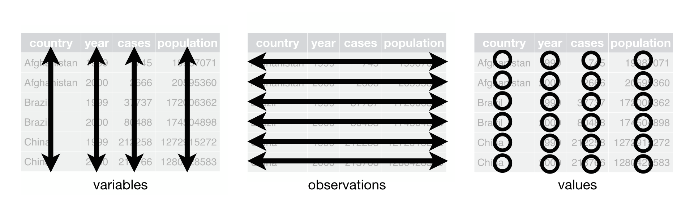
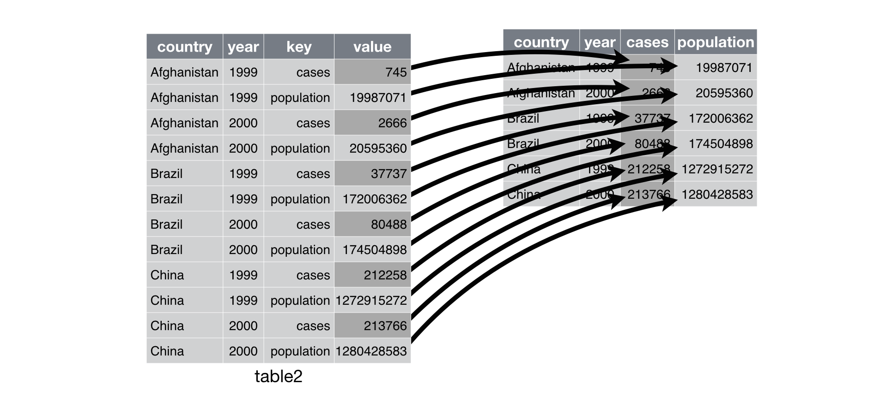
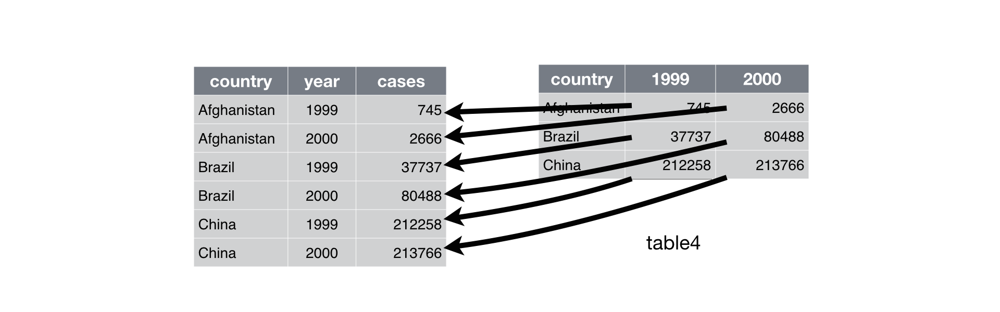
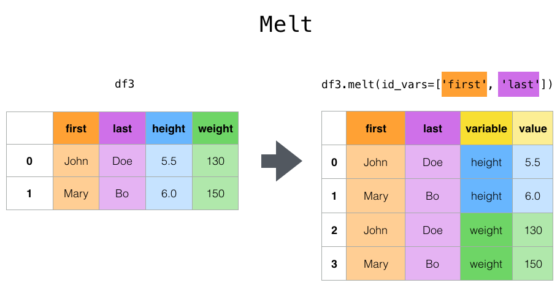
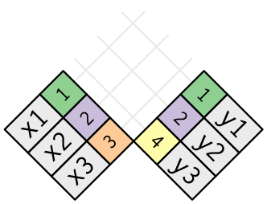
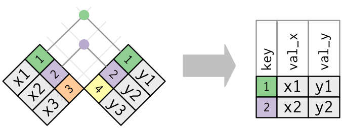
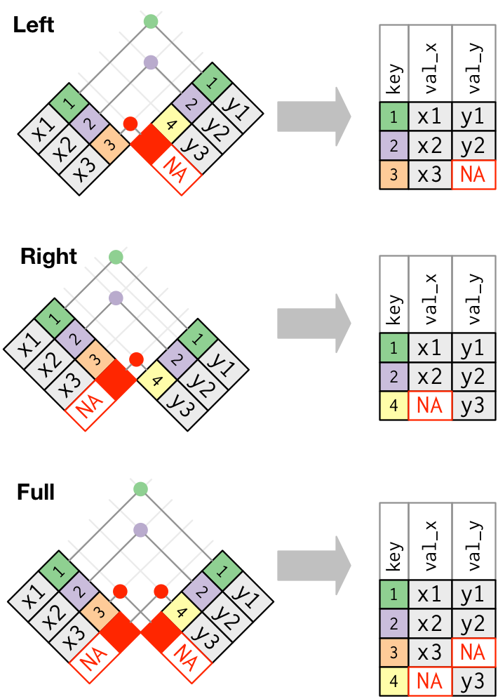

```{python}
#| echo: False
import os
import sys
import pandas as pd
sys.path.append(os.path.abspath('modules'))
```

# Diviser Appliquer Combiner

## Diviser Appliquer Combiner

- Technique de traitement couramment utilisée pour l’agrégation et la transformation de données.
- Aussi appelée **split-apply-combine** ou **group by**.
- Implique une ou plusieurs des étapes suivantes :
  - **Diviser** : diviser les données en groupes selon certains critères.
  - **Appliquer** : appliquer une fonction ou une transformation à chaque sous-ensemble.
  - **Combiner** : fusionner les résultats en une seule sortie (p.ex. tableau) cohérente.

::: notes

**Diviser, Appliquer, Combiner**

- **Concept** :  
  Cette technique, également appelée **split-apply-combine** ou **group by**, est une méthode puissante pour l’agrégation, la transformation, et le filtrage des données. Elle permet de traiter efficacement des ensembles de données en fonction de groupes spécifiques.
  
  Cette approche est essentielle pour analyser des données catégoriques ou groupées et pour appliquer des traitements spécifiques à des segments de données.

- **Étapes clés** :
  1. **Diviser** :  
     Les données sont divisées en groupes selon un ou plusieurs critères, tels que les valeurs d'une colonne.
  2. **Appliquer** :  
     Une fonction ou une transformation est appliquée à chaque sous-groupe.
  3. **Combiner** :  
     Les résultats de chaque groupe sont fusionnés dans une seule structure cohérente, comme un DataFrame.

- **Types d’opérations dans l’étape Appliquer** :
  - **Agrégation** :  
    Calcul d’une statistique récapitulative pour chaque groupe, comme :
    - Somme ou moyenne des valeurs dans les groupes.
    - Taille ou comptage des éléments dans chaque groupe.
  - **Transformation** :  
    Appliquer des calculs spécifiques à chaque groupe tout en conservant la structure des données d’origine. Exemples :
    - Standardisation des données (z-score) par groupe.
    - Remplissage des valeurs manquantes (`NA`) dans un groupe avec des valeurs dérivées de ce groupe.
  - **Filtration** :  
    Rejeter certains groupes en fonction de critères booléens. Exemples :
    - Exclure des groupes avec un faible nombre d'éléments.
    - Filtrer des groupes selon la somme ou la moyenne des valeurs.

- **Combinaisons d’opérations** :
  - Pandas tente de fournir un résultat combiné cohérent en fonction des opérations appliquées, même si elles ne correspondent pas exactement à l’une des catégories ci-dessus.


**Autres remarques** :

Parmi les 3 étapes, la division est la plus simple. En fait, dans de nombreuses situations, vous souhaiterez peut-être diviser l'ensemble de données en groupes et faire quelque chose avec ces groupes vous-même. Dans l'étape d'application, nous pourrions souhaiter l'une des opérations suivantes :

- Agrégation : calcul d'une statistique récapitulative (ou de statistiques) sur chaque groupe. Quelques exemples :

    - Calculer les sommes ou les moyennes des groupes
    - Calculer les tailles/comptes des groupes

- Transformation : effectuer des calculs spécifiques au groupe et renvoyer un résultat indexé de manière similaire. Quelques exemples :

    - Standardisation des données (zscore) au sein du groupe
    - Remplissage des NA au sein des groupes avec une valeur dérivée de chaque groupe

- Filtration : rejeter certains groupes, selon un calcul par groupe qui évalue Vrai ou Faux. Quelques exemples :

    - Rejet des données qui appartiennent à des groupes ne comptant que quelques membres
    - Filtrage des données en fonction de la somme ou de la moyenne du groupe

- Une combinaison des éléments ci-dessus : "group by" examinera les résultats de l'étape d'application et essaiera de renvoyer un résultat combiné raisonnablement s'il ne correspond à aucune de ces catégories.

:::

## Exemple simple

- Ventes de produits avec des prix et des quantités.

```{python}
ventes = {
    'Produit': ['Apple', 'Banana', 'Apple', 'Banana', 'Apple'],
    'Prix': [1.0, 0.5, 1.2, 0.6, 1.1],
    'Quantité': [10, 20, 15, 25, 30]
}
df = pd.DataFrame(ventes)
print(df)
```

- **Objectif** : calculer le nombre de ventes et le nombre total de produits vendus pour chaque produit.

::: notes

**Exemple simple : Diviser, Appliquer, Combiner**

- **Données de départ** :
  - Les ventes sont organisées dans un DataFrame avec les colonnes suivantes :
    - **Produit** : nom du produit vendu.
    - **Prix** : prix unitaire du produit.
    - **Quantité** : nombre d’unités vendues.
  - Exemple de DataFrame :
    ```
      Produit  Prix  Quantité
    0   Apple   1.0        10
    1  Banana   0.5        20
    2   Apple   1.2        15
    3  Banana   0.6        25
    4   Apple   1.1        30
    ```

- **Objectif** :
  - Calculer des métriques agrégées pour chaque produit :
    - Nombre de ventes par produit.
    - Quantité totale de produits vendus pour chaque produit.

- **Approche** :
  1. **Diviser** :  
     Grouper les données par la colonne **Produit**.
  2. **Appliquer** :  
     Effectuer deux calculs pour chaque groupe :
     - Le **nombre de ventes** : compter les lignes dans chaque groupe.
     - Le **nombre total de produits vendus** : sommer les quantités.
  3. **Combiner** :  
     Rassembler les résultats dans un nouveau DataFrame pour une vue agrégée des données.

Ce type d’analyse permet de résumer et d’explorer efficacement les données catégoriques, tout en tirant des insights utiles.

:::


## Exemple simple (suite)

- **Diviser** : par produit.

```{python}
grouped = df.groupby('Produit')
print(grouped)
```

- **Appliquer** : 

  ::: {.columns}
  ::: {.column width="55%"}

  - Nombre de ventes (taille des groupes) :

  ```{python}
  grouped.size()
  ```

  :::
  ::: {.column width="45%"}

  - Nombre total de produits :

  ```{python}
  grouped['Quantité'].sum()
  ```

  :::
  :::

::: notes

**Exemple simple (suite)**

- **Diviser** :
  - Les données sont regroupées par produit à l’aide de la méthode `groupby()`.
  - Exemple : `grouped = df.groupby('Produit')` crée un objet regroupant les lignes du DataFrame pour chaque produit unique.

- **Appliquer** :
  - Une fois les données regroupées, différentes opérations peuvent être appliquées à chaque groupe.

  - **Nombre de ventes** :
    - Utilisez `grouped.size()` pour calculer la taille de chaque groupe, c’est-à-dire le nombre de lignes correspondant à chaque produit.
    - Cela donne le **nombre de ventes** pour chaque produit.

  - **Nombre total de produits** :
    - Utilisez `grouped['Quantité'].sum()` pour calculer la somme des quantités vendues dans chaque groupe.
    - Cela donne le **nombre total de produits vendus** par produit.

Ces étapes montrent comment appliquer des calculs spécifiques à des groupes tout en conservant une organisation claire et concise des données.

:::

## Sélection de groupes et de colonnes

- **Objectif** : calculer la moyenne des prix pour les pommes.

::: {.columns}
::: {.column width="50%"}

- Sélection du groupe `"Apple"`.

```{python}
pommes = grouped.get_group('Apple')
print(pommes)
```

:::
::: {.column width="50%"}

- Sélection de la colonne `"Prix"`.

```{python}
prix_pommes = pommes['Prix']
print(prix_pommes)
```

:::
:::

- Calcul de la moyenne :

```{python}
print(prix_pommes.mean())
```

::: notes

**Sélection de groupes et de colonnes**

- **Objectif** :  
  Calculer la moyenne des prix pour le produit `"Apple"` en utilisant le regroupement par produit.

- **Étapes** :

  1. **Sélection du groupe `"Apple"`** :
     - Utilisez `grouped.get_group('Apple')` pour extraire toutes les lignes correspondant au produit `"Apple"`.
     - Cela renvoie un DataFrame contenant uniquement les données associées à ce produit.

  2. **Sélection de la colonne `"Prix"`** :
     - Une fois le groupe sélectionné, vous pouvez accéder à une colonne spécifique avec la notation `pommes['Prix']`.
     - Cela renvoie une Series contenant uniquement les prix pour le produit `"Apple"`.

  3. **Calcul de la moyenne** :
     - Appliquez la méthode `mean()` à la Series `prix_pommes` pour calculer la moyenne des prix pour `"Apple"`.
     - Exemple : `prix_pommes.mean()` renvoie le prix moyen de toutes les ventes d'`"Apple"`.

Cette méthode de sélection et d’analyse des groupes est utile pour effectuer des analyses spécifiques et détaillées sur des sous-ensembles des données.

:::


# Agrégation

## Agrégation

- Les calculs de somme et de moyenne sont des exemple d'**agrégation**.
- **Fonction d'agrégation** : réduit une série à un nombre.
- **Group by** pour l'agrégation :

    - **Diviser** : par groupe,
    - **Appliquer** : une fonction d'agrégation,
    - **Combiner** : les résultats agrégés.


::: notes

**Agrégation**

- **Concept** :
  - L’agrégation consiste à réduire une série de données à une seule valeur à l’aide de fonctions statistiques, comme la somme, la moyenne, le maximum ou le minimum.
  - Ces calculs permettent de résumer les données et d’extraire des informations clés sur chaque groupe.

- **Fonction d’agrégation** :
  - Une fonction d’agrégation prend une série comme entrée et renvoie un seul nombre. Exemples :
    - `sum()` pour la somme.
    - `mean()` pour la moyenne.
    - `count()` pour le comptage des éléments.

- **Group by et agrégation** :
  - L’agrégation est souvent utilisée avec la méthode **`groupby()`**, qui suit les trois étapes du modèle "Diviser, Appliquer, Combiner" :
    1. **Diviser** : Séparer les données en groupes selon une ou plusieurs colonnes.
    2. **Appliquer** : Appliquer une ou plusieurs fonctions d’agrégation à chaque groupe.
    3. **Combiner** : Rassembler les résultats agrégés pour chaque groupe dans un DataFrame ou une autre structure.

- **Exemples pratiques** :
  - Calculer la somme des ventes pour chaque produit.
  - Trouver la moyenne des prix pour chaque catégorie.

L’agrégation permet de simplifier et de résumer des ensembles de données volumineux en extrayant des métriques pertinentes.

:::


## La méthode `agg` (ou `aggregate`)

- Permet d'appliquer une fonction d'agrégation à chaque groupe et toutes les colonnes :

```{python}
print(grouped.agg("mean"))
```

::: notes

**La méthode `agg` (ou `aggregate`)**

- **Concept** :
  - La méthode `agg()` permet d’appliquer une ou plusieurs fonctions d’agrégation à chaque groupe d’un DataFrame regroupé. C’est une méthode puissante pour réaliser des résumés statistiques sur des groupes de données.

- **Fonctionnement** :
  - `grouped.agg("mean")` applique la fonction **moyenne** (`mean`) à chaque colonne du DataFrame regroupé.
  - Cette méthode est flexible et peut être utilisée pour des calculs variés, comme la somme, la moyenne, le maximum, ou des fonctions définies par l’utilisateur.

- **Avantages** :
  - Elle permet d’appliquer différentes fonctions d’agrégation à plusieurs colonnes en une seule étape.
  - Compatible avec des fonctions standard de Pandas ou des fonctions personnalisées.

- **Exemple** :
  - Appliquer `mean` pour calculer la moyenne des colonnes numériques, comme le prix ou la quantité, pour chaque produit.

L’utilisation de `agg()` simplifie l’application simultanée de plusieurs agrégations sur un DataFrame regroupé.

:::


## `agg` avec un dictionnaire

- Permet de spécifier les colonnes et fonctions à appliquer :

  - Les clés sont les noms des colonnes,
  - Les valeurs sont les fonctions à appliquer.

```{python}
print(grouped.agg({"Prix": "mean"}))
print(grouped.agg({"Prix": "mean", "Quantité": "sum"}))
```


::: notes

**`agg` avec un dictionnaire**

- **Concept** :
  - La méthode `agg()` peut être utilisée avec un dictionnaire pour spécifier les fonctions d’agrégation à appliquer à des colonnes spécifiques.
  - Cela permet un contrôle précis sur les opérations effectuées pour chaque colonne.

- **Structure du dictionnaire** :
  - Les **clés** représentent les noms des colonnes sur lesquelles vous souhaitez appliquer une agrégation.
  - Les **valeurs** sont les fonctions d’agrégation à appliquer (par exemple, `"mean"`, `"sum"`, ou des fonctions définies par l’utilisateur).

- **Exemples** :
  - `grouped.agg({"Prix": "mean"})` :
    - Calcule la moyenne des prix pour chaque groupe.
  - `grouped.agg({"Prix": "mean", "Quantité": "sum"})` :
    - Calcule la moyenne des prix et la somme des quantités pour chaque groupe.

- **Avantages** :
  - Flexibilité : permet d’appliquer différentes fonctions d’agrégation à différentes colonnes en une seule étape.
  - Lisibilité : le dictionnaire rend explicite les colonnes et les fonctions utilisées.

Cette méthode est particulièrement utile pour générer des résumés statistiques combinés à partir d’un DataFrame regroupé.

:::


## `agg` avec un dictionnaire de listes

- Permet d'appliquer plusieurs fonctions à chaque colonne :

  - Les clés sont les noms des colonnes,
  - Les valeurs sont des listes de fonctions à appliquer.

```{python}
print(grouped.agg({"Prix": ["mean", "median"]}))
print(grouped.agg({"Prix": ["mean", "median"], "Quantité": ["sum", "count"]}))
```


::: notes

**`agg` avec un dictionnaire de listes**

- **Concept** :
  - La méthode `agg()` permet d’appliquer **plusieurs fonctions d’agrégation** à une ou plusieurs colonnes à l’aide d’un dictionnaire.
  - Les clés spécifient les colonnes ciblées, et les valeurs sont des **listes** de fonctions à appliquer à chaque colonne.

- **Structure du dictionnaire** :
  - Les **clés** représentent les noms des colonnes du DataFrame.
  - Les **valeurs** sont des listes de fonctions d’agrégation, comme `"mean"`, `"median"`, `"sum"`, ou `"count"`.

- **Exemples** :
  - `grouped.agg({"Prix": ["mean", "median"]})` :
    - Calcule la moyenne et la médiane des prix pour chaque groupe.
  - `grouped.agg({"Prix": ["mean", "median"], "Quantité": ["sum", "count"]})` :
    - Applique :
      - `mean` et `median` sur la colonne `"Prix"`.
      - `sum` et `count` sur la colonne `"Quantité"`.

- **Avantages** :
  - Permet des analyses multi-niveaux en appliquant plusieurs agrégations à la fois.
  - Simplifie le code en centralisant plusieurs calculs dans une seule commande.

Cette approche est idéale pour obtenir des résumés statistiques détaillés et variés sur des colonnes spécifiques d’un DataFrame regroupé.

:::


## Agrégations intégrées {.smaller}

| Fonction        | Description                                                                                        |
|-----------------|----------------------------------------------------------------------------------------------------------------|
| **count**       | Nombre d'observations non-NaN                                                                 |
| **size**        | Taille de chaque groupe (inclut les valeurs NaN).                                                     |
| **sum**/**prod**         | Somme/produit                                                                                             |
| **mean**/**median**        | Moyenne/médiane                                                                                          |
| **std**/**var**/**mad**         | Écart-type/variance, écart absolu moyen                                                                                        |
| **min**/**max**         | Valeur minimale/maximale                                                                                              |
| **prod**        | Produit                                                                                           |
| **first**/ **last**      | Première/dernière valeur non-NaN                                                                                        |
| **nth**         | N-ième valeur non-NaN                                                                                          |
| **quantile**    | Quantile (ex. `quantile(0.75)` pour le 75e percentile).                                            |


::: notes

**Agrégations intégrées dans Pandas**

**Description** :
Pandas fournit une large gamme de fonctions d’agrégation prêtes à l’emploi pour effectuer des calculs sur des groupes ou des colonnes. Ces fonctions permettent de résumer et d’analyser rapidement les données.

**Utilisation** :
Ces fonctions peuvent être appliquées directement avec des méthodes comme `.agg()` ou `.apply()`, facilitant ainsi les calculs statistiques ou descriptifs sur des ensembles de données.

Ces fonctions couvrent une grande variété de besoins, des statistiques de base aux analyses plus complexes.

:::

## Agrégations personnalisées

- **Fonction d'agrégation** : prend une série/renvoie un scalaire.

  ```{python}
  def sum_in_eur(x):
      return sum(x * 0.9)
  print(sum(df['Prix']), sum_in_eur(df['Prix']))
  ```

- Nom de la fonction passé à `agg` **sans les guillemets**.

  ```{python}
  print(grouped.agg({"Prix": sum_in_eur}))
  print(grouped.agg({"Prix": ["sum", sum_in_eur]}))
  ```

::: notes

**Agrégations personnalisées**

- **Concept** :
  - Une fonction d’agrégation personnalisée vous permet de définir vos propres calculs sur une colonne ou un groupe, offrant une flexibilité totale dans l’analyse.

- **Fonction d’agrégation personnalisée** :
  - La fonction prend une **Series** en entrée (les valeurs d’une colonne ou d’un groupe) et retourne un **scalaire** (une seule valeur).
  - Exemple :
    ```python
    def sum_in_eur(x):
        return sum(x * 0.9)
    print(sum(df['Prix']), sum_in_eur(df['Prix']))
    ```
    Cette fonction convertit les valeurs en euros avant de les sommer.

- **Utilisation avec `agg`** :
  - Pour appliquer une fonction personnalisée dans `agg`, passez le nom de la fonction sans guillemets.
  - Exemple :
    ```python
    print(grouped.agg({"Prix": sum_in_eur}))
    ```
    Cela applique `sum_in_eur` à la colonne `"Prix"` pour chaque groupe.

- **Combinaison avec des fonctions intégrées** :
  - Vous pouvez combiner des fonctions standard et personnalisées dans une seule commande `agg`.
  - Exemple :
    ```python
    print(grouped.agg({"Prix": ["sum", sum_in_eur]}))
    ```
    Cela calcule à la fois la somme standard (`sum`) et la somme convertie en euros (`sum_in_eur`) pour chaque groupe.

Les agrégations personnalisées permettent de répondre à des besoins spécifiques en étendant les capacités des fonctions standard.

:::


<!-- | **sem**         | Erreur standard de la moyenne.                                                                                 |
| **skew**        | Asymétrie                                                                                         |
| **kurt**        | Kurtosis (coefficient d'aplatissement)                                                            | -->

# Transformation

## Transformation

::: {.columns}
::: {.column width="45%"}

  - **Fonction d'agrégation** : 
      - Réduit une série à un nombre.
      - P.ex., somme ou moyenne par groupe.

:::
::: {.column width="55%"}

  - **Fonction de transformation** : 
      - Renvoie une série de la même taille que l'entrée.
      - P.ex., remplissage des valeurs manquantes par groupe.

:::
:::

- **Group by** pour la transformation :

    - **Diviser** : par groupe,
    - **Appliquer** : une fonction de transformation,
    - **Combiner** : les groupes transformés.


::: notes

**Transformation**

- **Distinction entre agrégation et transformation** :
  - **Fonction d'agrégation** :
    - Réduit une **Series** à un **scalaire** (un seul nombre).
    - Exemples : somme ou moyenne des valeurs d’un groupe.
  - **Fonction de transformation** :
    - Applique une opération à chaque groupe et retourne une **Series** de la même taille que l’entrée d’origine.
    - Exemple : Remplissage des valeurs manquantes ou normalisation des données au sein d’un groupe.

- **Group by pour la transformation** :
  - La transformation suit le même modèle **Diviser, Appliquer, Combiner** que l'agrégation :
    1. **Diviser** : Séparer les données en groupes basés sur une ou plusieurs colonnes.
    2. **Appliquer** : Utiliser une fonction de transformation (par exemple, calcul de moyennes, normalisation ou remplissage).
    3. **Combiner** : Reconstituer un DataFrame ou une Series de la même taille que les données originales, avec les transformations appliquées.

- **Exemples de transformation** :
  - Remplissage des valeurs manquantes dans chaque groupe avec une valeur dérivée du groupe (comme la moyenne du groupe).
  - Normalisation des données au sein de chaque groupe.

Les transformations permettent de conserver la structure des données tout en modifiant les valeurs pour des analyses ou des visualisations plus cohérentes.

:::


## La méthode `transform`

- Permet d'appliquer une **fonction de transformation** qui renvoie une série de la même taille que l'entrée.
- **Exemple** : calculer la somme cumulative des quantités.


::: {.columns}
::: {.column width="30%"}

```{python}
print(df["Quantité"])
```

:::
::: {.column width="33%"}

```{python}
print(df["Quantité"]
  .transform("cumsum"))
```

:::
::: {.column width="36%"}

```{python}
print(grouped["Quantité"]
  .transform("cumsum"))
```

:::
:::

- Appliquer `transform` à un groupe renvoie une série de la même taille que le groupe.


::: notes

**La méthode `transform`**

- **Concept** :
  - La méthode `transform()` applique une **fonction de transformation** sur un DataFrame ou un groupe. Contrairement à une agrégation, elle renvoie une **Series de la même taille que l'entrée**, ce qui permet de conserver la structure des données originales.

- **Exemple** : Calcul de la somme cumulative des quantités :
  - `df["Quantité"].transform("cumsum")` :
    - Calcule la somme cumulative sur la colonne `"Quantité"` pour l'ensemble des données.
  - `grouped["Quantité"].transform("cumsum")` :
    - Calcule la somme cumulative pour chaque groupe distinct, en utilisant la méthode **Group by**.

- **Fonctionnement avec `grouped`** :
  - Lorsque `transform()` est appliqué à un DataFrame regroupé (`grouped`), chaque transformation est réalisée individuellement sur chaque groupe.
  - Le résultat conserve la même structure et les mêmes index que les données d'origine, mais les valeurs sont modifiées selon la transformation.

- **Applications typiques** :
  - Calculs comme les sommes cumulatives, les moyennes mobiles, ou la normalisation par groupe.
  - Remplissage des valeurs manquantes avec des statistiques calculées au sein de chaque groupe (par exemple, la moyenne ou la médiane).

La méthode `transform` est utile pour appliquer des transformations qui nécessitent de conserver la granularité des données tout en effectuant des calculs par groupe.

:::


## Transformations intégrées {.smaller}

| Méthode         | Description en Français                                                                                         |
|-----------------|-----------------------------------------------------------------------------------------------------------------|
| **cumcount()**  | Calcule le compte cumulatif                                                                |
| **cummax()**    | Calcule le maximum cumulatif                                                               |
| **cummin()**    | Calcule le minimum cumulatif                                                               |
| **cumprod()**   | Calcule le produit cumulatif                                                               |
| **cumsum()**    | Calcule la somme cumulative                                                                |
| **diff()**      | Calcule la différence entre les valeurs adjacentes                                         |
| **ffill()**     | Remplit les valeurs NA par les valeurs précédentes                                         |
| **bfill()**     | Remplit les valeurs NA par les valeurs suivantes                                           |
| **pct_change()**| Calcule le changement en pourcentage entre les valeurs adjacentes                          |
| **rank()**      | Calcule le rang de chaque valeur                                                           |
| **shift()**     | Décale les valeurs vers le haut ou le bas                                                  |


::: notes

**Transformations intégrées**

**Description** :
Pandas propose un ensemble de méthodes intégrées pour effectuer des transformations sur les données, qu'elles soient appliquées globalement ou par groupe.

**Applications typiques** :

  - Les méthodes cumulatives (**cumsum**, **cummax**) sont utiles pour suivre des tendances progressives.
  - Les méthodes de remplissage (**ffill**, **bfill**) sont utilisées pour traiter les valeurs manquantes.
  - Les méthodes de décalage (**shift**) sont utilisées pour calculer des différences ou des tendances.

Ces transformations intégrées permettent d’effectuer des calculs complexes tout en conservant la structure des données.

:::


## Transformations personnalisées

- **Fonction de transformation** : prend une série/renvoie une série de la même taille.

  ```{python}
  def normalize(x):
      return (x - x.min()) / (x.max() - x.min())
  ```

  ::: {.columns}
  ::: {.column width="45%"}

  - Données initiales :

    ```{python}
    print(df)
    ```

  :::
  ::: {.column width="55%"}

  - Transformation :

    ```{python}
    print(grouped.transform(normalize))
    ```

  :::
  :::


::: notes

**Transformations personnalisées**

- **Concept** :
  - Une transformation personnalisée est une fonction appliquée à une **Series**, qui renvoie une **Series de la même taille** après avoir transformé ses valeurs.
  - Contrairement aux agrégations, les transformations conservent la granularité des données d'origine.

- **Fonction personnalisée** :
  - La fonction suivante normalise les valeurs d'une série en les ramenant dans une échelle de 0 à 1 :
    ```python
    def normalize(x):
        return (x - x.min()) / (x.max() - x.min())
    ```
    Cette transformation est utile pour standardiser des données au sein d’un groupe, quel que soit l'échelle initiale.

- **Application avec Group by** :
  - **Données initiales** :  
    Affichez le DataFrame pour visualiser les valeurs avant transformation avec `print(df)`.
  - **Transformation** :  
    Utilisez `grouped.transform(normalize)` pour appliquer la fonction `normalize` à chaque groupe. Cela renvoie un DataFrame ou une Series de la même taille que les données d’origine, mais avec des valeurs normalisées dans chaque groupe.

- **Applications pratiques** :
  - Standardisation des données pour des analyses statistiques.
  - Normalisation de valeurs numériques pour garantir une cohérence entre les groupes.

Les transformations personnalisées offrent une grande flexibilité pour répondre à des besoins spécifiques et effectuer des calculs avancés par groupe.

:::


## Remplissage des valeurs manquantes

- Application typique de la transformation.
- On introduit deux valeurs manquantes pour l'exemple.

  ```{python}
  df.loc[[3, 4], 'Prix'] = None; print(df)
  ```

- Moyenne globale  vs moyenne par groupe.

  ::: {.columns}
  ::: {.column width="45%"}

  ```{python}
  print(df["Prix"].mean())
  ```

  :::
  ::: {.column width="55%"}

  ```{python}
  grouped = df.groupby('Produit')
  print(grouped["Prix"].mean())
  ```

  :::
  :::

::: notes

**Remplissage des valeurs manquantes**

- **Concept** :
  - Le remplissage des valeurs manquantes est une application typique de la transformation. Il s'agit de combler les données manquantes avec des valeurs calculées, telles que la moyenne, pour garantir la cohérence des analyses.

- **Exemple avec des valeurs manquantes** :
  - Pour illustrer, deux valeurs manquantes sont introduites dans la colonne `"Prix"` :
    ```python
    df.loc[[3, 4], 'Prix'] = None; print(df)
    ```

- **Moyenne globale vs. moyenne par groupe** :
  - **Moyenne globale** :  
    - La méthode `mean()` appliquée à une colonne renvoie la moyenne de toutes les valeurs non manquantes dans cette colonne.
    - Exemple : `df["Prix"].mean()` calcule la moyenne des prix pour l’ensemble des produits.
  - **Moyenne par groupe** :  
    - En regroupant les données par produit (`groupby('Produit')`), vous pouvez calculer une moyenne distincte pour chaque groupe.
    - Exemple : 
      ```python
      grouped = df.groupby('Produit')
      print(grouped["Prix"].mean())
      ```
      Cela calcule la moyenne des prix pour chaque produit individuellement, ignorant les valeurs manquantes au sein des groupes.

- **Applications pratiques** :
  - Remplir les valeurs manquantes avec la moyenne globale ou par groupe pour préserver la cohérence des données.
  - Garantir que les analyses ne sont pas biaisées par des données manquantes.

Ce processus améliore la qualité des données tout en permettant des analyses fiables.

:::


## Remplissage des valeurs manquantes

- Suppression pour simuler des données manquantes :
  ```{python}
  df.loc[[3, 4], ['Prix', 'Quantité']] = None
  ```

- Calcul de la moyenne de chaque groupe :
  ```{python}
  transformed_df = grouped.transform('mean')
  ```

- Remplissage avec la moyenne de chaque groupe : 
  ```{python}
  print(df.fillna(transformed_df))
  ```

::: notes

**Remplissage des valeurs manquantes**

- **Concept** :
  - Le remplissage des valeurs manquantes (NaN) est essentiel pour garantir la cohérence des données et préserver leur utilité dans les analyses.
  - `transform` permet de calculer des statistiques (comme la moyenne) par groupe et de les utiliser pour combler les données manquantes.

- **Étapes du processus** :

  1. **Introduction de valeurs manquantes** :
     - Simuler des données manquantes en remplaçant certaines valeurs dans les colonnes `Prix` et `Quantité` par `None` :
       ```python
       df.loc[[3, 4], ['Prix', 'Quantité']] = None
       ```
     - Cela aide à démontrer les techniques de remplissage sur des colonnes spécifiques.

  2. **Calcul des moyennes par groupe** :
     - Utiliser la méthode `transform` pour calculer la moyenne de chaque groupe pour les colonnes ciblées :
       ```python
       transformed_df = grouped.transform('mean')
       ```
     - Cela génère un DataFrame où chaque valeur est remplacée par la moyenne de son groupe.

  3. **Remplissage des NaN** :
     - Remplacer les valeurs manquantes dans le DataFrame original avec les moyennes calculées par groupe :
       ```python
       print(df.fillna(transformed_df))
       ```
     - Cette opération remplit les `NaN` tout en conservant la structure originale des données.

- **Applications typiques** :
  - Remplir des données manquantes avec des valeurs significatives pour éviter de biaiser les analyses.
  - Maintenir la cohérence des groupes en utilisant des statistiques locales plutôt que globales.

Ce processus est particulièrement utile pour traiter les données manquantes de manière adaptée au contexte des groupes.

:::


## Remplissage des valeurs manquantes

```{python}
def replace_missing(x):
      return x.fillna(x.mean())
```

- Remplissage par la moyenne globale.

  ```{python}
  print(df['Prix'].transform(replace_missing))
  ```

- Remplissage par la moyenne par groupe.

  ```{python}
  print(grouped['Prix'].transform(replace_missing))
  ```


::: notes

**Remplissage des valeurs manquantes**

- **Concept** :
  - Le remplissage des valeurs manquantes peut être réalisé en utilisant une fonction personnalisée appliquée à l'ensemble des données ou à des groupes spécifiques.

- **Fonction personnalisée** :
  - La fonction suivante remplit les valeurs manquantes dans une **Series** avec la moyenne calculée sur cette série :
    ```python
    def replace_missing(x):
        return x.fillna(x.mean())
    ```

- **Remplissage par la moyenne globale** :
  - La méthode `transform()` appliquée à une colonne complète remplit les valeurs manquantes avec la moyenne globale de cette colonne.
  - Exemple :
    ```python
    print(df['Prix'].transform(replace_missing))
    ```
    Ce code remplace toutes les valeurs `NaN` dans la colonne `"Prix"` par la moyenne globale des prix.

- **Remplissage par la moyenne par groupe** :
  - Lorsque `transform()` est utilisé avec un objet regroupé (`groupby`), les valeurs manquantes sont remplacées par la moyenne au sein de chaque groupe.
  - Exemple :
    ```python
    print(grouped['Prix'].transform(replace_missing))
    ```
    Ce code remplace les valeurs `NaN` dans la colonne `"Prix"` par la moyenne calculée uniquement pour le groupe correspondant.

- **Applications pratiques** :
  - Remplir les valeurs manquantes globalement pour maintenir la cohérence générale.
  - Utiliser la moyenne par groupe pour conserver des différences spécifiques à chaque groupe, ce qui est souvent préférable pour des analyses segmentées.

Ces approches garantissent que les données restent complètes et utilisables, même en présence de valeurs manquantes.

:::


# Filtration

## Filtration

::: {.columns}
::: {.column width="45%"}

- **Fonction d'agrégation** : 
    - Réduit une série à un seul nombre.

:::
::: {.column width="55%"}

- **Fonction de transformation** : 
    - Renvoie une série de la même taille que l'entrée.

:::
:::

<!-- ::: {.columns}
::: {.column width="55%"} -->

- **2 types de fonctions de filtration** :

  ::: {.columns}
  ::: {.column width="45%"}

  - Réduit une série à un seul booléen
  - P.ex., filtrer les groupes en fonction de différentes conditions.


  :::
  ::: {.column width="55%"}

  - Renvoie une série de booléens de la même taille que l'entrée.
  - P.ex., filtrer les prix supérieurs à la moyenne par groupe.

  :::
  :::


<!-- :::
::: {.column width="45%"}

- **Group by** pour la filtration :

    - **Diviser** : par groupe,
    - **Appliquer** : une fonction de filtration,
    - **Combiner** : les groupes filtrés.

:::
::: -->


::: notes

**Filtration**

- **Concept** :
  - La filtration est une méthode pour sélectionner des données en fonction de conditions spécifiques, en travaillant soit sur des groupes, soit sur des valeurs individuelles.

- **Distinction entre agrégation, transformation et filtration** :
  - **Fonction d'agrégation** :
    - Réduit une **Series** à un **scalaire** (un seul nombre), par exemple, la somme ou la moyenne.
  - **Fonction de transformation** :
    - Renvoie une **Series de la même taille** que l’entrée, avec des valeurs transformées.
  - **Fonction de filtration** :
    - Sélectionne ou rejette des groupes ou des valeurs selon des critères booléens.

- **Types de fonctions de filtration** :
  1. **Filtration basée sur un booléen unique** :
     - Réduit une **Series** à un seul booléen.
     - Exemple : Filtrer les groupes où la somme des valeurs dépasse un seuil donné.
  2. **Filtration basée sur une série de booléens** :
     - Renvoie une **Series de booléens** de la même taille que l'entrée.
     - Exemple : Sélectionner les valeurs de prix supérieures à la moyenne par groupe.

- **Applications pratiques** :
  - Filtrer les groupes en fonction de conditions globales (par exemple, rejeter les groupes avec moins de 5 membres).
  - Filtrer des valeurs au sein des groupes en fonction de critères calculés (par exemple, les prix supérieurs à la moyenne locale).

Ces distinctions permettent une grande flexibilité pour sélectionner des sous-ensembles de données adaptés à une analyse spécifique.

:::


## Fonction de filtration

```{python}
data = {
    'produit': ['A', 'A', 'A', 'B', 'B', 'B', 'C', 'C'],
    'prix': [1, 2, 3, 4, 5, 6, 7, 8]
}
df = pd.DataFrame(data)
grouped = df.groupby('produit')
```

::: {.columns}
::: {.column width="50%"}

- Un seul booléen :

  ```{python}
  def filter_price1(x):
      return x['prix'].mean() > 4
  print(filter_price1(df))
  ```

:::
::: {.column width="50%"}

- De même taille que l'entrée :

  ```{python}
  def filter_price2(x):
      return x > x.mean()
  print(filter_price2(df['prix']))
  ```


:::
:::


::: notes

**Fonction de filtration**

- **Concept** :
  - Les fonctions de filtration sélectionnent des données ou des groupes en fonction de conditions spécifiques. Elles peuvent produire un résultat global (booléen unique) ou une série de booléens de la même taille que l'entrée.

- **Exemple de données** :
  - Le DataFrame suivant regroupe les données par produit :
    ```python
    data = {
        'produit': ['A', 'A', 'A', 'B', 'B', 'B', 'C', 'C'],
        'prix': [1, 2, 3, 4, 5, 6, 7, 8]
    }
    df = pd.DataFrame(data)
    grouped = df.groupby('produit')
    ```

- **Types de filtration** :
  1. **Un seul booléen (global)** :
     - Utilisez une fonction qui renvoie un booléen unique pour chaque groupe.
     - Exemple :
       ```python
       def filter_price1(x):
           return x['prix'].mean() > 4
       ```
       Cette fonction vérifie si la moyenne des prix dans un groupe est supérieure à 4.

  2. **De même taille que l'entrée** :
     - Utilisez une fonction qui renvoie une série de booléens, où chaque valeur indique si elle satisfait la condition.
     - Exemple :
       ```python
       def filter_price2(x):
           return x > x.mean()
       ```
       Cette fonction identifie les valeurs de prix supérieures à la moyenne dans l'ensemble des données.

- **Applications pratiques** :
  - Filtrer les groupes en fonction d’un critère global, comme rejeter les groupes ayant une moyenne inférieure à un certain seuil.
  - Sélectionner des valeurs spécifiques dans un groupe, comme les prix au-dessus de la moyenne locale.

Ces fonctions de filtration permettent une sélection fine des données, essentielle pour des analyses ciblées.

:::


## Group by pour la filtration

::: {.columns}
::: {.column width="45%"}

- Avec `filter` :

    - **Diviser** : par groupe,
    - **Appliquer** : une fonction de filtration qui réduit à un booléen,
    - **Combiner** : les groupes filtrés.

:::
::: {.column width="55%"}

- Avec `transform` :

    - **Diviser** : par groupe,
    - **Appliquer** : une fonction de transformation qui renvoie une série de booléens,
    - **Combiner** : les groupes transformés,
    - **Filtrer** : les éléments pour lesquels la transformation renvoie `True`.

:::
:::


::: notes

**Group by pour la filtration**

- **Filtration avec `filter`** :
  - La méthode `filter` est utilisée pour sélectionner ou exclure des **groupes entiers** en fonction d’un critère booléen global.
  - Processus :
    1. **Diviser** : Les données sont regroupées par une ou plusieurs colonnes.
    2. **Appliquer** : Une fonction de filtration est appliquée à chaque groupe. Cette fonction doit renvoyer un **booléen unique**.
    3. **Combiner** : Les groupes pour lesquels la fonction renvoie `True` sont conservés.

  - Exemple :
    - Filtrer les groupes où la moyenne des prix est supérieure à un certain seuil.

- **Filtration avec `transform`** :
  - La méthode `transform` permet de sélectionner **des éléments individuels** au sein des groupes.
  - Processus :
    1. **Diviser** : Les données sont regroupées par une ou plusieurs colonnes.
    2. **Appliquer** : Une fonction de transformation est appliquée à chaque groupe, renvoyant une **série de booléens** de la même taille que le groupe.
    3. **Combiner** : Les valeurs correspondant à `True` dans la série transformée sont conservées.

  - Exemple :
    - Filtrer les lignes où le prix est supérieur à la moyenne locale dans chaque groupe.

- **Résumé** :
  - **`filter`** : Travaille au niveau des groupes, conserve ou rejette des groupes entiers.
  - **`transform`** : Travaille au niveau des lignes, sélectionne ou rejette des valeurs individuelles dans les groupes.

Ces deux méthodes offrent une grande flexibilité pour adapter la filtration des données à des besoins spécifiques.

:::


## La méthode `filter`

- Permet d'appliquer une **fonction de filtration** qui renvoie un booléen pour chaque groupe.
- Filtrer les groupes avec une moyenne de prix supérieure à 4.

::: {.columns}
::: {.column width="45%"}

```{python}
print(grouped.mean())
```

:::
::: {.column width="55%"}

```{python}
print(grouped.filter(filter_price1))
```

:::
:::


::: notes

**La méthode `filter`**

- **Concept** :
  
  La méthode `filter()` permet de sélectionner ou de rejeter des **groupes entiers** en fonction d’un critère booléen défini par une fonction appliquée à chaque groupe.
  
  La méthode `filter` est idéale pour des analyses au niveau des groupes, où les critères de sélection s’appliquent à des agrégations globales des groupes.

- **Exemple : Filtrer les groupes avec une moyenne de prix supérieure à 4** :
  - **Étape 1** : Calculer la moyenne des prix par groupe :
    ```python
    print(grouped.mean())
    ```
    Cela permet de visualiser les moyennes des groupes pour définir un seuil.
  - **Étape 2** : Utiliser une fonction de filtrage :
    ```python
    print(grouped.filter(filter_price1))
    ```
    La fonction `filter_price1` renvoie `True` pour les groupes dont la moyenne des prix est supérieure à 4. Ces groupes sont conservés, les autres sont rejetés.

- **Caractéristiques de la méthode `filter`** :
  - La **fonction de filtrage** doit prendre une **Series** (le groupe) en entrée et renvoyer un **booléen unique**.
  - La méthode applique cette fonction à chaque groupe séparément.
  - Seuls les groupes pour lesquels la fonction renvoie `True` sont inclus dans le DataFrame final.

- **Applications typiques** :
  - Rejeter les groupes avec un faible nombre d’éléments.
  - Sélectionner les groupes répondant à des critères statistiques (somme, moyenne, variance, etc.).

**Résumé :**

- La fonction de filtrage doit réduire une série à un seul booléen.
- La fonction de filtrage est appliquée à chaque groupe.
- Les groupes pour lesquels la fonction renvoie `True` sont conservés, les autres sont rejetés.

:::


## `transform` pour la filtration

- Permet d'appliquer une **fonction de transformation** qui renvoie un booléen pour chaque élément.
- Filtrer les prix supérieurs à la moyenne par groupe.

::: {.columns}
::: {.column width="65%"}

```{python}
mask = grouped["prix"].transform(filter_price2)
print(mask)
```

:::
::: {.column width="35%"}

```{python}
print(df[mask])
```

:::
::: 


::: notes

**`transform` pour la filtration**

- **Concept** :
  - La méthode `transform()` applique une fonction à chaque groupe, renvoyant une **Series de booléens** de la même taille que l’entrée. Cela permet de conserver ou de rejeter des éléments individuels en fonction d’un critère.

- **Exemple : Filtrer les prix supérieurs à la moyenne par groupe** :
  - **Étape 1** : Créer un masque booléen avec `transform()` :
    ```python
    mask = grouped["prix"].transform(filter_price2)
    print(mask)
    ```
    La fonction `filter_price2` retourne `True` pour les prix supérieurs à la moyenne locale dans chaque groupe.
  - **Étape 2** : Appliquer le masque pour filtrer le DataFrame :
    ```python
    print(df[mask])
    ```
    Seules les lignes correspondant à `True` dans le masque sont conservées dans le DataFrame final.

- **Caractéristiques de `transform` pour la filtration** :
  - La **fonction de transformation** doit prendre une **Series** (le groupe) en entrée et renvoyer une **Series** de booléens de la même taille que le groupe.
  - La méthode applique cette fonction à chaque groupe séparément.
  - Les éléments pour lesquels la fonction renvoie `True` sont conservés.

- **Applications typiques** :
  - Filtrer des valeurs au sein des groupes en fonction de statistiques locales (p. ex., valeurs au-dessus ou en dessous de la moyenne).
  - Sélectionner des anomalies ou des valeurs spécifiques dans des segments de données.

Cette méthode est utile pour des analyses détaillées au niveau des éléments individuels tout en tenant compte des caractéristiques des groupes.

:::


## Exercice {.smaller}

* Fonction d'agrégation, de transformation ou de filtrage?

::: {.columns}
::: {.column width="47%"}

```{python}
def f1(x):
    return x.sum()

def f2(x):
    return 100 * (x / x.sum())
```

:::
::: {.column width="53%"}

```{python}
def f3(x):
    return x["prix"].sum() > 6

def f4(x):
    return x > x.median()
```

:::
:::

. . .

* Utilisation de `agg`, `transform` ou `filter`?

::: {.columns}
::: {.column width="47%"}

```{python}
print(grouped.agg(f1))

print(grouped.transform(f2))
```

:::
::: {.column width="53%"}

```{python}
print(grouped.filter(f3))

print(df[grouped["prix"].transform(f4)])
```

:::
:::


::: notes

**Exercice : Identifier le type de fonction et la méthode adaptée**

1. **Fonction d'agrégation, de transformation ou de filtrage ?**

   - **`f1(x)`** :
     - Type : Fonction d’agrégation.
     - Raison : Calcule la somme des valeurs dans la **Series** et retourne un **scalaire**.

   - **`f2(x)`** :
     - Type : Fonction de transformation.
     - Raison : Applique une transformation (pourcentage relatif) à chaque valeur dans la **Series** et renvoie une **Series** de la même taille.

   - **`f3(x)`** :
     - Type : Fonction de filtration.
     - Raison : Vérifie si la somme des prix dans un groupe est supérieure à un seuil et retourne un **booléen unique**.

   - **`f4(x)`** :
     - Type : Fonction de transformation.
     - Raison : Renvoie une **Series de booléens** indiquant si chaque valeur est supérieure à la médiane.

2. **Utilisation de `agg`, `transform` ou `filter` ?**

   - **`grouped.agg(f1)`** :
     - Utilisation : Appliquer une fonction d’agrégation pour calculer une métrique résumée par groupe (ici, la somme).

   - **`grouped.transform(f2)`** :
     - Utilisation : Appliquer une transformation qui conserve la granularité des données tout en modifiant les valeurs (ici, pourcentage relatif).

   - **`grouped.filter(f3)`** :
     - Utilisation : Appliquer une fonction de filtration pour conserver ou rejeter des groupes entiers selon un critère global (ici, somme des prix > 6).

   - **`df[grouped["prix"].transform(f4)]`** :
     - Utilisation : Appliquer une transformation pour filtrer des lignes au sein des groupes en fonction d’une condition locale (ici, valeurs > médiane).

Cet exercice aide à comprendre les distinctions entre les types de fonctions et les méthodes associées dans Pandas.

:::


# Data tidying

## Tidy Data ?

- 3 règles interdépendantes :
  - Chaque variable doit avoir sa propre colonne.
  - Chaque observation doit avoir sa propre ligne.
  - Chaque valeur doit avoir sa propre cellule.

<!-- - **Avantages** :
  - Facilite la visualisation et l'analyse des données.
  - Compatible avec les opérations de groupe.
  - Optimise la performance des opérations. -->




::: notes

**Tidy Data**

- **Définition** :
  - Les données dites "tidy" respectent une structure standardisée qui facilite leur manipulation, leur visualisation, et leur analyse.

- **Les 3 règles du Tidy Data** :
  1. **Chaque variable doit avoir sa propre colonne** :
     - Une colonne représente un attribut unique (par exemple, `prix`, `quantité`, `produit`).
  2. **Chaque observation doit avoir sa propre ligne** :
     - Une ligne représente un enregistrement unique ou un événement (par exemple, une transaction ou une mesure).
  3. **Chaque valeur doit avoir sa propre cellule** :
     - Une cellule contient une valeur unique correspondant à une observation et une variable.

- **Illustration** :
  - Un tableau tidy garantit une disposition où chaque élément est clairement défini et bien organisé, évitant les doublons et les regroupements désordonnés.

Ces principes assurent que les données sont prêtes pour l'analyse statistique et les visualisations, tout en étant compatibles avec les bibliothèques analytiques courantes.

:::


## Un exemple {.smaller}

```{python}
#| echo: False
pd.options.display.max_rows = 6
base_url = "https://github.com/byuidatascience/data4python4ds/raw/master/data-raw/"
table1 = pd.read_csv("{}table1/table1.csv".format(base_url))
table2 = pd.read_csv("{}table2/table2.csv".format(base_url))
table3a = pd.read_csv("{}table4a/table4a.csv".format(base_url))
table3b = pd.read_csv("{}table4b/table4b.csv".format(base_url))
#pd.DataFrame.to_csv("data/table1.csv", table1, index=False)
#pd.DataFrame.to_csv("data/table2.csv", table2, index=False)
#pd.DataFrame.to_csv("data/table3a.csv", table3a, index=False)
#pd.DataFrame.to_csv("data/table3b.csv", table3b, index=False)
```

::: {.columns}
::: {.column width="50%"}

- Table 1 :

```{python}
print(table1)
```
- Table 2 :

```{python}
print(table2)
```

:::
::: {.column width="50%"}

- Table 3 :

```{python}
print(table3a)
print(table3b)
```

:::
:::


::: notes

**Un exemple de Tidy Data**

- **Présentation** :
  - L'exemple illustre des tables de données `table1`, `table2`, `table3a`, et `table3b`, qui peuvent ou non être conformes aux principes des Tidy Data.

- **Données des tables** :
  - **Table 1** :
    - Une version proche d'un format tidy.
    - Chaque variable est dans une colonne spécifique (par exemple, année, cas, population).
  - **Table 2** :
    - Les observations sont réparties entre plusieurs colonnes (cas et population dans la même ligne pour des années distinctes), ce qui nécessite une transformation pour se conformer aux règles des Tidy Data.
  - **Tables 3a et 3b** :
    - Ces tables contiennent des données qui doivent être combinées et restructurées pour être tidy. Par exemple :
      - Les colonnes représentant les années doivent être transformées en une seule colonne `année`.
      - Les valeurs de population et de cas doivent être rassemblées dans une colonne `variable` et une colonne `valeur`.

- **Prochaines étapes** :
  - Identifier les transformations nécessaires pour rendre les tables conformes aux principes des Tidy Data.
  - Restructurer les données en utilisant des outils tels que `melt()` ou `pivot()`.

Ces étapes démontrent l’importance de structurer les données correctement pour simplifier leur manipulation et leur analyse.

:::


## Exemple (suite)

- Cas par 1000 habitants :

```{python}
table1["rate"] = table1["cases"] / table1["population"] * 1000
print(table1)
```

- Nombre de cas par année :

```{python}
table1.groupby("year")["cases"].sum()
```


::: notes

**Exemple (suite)**

- **Ajout d'une colonne dérivée** :
  - **Cas par 1000 habitants** :
    - Une nouvelle colonne `rate` est ajoutée à `table1` pour calculer le taux de cas par 1000 habitants.
    - Calcul :
      ```python
      table1["rate"] = table1["cases"] / table1["population"] * 1000
      ```
    - Cela enrichit les données avec une métrique standardisée, facilitant la comparaison entre les observations.

- **Agrégation par groupe** :
  - **Nombre de cas par année** :
    - Le DataFrame est regroupé par la colonne `year`, et la somme des cas est calculée pour chaque année.
    - Méthode :
      ```python
      table1.groupby("year")["cases"].sum()
      ```
    - Ce type d’agrégation est utile pour analyser les tendances annuelles et résumer les données.

Ces opérations montrent comment enrichir les données et extraire des insights pertinents à l'aide de calculs dérivés et d'agrégations.

:::


## Tidy Data

- **Avantages** :
  - Facilite la visualisation et l'analyse des données.
  - Compatible avec les opérations de groupe.
  - Optimise la performance des opérations.
- 2 techniques :
  - Élargissement des données,
  - Allongement des données.


::: notes

**Tidy Data**

- **Avantages** :
  - Les données tidy sont organisées de manière standardisée, ce qui offre plusieurs bénéfices :
    - **Facilité de visualisation et d'analyse** : Les données bien structurées sont plus simples à explorer et à comprendre.
    - **Compatibilité avec les opérations de groupe** : Les outils de regroupement et d’agrégation (comme `groupby`) fonctionnent efficacement sur des données tidy.
    - **Optimisation des performances** : Les transformations, calculs et visualisations sont plus rapides et moins sujets aux erreurs.

- **Techniques pour obtenir des données tidy** :
  1. **Élargissement des données** :
     - Transforme des colonnes multiples représentant des observations similaires en une seule colonne.
     - Exemple : Combiner plusieurs colonnes représentant des catégories en une seule colonne catégorielle.
  2. **Allongement des données** :
     - Convertit des colonnes en lignes pour structurer les données en respectant les principes tidy.
     - Exemple : Utiliser `melt()` pour convertir des années en une seule colonne `year`.

Ces techniques sont essentielles pour préparer les données à une analyse et une visualisation efficaces.

:::


## Élargissement des données (`pivot`) {.smaller}

```{python}
table2_pivoted = table2.pivot(index = ['country', 'year'], 
  columns = 'type', values = 'count').reset_index()
```

- `index` : colonne(s) à conserver telles quelles.
- `columns` : colonne contenant les noms des variables.
- `values` : colonne contenant les valeurs.

::: {.columns}
::: {.column width="50%"}

```{python}
print(table2.head(4))
print(table2_pivoted.head(2))
```

:::
::: {.column width="50%"}



:::
::: 


::: notes

**Élargissement des données (`pivot`)**

- **Concept** :
  - La méthode `pivot()` est utilisée pour restructurer un DataFrame en élargissant les données, c'est-à-dire en transformant les valeurs d'une colonne en colonnes distinctes.

- **Syntaxe** :
  - `pivot(index, columns, values)` :
    - **`index`** : Les colonnes à conserver telles quelles. Elles servent de base pour l'organisation des données (par exemple, `country`, `year`).
    - **`columns`** : La colonne dont les valeurs deviendront les noms des nouvelles colonnes (par exemple, `type`).
    - **`values`** : La colonne contenant les données à placer dans les nouvelles colonnes (par exemple, `count`).

- **Exemple** :
  - Transformation de `table2` pour obtenir un tableau élargi où les types (`cases`, `population`) deviennent des colonnes :
    ```python
    table2_pivoted = table2.pivot(index=['country', 'year'], columns='type', values='count').reset_index()
    ```
  - Le tableau initial `table2` contient une colonne `type` avec des valeurs comme `cases` ou `population`, qui sont transformées en colonnes distinctes dans `table2_pivoted`.

- **Visualisation** :
  - **Données initiales (`table2`)** :
    - Chaque ligne représente un type et sa valeur pour un pays et une année.
  - **Données pivotées (`table2_pivoted`)** :
    - Chaque ligne regroupe toutes les informations pour un pays et une année.

- **Avantages** :
  - Clarifie la structure des données en regroupant les variables liées dans des colonnes distinctes.
  - Prépare les données pour des analyses comparatives ou des visualisations.

Ce type de transformation est essentiel pour passer d’un format long à un format large, facilitant des analyses spécifiques.

:::


## Allongement des données (`melt`) {.smaller}


```{python}
table3a_melted = table3a.melt(
  id_vars=["country"], var_name="year", value_name="cases")

table3b_melted = table3b.melt(
  id_vars=["country"], var_name="year", value_name="population")
```

- `id_vars` : colonne(s) à conserver telles quelles.
- `var_name` : colonne contenant les noms des variables.
- `value_name` : colonne contenant les valeurs.


::: {.columns}
::: {.column width="70%"}



:::
::: {.column width="30%"}

```{python}
print(table3a)
print(table3a_melted)
```


:::
:::


::: notes

**Allongement des données (`melt`)**

- **Concept** :
  - La méthode `melt()` est utilisée pour restructurer un DataFrame en allongeant les données, c'est-à-dire en transformant plusieurs colonnes en une colonne unique contenant les valeurs, avec une autre colonne pour indiquer le nom de l'attribut.

- **Syntaxe** :
  - `melt(id_vars, var_name, value_name)` :
    - **`id_vars`** : Les colonnes à conserver telles quelles, qui ne seront pas transformées (par exemple, `country`).
    - **`var_name`** : Le nom de la nouvelle colonne contenant les anciens noms de colonnes (par exemple, `year`).
    - **`value_name`** : Le nom de la nouvelle colonne contenant les valeurs des anciennes colonnes (par exemple, `cases`, `population`).

- **Exemple** :
  - Transformation de `table3a` et `table3b` en tables allongées :
    ```python
    table3a_melted = table3a.melt(id_vars=["country"], var_name="year", value_name="cases")
    table3b_melted = table3b.melt(id_vars=["country"], var_name="year", value_name="population")
    ```
    Cela crée des tables où chaque ligne correspond à une combinaison unique de pays et d'année, avec une seule valeur pour `cases` ou `population`.

- **Visualisation** :
  - **Données initiales (`table3a`)** :
    - Chaque colonne correspond à une année avec des valeurs.
  - **Données allongées (`table3a_melted`)** :
    - Les années deviennent des lignes, et leurs valeurs sont regroupées dans une colonne unique.

- **Avantages** :
  - Passe d’un format large à un format long, conforme aux principes des Tidy Data.
  - Simplifie l’analyse et la visualisation en consolidant les variables dans une structure cohérente.

Cette transformation est essentielle pour convertir des données tabulaires en un format adapté à des outils analytiques ou à des visualisations spécifiques.

:::


<!-- ## Allongement des données (`melt`)



::: {.columns}
::: {.column width="50%"}

```{python}
people = pd.DataFrame({
        "first": ["John", "Mary"],
        "last": ["Doe", "Bo"],
        "height": [5.5, 6.0],
        "weight": [130, 150]})
print(people)
```

:::
::: {.column width="50%"}

```{python}
people_melted = people.melt(
    id_vars=["first", "last"],
    var_name="measure",
    value_name="value",
)
print(people_melted)
```

:::
:::  -->


# Fusions et jointures

## Fusions (`concat`)

::: {.columns}
::: {.column width="50%"}


```{python}
df1 = pd.DataFrame({
    'A': ['A0', 'A1', 'A2'],
    'B': ['B0', 'B1', 'B2'],
    'C': ['C0', 'C1', 'C2'],
})
```

:::
::: {.column width="50%"}

```{python}
df2 = pd.DataFrame({
    'A': ['A3', 'A4', 'A5'],
    'B': ['B3', 'B4', 'B5'],
    'C': ['C3', 'C4', 'C5'],
})
```

:::
:::

- **Objectif** : combiner `df1` et `df2` en fusionnant les lignes ou les colonnes.

::: {.columns}
::: {.column width="50%"}

- Par lignes :

```{python}
print(pd.concat([df1, df2]))
```

:::
::: {.column width="50%"}

- Par colonnes :

```{python}
print(pd.concat([df1, df2], axis=1))
```

:::
:::


::: notes

**Fusions (`concat`)**

- **Concept** :
  - La méthode `concat()` est utilisée pour fusionner deux ou plusieurs DataFrames en combinant leurs lignes ou colonnes.

- **Données de départ** :
  - Deux DataFrames distincts, `df1` et `df2` :
    ```python
    df1 = pd.DataFrame({
        'A': ['A0', 'A1', 'A2'],
        'B': ['B0', 'B1', 'B2'],
        'C': ['C0', 'C1', 'C2'],
    })
    df2 = pd.DataFrame({
        'A': ['A3', 'A4', 'A5'],
        'B': ['B3', 'B4', 'B5'],
        'C': ['C3', 'C4', 'C5'],
    })
    ```

- **Fusion des DataFrames** :
  - **Par lignes** (par défaut) :
    - Combine les lignes des deux DataFrames, en conservant les colonnes communes :
      ```python
      print(pd.concat([df1, df2]))
      ```
    - Résultat : Un DataFrame avec 6 lignes, combinant celles de `df1` et `df2`.

  - **Par colonnes** :
    - Combine les colonnes des deux DataFrames, alignées par leur index :
      ```python
      print(pd.concat([df1, df2], axis=1))
      ```
    - Résultat : Un DataFrame avec les colonnes de `df1` à gauche et celles de `df2` à droite.

- **Applications typiques** :
  - Ajouter de nouvelles données sous forme de lignes (concaténation verticale).
  - Ajouter des attributs supplémentaires sous forme de colonnes (concaténation horizontale).

La méthode `concat` est utile pour combiner rapidement des DataFrames avec des structures similaires, soit pour enrichir les données, soit pour les étendre.

:::


## Jointures (`merge`)

- **Objectif** : combiner deux DataFrames en fusionnant leurs lignes sur des colonnes communes.

```{python}
table3 = pd.merge(table3a_melted, table3b_melted, on=["country", "year"])
```

- `on` : colonne(s) à utiliser pour la jointure.

::: {.columns}
::: {.column width="45%"}

```{python}
print(table3a_melted.head(4))
print(table3b_melted.head(4))
```

:::
::: {.column width="55%"}

```{python}
print(table3)
```

:::
:::


::: notes

**Jointures (`merge`)**

- **Concept** :
  - La méthode `merge()` permet de combiner deux DataFrames en fusionnant leurs lignes selon des colonnes communes, similaires à une jointure SQL.

- **Syntaxe** :
  - `pd.merge(left, right, on)` :
    - **`left`** et **`right`** : Les deux DataFrames à combiner.
    - **`on`** : Les colonnes utilisées pour effectuer la correspondance entre les deux DataFrames.

- **Exemple** :
  - Fusion des DataFrames `table3a_melted` et `table3b_melted` sur les colonnes `country` et `year` :
    ```python
    table3 = pd.merge(table3a_melted, table3b_melted, on=["country", "year"])
    ```
    Cela produit un DataFrame combiné avec les colonnes `country`, `year`, `cases`, et `population`.

- **Données initiales** :
  - **`table3a_melted`** :
    - Contient les colonnes `country`, `year`, et `cases`.
  - **`table3b_melted`** :
    - Contient les colonnes `country`, `year`, et `population`.

- **Données fusionnées** :
  - Le DataFrame `table3` inclut toutes les colonnes des deux tables fusionnées, avec des correspondances basées sur les colonnes `country` et `year`.

- **Applications typiques** :
  - Combiner des données provenant de différentes sources ayant des relations communes.
  - Enrichir un DataFrame avec des données supplémentaires en fonction de colonnes clés.

Les jointures `merge` sont essentielles pour intégrer efficacement des ensembles de données complexes dans un format cohérent.

:::


## Comprendre les jointures {.smaller}

::: {.columns}
::: {.column width="50%"}



:::
::: {.column width="50%"}

- Deux DataFrames `x` et `y` comme exemple.

```{python}
x = pd.DataFrame({
    'key': [1,2,3],
    'val_x': ['x1', 'x2', 'x3']})

y = pd.DataFrame({
    'key': [1,2,4],
    'val_y': ['y1', 'y2', 'y3']})
```

:::
:::


::: {.columns}
::: {.column width="50%"}



:::
::: {.column width="50%"}

- **Inner Join** : intersection des "clés".

```{python}
print(pd.merge(x, y, on='key', how='inner'))
```

:::
:::


::: notes

**Comprendre les jointures**

- **Concept** :
  - Les jointures permettent de combiner deux DataFrames en fonction de valeurs communes dans des colonnes clés. Plusieurs types de jointures sont disponibles selon la manière dont les correspondances sont définies.

- **Exemple de DataFrames** :
  - Deux DataFrames, `x` et `y`, avec une colonne clé commune (`key`) :
    ```python
    x = pd.DataFrame({
        'key': [1, 2, 3],
        'val_x': ['x1', 'x2', 'x3']
    })
    y = pd.DataFrame({
        'key': [1, 2, 4],
        'val_y': ['y1', 'y2', 'y3']
    })
    ```

- **Inner Join** :
  - **Définition** :
    - Ne conserve que les lignes avec des correspondances exactes entre les clés dans les deux DataFrames.
  - **Exemple** :
    ```python
    print(pd.merge(x, y, on='key', how='inner'))
    ```
    - Le résultat inclut uniquement les clés présentes à la fois dans `x` et `y` (1 et 2).
  - **Illustration** :
    - Les clés correspondantes sont les valeurs communes entre les deux DataFrames.

- **Applications typiques** :
  - Extraire les données qui existent dans les deux ensembles.
  - Utiliser pour des analyses nécessitant une intersection stricte des données.

Les jointures, comme l'**Inner Join**, sont fondamentales pour intégrer et croiser des données provenant de différentes sources tout en conservant uniquement les informations pertinentes.

:::


## Outer Joins {.smaller}

::: {.columns}
::: {.column width="40%"}

{width=100%}

:::
::: {.column width="60%"}

- **Left Join** : toutes les lignes de `x`.

```{python}
print(pd.merge(x, y, on='key', how='left'))
```

- **Right Join** : toutes les lignes de `y`.

```{python}
print(pd.merge(x, y, on='key', how='right'))
```

- **Outer Join** : toutes les lignes de `x` et `y`.

```{python}
print(pd.merge(x, y, on='key', how='outer'))
```

:::
:::


::: notes

**Outer Joins**

- **Concept** :
  - Les jointures externes permettent de conserver des lignes d'un ou des deux DataFrames, même lorsqu'il n'y a pas de correspondance entre les clés.

- **Types d'Outer Joins** :

  1. **Left Join** :
     - Conserve toutes les lignes du DataFrame `x`.
     - Les colonnes de `y` sont ajoutées là où il y a correspondance, sinon des valeurs `NaN` sont insérées.
     - **Exemple** :
       ```python
       print(pd.merge(x, y, on='key', how='left'))
       ```
     - Inclut toutes les clés de `x`, même si elles n'existent pas dans `y`.

  2. **Right Join** :
     - Conserve toutes les lignes du DataFrame `y`.
     - Les colonnes de `x` sont ajoutées là où il y a correspondance, sinon des valeurs `NaN` sont insérées.
     - **Exemple** :
       ```python
       print(pd.merge(x, y, on='key', how='right'))
       ```
     - Inclut toutes les clés de `y`, même si elles n'existent pas dans `x`.

  3. **Full Outer Join** :
     - Conserve toutes les lignes des deux DataFrames.
     - Les valeurs non correspondantes dans `x` ou `y` sont remplies avec `NaN`.
     - **Exemple** :
       ```python
       print(pd.merge(x, y, on='key', how='outer'))
       ```
     - Inclut toutes les clés présentes dans `x` ou `y`.

- **Illustration** :
  - Les différentes jointures montrent comment les lignes sont conservées ou remplies selon la correspondance des clés.

- **Applications typiques** :
  - **Left Join** : Ajouter des données supplémentaires à un DataFrame principal.
  - **Right Join** : Prioriser les données d'un DataFrame secondaire.
  - **Outer Join** : Fusionner deux ensembles tout en conservant toutes les données disponibles.

Ces types de jointures offrent une flexibilité pour croiser ou enrichir les ensembles de données.

:::

