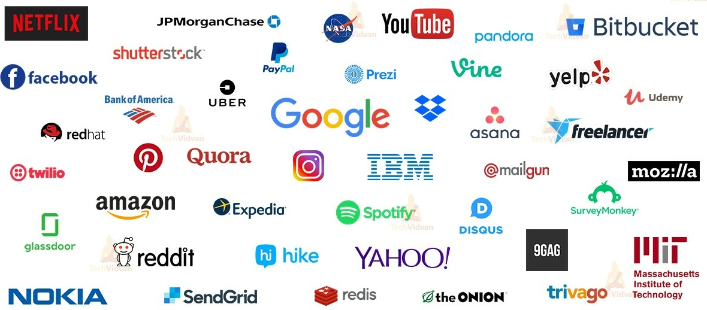
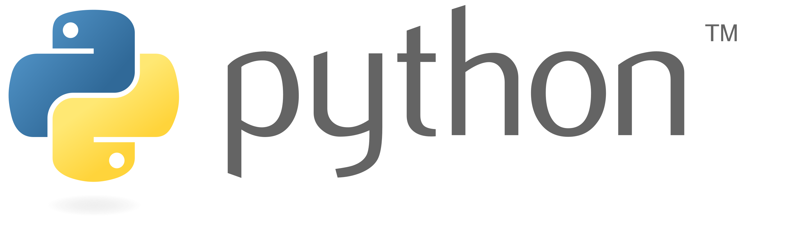
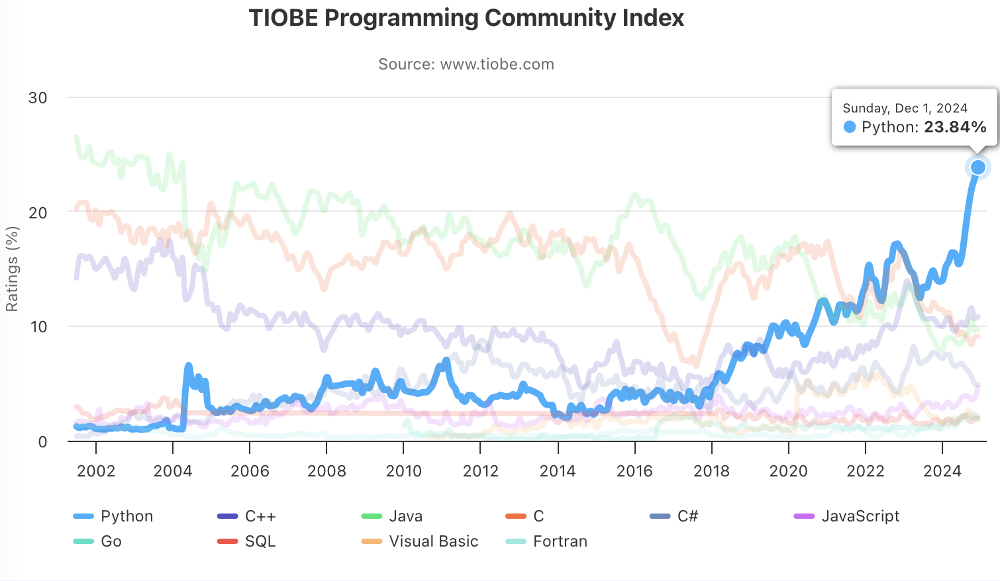
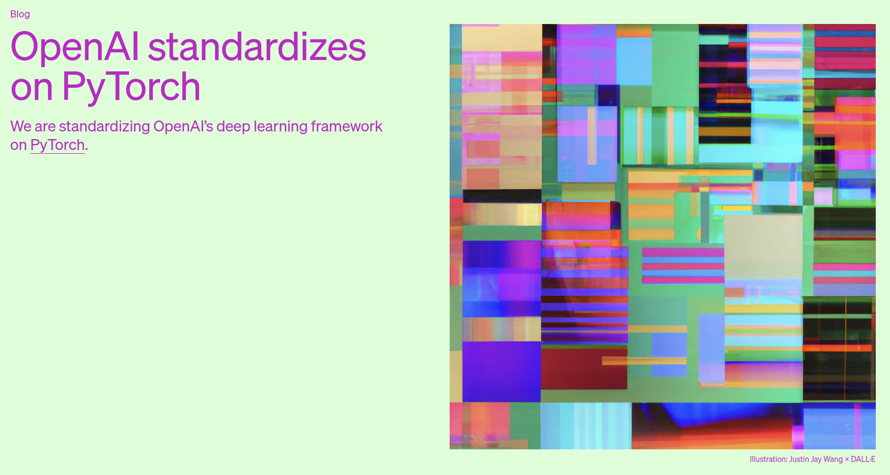
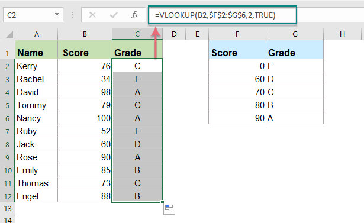
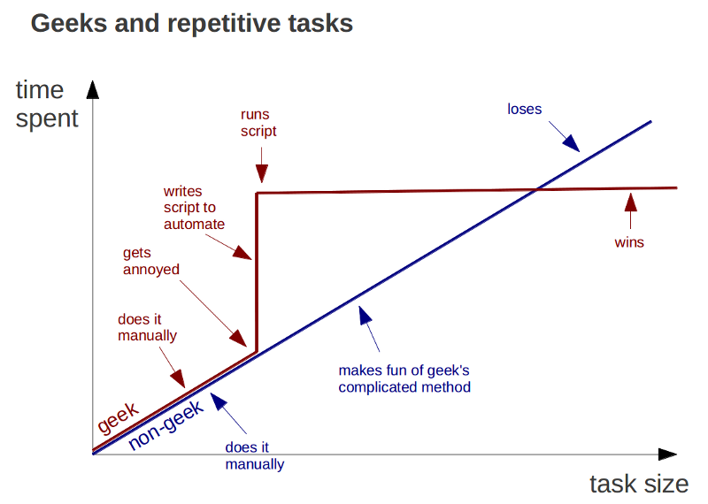
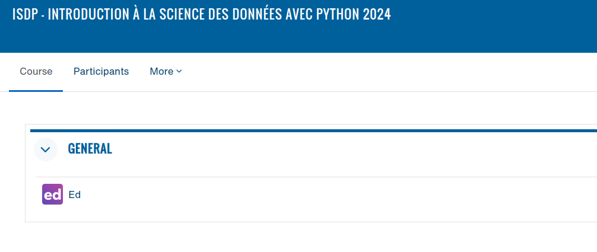
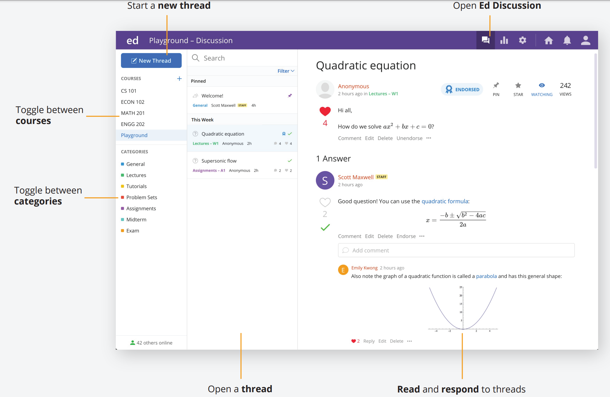
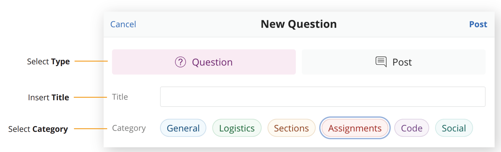
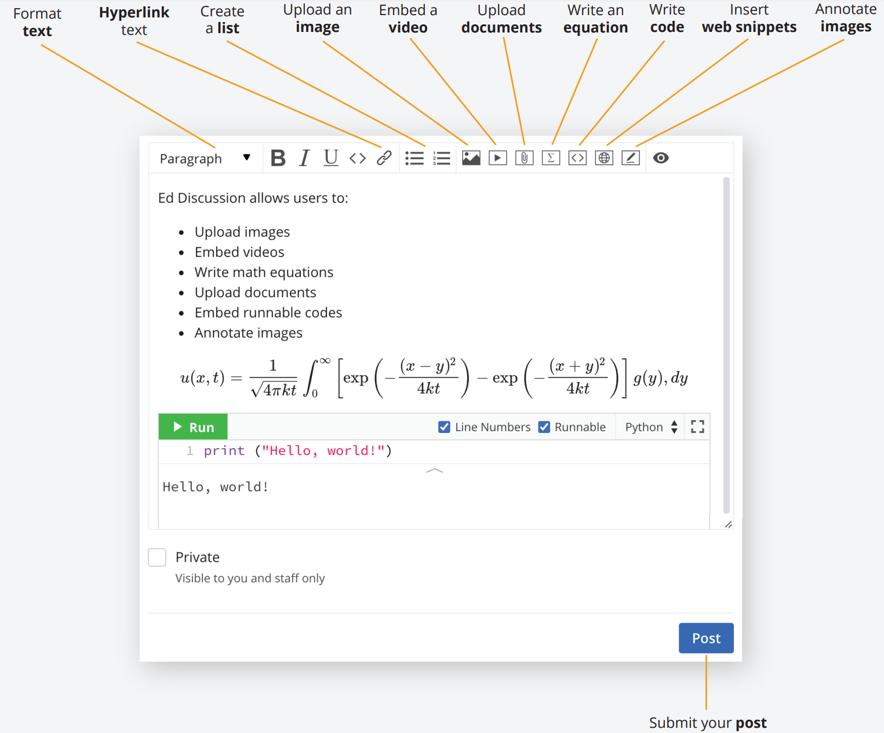

# Introduction

## Pourquoi apprendre à programmer?

> Everybody should learn to program a computer,
> because it teaches you how to think. (Steve Jobs)

OK, mais en pratique ?

::: {.columns}
::: {.column width="57%"}

* **Opportunités** professionnelles
* **Compétences** numériques
* **Automatisation** de tâches répétitives

:::
::: {.column width="43%"}

* **Analyse** de données
* **Créativité** et **innovation**
* **Résolution** de problèmes

:::
:::

* Monter sa propre entreprise et... **changer le monde**!

## Point commun pour ces compagnies ?

::: notes

* ... Python !

:::

## 

::: {layout="[[-1], [1], [-1]]"}

{fig-align="center"}

:::

## Populaire ?

::: footer
Plus d'informations sur le site du [TIOBE index](https://www.tiobe.com/tiobe-index/)
:::

::: notes

* Python est le langage de programmation le plus populaire en 2024 selon le TIOBE index.

:::

## IA ?

::: footer
Plus d'informations sur le blog d'[OpenAI](https://openai.com/blog/openai-pytorch)
:::

## Que peut-on faire avec Python ? {.smaller}

:::: {.columns}

::: {.column width="40%"}

* **Science des données**
  * Nettoyage, transformation, visualisation, modèles prédictifs
  * Examples: [Pandas](https://pandas.pydata.org/), [Numpy](https://numpy.org/), [SciPy](https://scipy.org/), [scikit-learn](https://scikit-learn.org/)
* **Intelligence artificielle**
  * Réseaux de neurones, ChatGPT, [OpenAI](https://openai.com/)
  * Examples: [PyTorch](https://pytorch.org/), [TensorFlow](https://www.tensorflow.org/)

:::

::: {.column width="60%"}

* **Développement web**
  * Sites web, API, applications, [Instagram](https://www.instagram.com/)
  * Examples: [Django](https://www.djangoproject.com/), [Flask](https://flask.palletsprojects.com/en/3.0.x/)
* **IoT**
  * Objets connectés
  * Examples: [Raspberry Pi](https://www.raspberrypi.org/), [MicroPython](https://micropython.org/) 
* **Big Data**
  * Traitement de données massives et orchestration de workflows
  * Examples: [PySpark](https://spark.apache.org/docs/latest/api/python/index.html), [Dask](https://www.dask.org/), [Airflow](https://airflow.apache.org/)
* **... et bien plus !**

:::

::::

## Un language de programation

:::: {.columns}
::: {.column width="45%"}

  * Inventé par Guido van Rossum en 1991
  * Polyvalent (web, science des données, IA, etc.)
  * Populaire (communauté active, bien documenté)
  * Open-source (gratuit et modifiable)
  
  <!-- * Multi-paradigme (impératif, orienté objet, fonctionnel). -->
:::

::: {.column width="55%"}

  * Simple à apprendre
  * Lisible (syntaxe claire/similaire à l'anglais)
  * Interprété (exécution immédiate ligne par ligne)
  * Multi-plateforme (Windows, Mac, Linux, etc.)

:::
::::

::: notes

* Language de programmation : 
  * Language de communication entre l'homme et la machine
  * Langage formel conçu pour communiquer des instructions à une machine, particulièrement un ordinateur.

:::

## Excel ? {visibility="hidden"}

## Avantages de Python {visibility="hidden"}

:::: {.columns}
::: {.column #vcenter width="52%"}

* Prise en charge de plus grands ensembles de données
* Capacités de manipulation de données plus puissantes
* Plus performant
* Gratuit et open source
* Automatisation plus facile
* Meilleure reproductibilité

:::

::: {.column #vcenter width="48%"}

:::
::::

## Plan de cours {.smaller}

:::: {.columns}
::: {.column width="50%"}
| #  | Thème |
|-------|-------|
| 1 | Introduction & motivation |
| 2 | Variables |
| 3 | Collections |
| 4 | Fonctions |
| 5 | Sélections et conditions |
| 6 | Itérations et boucles |
:::

::: {.column width="50%"}

:::

::::

# EdStem

## Qu'est-ce qu'EdStem ?

* Une plateforme de Q&A interactive et sociale. 

* Un outil de présentation de contenu
  * offrant une expérience d’apprentissage interactive,
  * permettant d’expérimenter et résoudre des problèmes de programmation avec des défis gamifiés. 

* Un environnement de développement collaboratif vous donnant l’occasion de coder ensemble en temps réel. 

## Comment se connecter

* Accès à la page Moodle du cours:
* Ensuite, cliquer sur le lien Ed.

<!--  -->

## Ed Discussion

## Poser une question

::: {.columns}
::: {.column #vcenter width="50%"}

:::
::: {.column #vcenter width="50%"}

:::
:::
