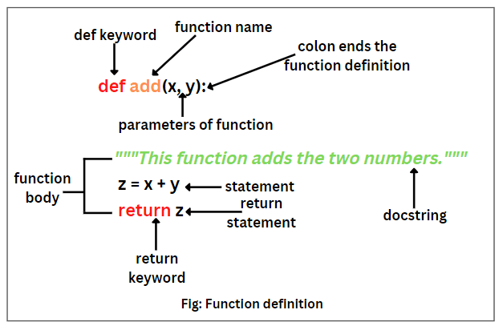
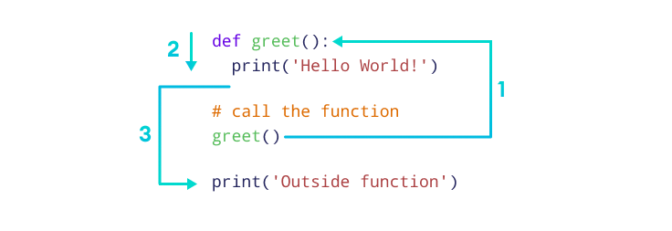
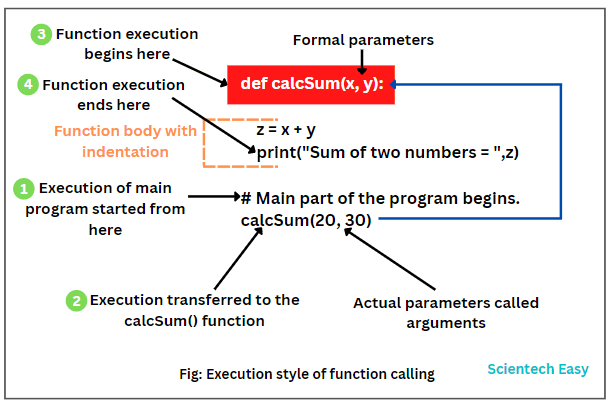

## Aujourd'hui

* Fonctions :

  * Définition,
  * Syntaxe,
  * Appel,
  * Paramètres,
  * Valeurs de retour.

<!--* Portée des variables et règles LEGB.-->

::: notes

**Fonctions**

- **Définition :**  
  Une fonction est un bloc de code réutilisable, qui effectue une tâche spécifique et peut prendre des paramètres, effectuer des opérations et renvoyer des résultats.

- **Syntaxe :**  
  Une fonction est définie avec le mot-clé `def`, suivi du nom de la fonction et d'une liste de paramètres entre parenthèses. Le corps de la fonction est indenté.

  Exemple :  
  `def ma_fonction(param1, param2):`

- **Appel :**  
  Pour exécuter une fonction, il suffit de l'appeler par son nom suivi des arguments entre parenthèses.

  Exemple :  
  `ma_fonction(valeur1, valeur2)`

- **Paramètres :**  
  Les fonctions peuvent accepter des paramètres, qui sont des valeurs d'entrée que vous passez lors de l'appel de la fonction. Il peut y avoir des paramètres par défaut et des paramètres facultatifs.

- **Valeurs de retour :**  
  Une fonction peut renvoyer une valeur avec le mot-clé `return`. Cela permet de récupérer le résultat d'une opération.

  Exemple :  
  `return resultat`

---

<!--
**Portée des variables et règles LEGB**

- **LEGB** (Local, Enclosing, Global, Built-in) est l'ordre de recherche des variables en Python. Lorsque vous utilisez une variable dans une fonction, Python la cherche dans cet ordre :
  - **Local** : variables définies à l'intérieur de la fonction.
  - **Enclosing** : variables définies dans les fonctions englobantes (niveaux supérieurs).
  - **Global** : variables définies au niveau global du module.
  - **Built-in** : variables ou fonctions prédéfinies par Python.
-->
:::


## Fonction

* **Définition :** un bloc de code qui ne s'exécute que lorsqu'il est appelé par son nom et peut :
  
    * Prendre des paramètres/arguments en entrée.
  
    * Effectuer des opérations.
  
    * Renvoyer des valeurs.

* A quoi ça sert ?

  * Réduire la duplication.
  * Décomposer des problèmes complexes.
  * Améliorer la lisibilité.

::: notes

**Les fonctions en Python**

**Définition :**  une fonction est un bloc de code qui ne s'exécute que lorsqu'il est appelé par son nom. Une fonction peut :

  - Prendre des **paramètres** ou **arguments** en entrée.
  - Effectuer des **opérations** spécifiques à l'intérieur du bloc.
  - **Renvoyer** une ou plusieurs valeurs en sortie.

**Pourquoi utiliser des fonctions ?**

Les fonctions sont essentielles pour les raisons suivantes : 

- **Réutilisabilité** :  
  Les fonctions permettent d'écrire une fois du code que l'on peut réutiliser plusieurs fois dans différents contextes.
  
- **Réduction du code** :  
  Elles évitent d'avoir à réécrire le même code plusieurs fois, ce qui facilite les modifications et la maintenance.

- **Lisibilité** :  
  Elles permettent de rendre le code plus clair et structuré et le rendent ainsi plus faciles à comprendre.
  
- **Modularité** :  
  Les fonctions permettent de structurer un programme en le divisand en blocs logiques plus simples et indépendantes. C'est une manière de  décomposer les problèmes complexes.

- **Évolutivité** :  
  Elles permettent de rendre le programme plus évolutif, en facilitant l'ajout de nouvelles fonctionnalités sans avoir à réécrire le code existant.
:::


## Création de fonctions



::: notes
Cette image explique comment définir une fonction, ainsi que sa structure :

- **def keyword** : Le mot-clé `def` est utilisé pour définir une fonction.
  
- **Function name** : Le nom de la fonction ici est `add`.
  
- **Parameters of function** : Les paramètres formels `x, y` sont les entrées de la fonction.
  
- **Function body** : Le corps de la fonction contient des instructions, ici `z = x + y`.

- **Return statement** : La fonction utilise `return z` pour renvoyer la valeur calculée.

- **Docstring** : Une chaîne de documentation (docstring) est utilisée pour décrire ce que fait la fonction. Ici, la docstring est : `"This function adds the two numbers."`.

:::


## Création de fonctions

```python
def nom_de_la_fonction(param1, param2, ...):
    # bloc de code
    return valeur
```

* Syntaxe pour créer une fonction :
  * `def` : mot-clé pour définir une fonction.
  * `nom_de_la_fonction` : nom de la fonction.
  * `(` `)` : début et fin de la déclaration des paramètres.
  * `param1, param2, ...` : paramètres de la fonction.
  * `:` indique la fin de la déclaration de la fonction.
  * `# bloc de code` : code à exécuter.
  * `return` : mot-clé pour renvoyer une `valeur`.


::: notes 
**Création de fonctions**

- **`def`** : mot-clé qui marque le début de la déclaration d'une fonction.
- **`nom_de_la_fonction`** : nom que vous donnez à la fonction.
- **`(` & `)`** : délimitent la déclaration des paramètres de la fonction.
- **`param1, param2, ...`** : les paramètres sont les variables que vous passez à la fonction.
- **`:`** : marque la fin de la déclaration de la fonction et le début du bloc de code.
- **`bloc de code`** : l'ensemble des instructions que la fonction exécutera lorsqu'elle sera appelée.
- **`return`** : mot-clé utilisé pour renvoyer une valeur depuis la fonction. Si une fonction n'a pas de `return`, elle renverra implicitement `None`.
:::


## Bonnes pratiques de nommage

- **Descriptif** :  le nom de la fonction doit indiquer clairement ce qu'elle fait, par exemple: `calculer_somme`, `afficher_message`.
  
- **Utilisation des verbes** :  les noms de fonctions commencent souvent par un verbe, car elles effectuent une action.

- **Respecter les conventions** :  en Python, les noms de fonctions sont généralement en minuscules, avec des mots séparés par des symbôles "tiret bas" `_` (underscores).

::: notes

**Bonnes pratiques de nommage pour les fonctions**

- **Descriptivité** :
  - Le nom d'une fonction doit clairement refléter **son rôle ou son effet**. Cela améliore la lisibilité du code, facilite la compréhension rapide, et permet une maintenance plus aisée.

- **Verbes en début de nom** :
  - Une fonction exécute une **action**, il est donc logique de commencer son nom par un verbe, comme :
    - `afficher_message`, `envoyer_email`, `calculer_moyenne`, `lire_fichier`.

- **Conventions Python** :
  - En Python, les noms de fonctions suivent la **convention snake_case** :
    - lettres **minuscules**,
    - **underscore** (`_`) pour séparer les mots,
    - pas d’espaces, pas de majuscules.
  - Exemple conforme : `verifier_condition`, et non `VerifierCondition` ou `verifierCondition`.

- Ces bonnes pratiques rendent le code plus clair, cohérent, et conforme aux standards de la communauté Python.

:::


## Appel de fonction

* Une fois définie, la fonction peut alors être appelée en utiliant : 

  * le nom de la fonction,
  * suivi des `(` & `)`,
  * avec les paramètres nécessaires, s'il y en a.

* Exemples :

::: {.columns}
::: {.column width="50%"}

```{python}
def afficher_message():
    print("Hello")

afficher_message()
```
:::
::: {.column width="50%"}
```{python}
def calculer_somme(a, b):
    print(a + b)

calculer_somme(2, 3)
```
:::
:::


::: notes

**Appel de fonction**

Une fonction peut être appelée après sa définition en respectant la syntaxe suivante :

- Utilisez le **nom de la fonction**.
- Ajoutez les **parenthèses** `(` et `)`.
- Passez les **paramètres nécessaires** dans ces parenthèses.

---

Exemple d'une fonction sans paramètre :  
`def hello(): return "Hello"`, puis `hello()` appelle la fonction et renvoie `"Hello"`.

Exemple d'une fonction avec des paramètres :  
`def addition(a, b): return a + b`, puis `addition(2, 3)` appelle la fonction et renvoie `5`.

:::


## Appel de fonction


* Comportement d'appels de fonction :

  1. Le programme principal appelle la fonction.
  2. La fonction est exécutée.
  3. Le contrôle revient au programme principal.

<!---->


:::notes
Cette image montre comment une fonction est appelée dans un programme Python :

1. Le programme appelle la fonction `greet()` à partir de la partie principale du programme (`# call the function`). 

2. La fonction `greet()` est définie avec `def greet():`. L'exécution entre dans la fonction à ce moment-là et affiche le message `Hello World!`. 

3. Après l'exécution de la fonction `greet()`, le programme principal continue et affiche `Outside function`.

Cela illustre un flux d'exécution simple, où une fonction est définie, puis appelée, et enfin le programme reprend une exécution normale.
:::

## Appel de fonction  (autre exemple)



::: notes

Cette image illustre le processus d'appel de fonction en Python, c'est-à-dire comment un programme principal appelle une fonction (en passant des arguments), et comment la fonction s'exécute avant de revenir à la suite du programme principal. Voici les processus étape après étape :

1. L'exécution du programme principal commence à l'endroit indiqué avec `# Main part of the program begins`.
  
2. L'exécution est transférée à la fonction `calcSum()` avec les arguments `20` et `30` (appelés *arguments réels*).
  
3. L'exécution de la fonction commence lorsque la définition de la fonction `def calcSum(x, y):` est atteinte, où `x` et `y` sont les *paramètres formels*.
Le corps de la fonction est alors exécuté, où `z = x + y` est calculé et le résultat est affiché avec `print`.

4. Finalement, l'exécution de la fonction se termine et le contrôle retourne à la partie principale du programme.

:::


## Valeurs de retour
  
* Une fonction peut renvoyer une valeur après son exécution.
* Deux types de fonctions :

::: {.columns}
::: {.column width="50%"}


* **Fonctions sans retour** :

  * ne revoient pas de résultat (`None`)
  * comme `print()`


```{python} 
def calculer_somme(a, b):
  print(a + b)


calculer_somme(2, 3)
```

:::
::: {.column width="50%"}


* **Fonctions avec retour** :

  * retournent une valeur grâce au mot-clé `return`
  * comme `sum()`


```{python} 
def calculer_somme(a, b):
  return a + b

somme = calculer_somme(2, 3)
print(somme)
```


:::
:::


::: notes

**Valeurs de retour**

Il existe deux types de fonctions :  

- **Fonctions avec retour** : celles qui retournent une valeur après traitement (comme `sum()`).
- **Fonctions sans retour** : celles qui exécutent une action sans renvoyer de résultat (comme `print()`).
  
**Pourquoi utiliser des valeurs de retour ?** :  
Elles permettent de récupérer le résultat d'une fonction pour l'utiliser ailleurs dans le programme.

**Valeurs de retour avec `return`** :
Une fonction peut renvoyer une valeur en utilisant le mot-clé **`return`**. Cela permet d'utiliser le résultat de la fonction dans d'autres calculs ou opérations.

  Exemple :  
  `def addition(a, b): return a + b`  
  L'appel `addition(2, 3)` renvoie `5`, et cette valeur peut être utilisée pour d'autres opérations, comme `addition(2, 3) + 1`.

Si une fonction ne renvoie aucune valeur, elle renverra implicitement **`None`**. Cela arrive lorsqu'il n'y a pas de **`return`** explicite.

  Exemple :  
  `def hello1(): return "Hello"` renvoie `"Hello"` et retourne un type `str`.  
  `def hello2(): print("Hello")` ne renvoie aucune valeur explicite et retourne donc `None`.

Ces concepts sont essentiels pour manipuler et utiliser les résultats des fonctions dans les programmes.

:::


## Valeurs de retour multiples

* Plusieurs valeurs peuvent être retournées en les séparant par des virgules :

```{python}
def calculer(a, b):
    return a + b, a - b

addition, soustraction = calculer(2, 3)
print(addition, soustraction)
```

* Une collection (`tuple`, `liste`, `dictionnaire`, etc.) peut aussi être utilisée pour renvoyer plusieurs valeurs :

```{python}
def calculer(a, b):
    return [a + b, a - b]

resultats = calculer(2, 3)
print(resultats)
```


::: notes

**Valeurs de retour multiples**

- Une fonction peut renvoyer plusieurs valeurs séparées par des virgules. Ces valeurs seront renvoyées sous forme de **tuple** et peuvent être affectées à plusieurs variables.

  Exemple :  
  `def calculer(a, b): return a + b, a - b`  
  L'appel `addition, y = calculer(2, 3)` affecte `addition = 5` et `soustraction = -1`.

- Une autre approche consiste à utiliser une **collection** comme un `tuple`, une `liste`, ou un `dictionnaire` pour organiser les valeurs de retour. Cela permet de renvoyer des données structurées.

  Exemple :  
  `def calculer(a, b): return [a + b, a - b]`  
  L'appel `resultats = calculer(2, 3)` renvoie une liste avec les résultats de l'addition et de la soustraction sous forme de paires clé-valeur.

Ces techniques permettent de gérer plusieurs résultats à partir d'une seule fonction.

:::


## Paramètres / arguments

* Les paramètres (ou arguments) sont :

  * les valeurs passées à la fonction lors de son appel.
  * définis dans la déclaration de la fonction.
  * utilisés dans le corps de la fonction.
  * de différents types (entiers, chaînes, listes, etc.)
  * obligatoires ou optionnels
  <!--* positionnels ou nommés -->
  <!--* individuels ou multiples.-->

```python
def nom_de_la_fonction(param1, param2=2):
    # bloc de code
    return valeur
```

<!--
```python
def fonction(param1, param2=2, *args, **kwargs):
    # bloc de code
    return valeur
```

* `param1` : paramètre obligatoire.
* `param2` : paramètre optionnel (avec valeur par défaut).
* `*args` : paramètres multiples.
* `**kwargs` : paramètres multiples nommés.
-->

::: notes

**Paramètres / arguments**

- **Définition :**  
  Les paramètres sont des noms utilisés lors de la définition de la fonction pour représenter les valeurs qui lui seront transmises lorsqu'elle sera appelée.

---

**Types de paramètres**


```python
def nom_de_la_fonction(param1, param2=2):
    # bloc de code
    return valeur
```

* `param1` : paramètre obligatoire.
* `param2` : paramètre optionnel (avec valeur par défaut).


- **Paramètre obligatoire** :  
  Un paramètre qui doit être fourni lors de l'appel de la fonction.  
  Exemple : `param1`.

- **Paramètre optionnel** :  
  Un paramètre avec une **valeur par défaut**. Si ce paramètre n'est pas fourni lors de l'appel, il prend la valeur par défaut.  
  Exemple : `param2=2`.

<!--
- **Paramètres multiples** :  
  Utilisez **`*args`** pour passer un nombre indéfini d'arguments sous forme de tuple. Cela permet d'accepter plusieurs paramètres sans les définir explicitement.

- **Paramètres nommés multiples** :  
  Utilisez **`**kwargs`** pour accepter des arguments nommés supplémentaires sous forme de dictionnaire. Cela permet de passer des paramètres nommés sans les définir au préalable.

---

Exemple :  
La fonction `def fonction(param1, param2=2, *args, **kwargs):` peut être appelée de plusieurs façons en jouant avec les paramètres obligatoires, optionnels, multiples (`*args`), ou nommés (`**kwargs`).
-->
:::


## Paramètres obligatoires / optionnels


```{python}
def puissance(x, y=2):
    return x ** y
```

* `x` est **obligatoire** et doit être fourni lors de l'appel de la fonction.
* `y` est **optionnel** et une la valeur par défaut (`2`) est utilisée si aucune valeur n'est fournie lors de l'appel.

<p>
```{python}
#| error: true
#| output-location: column
print(puissance(2, 3))
print(puissance(2))
print(puissance())
```
</p>

::: notes

**Paramètres obligatoires/optionnels**

- **Paramètre obligatoire** :  
  Un paramètre qui **doit** être fourni lors de l'appel de la fonction. Si ce paramètre n'est pas passé, une erreur sera générée.

- **Paramètre optionnel** :  
  Un paramètre qui a une **valeur par défaut**. Si l'appel de la fonction ne fournit pas de valeur pour ce paramètre, la valeur par défaut sera utilisée.

- **Pourquoi des paramètres optionnels ?** :  
  Cela permet de rendre une fonction plus flexible en offrant des comportements par défaut tout en laissant la possibilité de personnaliser l'exécution.
---

Exemple :  
Dans `def puissance(x, y=2):`, `x` est obligatoire, tandis que `y` est optionnel avec une valeur par défaut de `2`.  

- `puissance(2, 3)` renvoie `5` car les deux paramètres sont fournis.
- `puissance(2)` renvoie `4` car seule `x` est donnée, et `y` prend sa valeur par défaut.
- `puissance()` génère une erreur car le paramètre obligatoire `x` n'est pas fourni.

:::


## Paramètres nommés

* Les paramètres nommés sont passés par nom plutôt que par position.
* Cela permet de spécifier les valeurs des paramètres dans un ordre différent.
* Syntaxe `param=valeur` pour spécifier le nom du paramètre et sa valeur.

```{python}
def puissance(x, y):
    return x ** y

print(puissance(2, 3))
print(puissance(y=3, x=2))
```

::: notes

**Paramètres nommés**

- Les paramètres nommés sont utiles pour passer des arguments dans un **ordre différent** de celui défini dans la fonction.
  
- En utilisant la syntaxe **`param=valeur`**, vous pouvez spécifier explicitement le nom du paramètre et sa valeur lors de l'appel de la fonction.

---

Exemple :  
Dans la fonction `def puissance(x, y):`, vous pouvez appeler la fonction en passant les arguments par nom, ce qui permet de changer leur ordre :  

- `puissance(2, 3)` renvoie `5`, en respectant l'ordre initial des paramètres.
- `puissance(y=3, x=2)` renvoie également `5`, mais les paramètres sont passés dans un ordre différent grâce à la spécification `param=valeur`.

:::


<!--
## Paramètres multiples

* Si on ne sait pas à l'avance combien de paramètres seront passés à une fonction :

  * `*` (p.ex. `*args`): la fonction reçoit un tuple.
  * `**` (p.ex. `*kwargs`): la fonction reçoit un dictionnaire.

::: {.columns}
::: {.column width="43%"}
```{python}
def addition(*nombres):
  print(nombres)
  return sum(nombres)

print(addition(2, 3, 4))
print(addition(2, 3, 4, 5))
```
:::
::: {.column width="56%"}
```{python}
def addition(**nombres):
  print(nombres)
  return sum(nombres.values())

print(addition(a=2, b=3, c=4))
print(addition(a=2, b=3, c=4, d=5))
```
:::
:::

::: notes

**Paramètres multiples**

- Lorsque vous ne savez pas à l'avance combien de paramètres seront passés à une fonction, vous pouvez utiliser :
  - **`*args`** : La fonction recevra les paramètres sous forme de **tuple**.
  - **`**kwargs`** : La fonction recevra les paramètres sous forme de **dictionnaire** avec des paires clé-valeur.

---

- **`*args`** :  
  Utilisé pour capturer un nombre variable d'arguments positionnels dans un tuple.  
  Exemple : `def addition(*nombres):` permet de passer plusieurs nombres à additionner, comme `addition(2, 3, 4)` ou `addition(2, 3, 4, 5)`.

- **`**kwargs`** :  
  Utilisé pour capturer un nombre variable d'arguments nommés dans un dictionnaire.  
  Exemple : `def addition(**nombres):` permet de passer plusieurs paires clé-valeur à additionner, comme `addition(a=2, b=3, c=4)` ou `addition(a=2, b=3, c=4, d=5)`.

Ces deux mécanismes permettent une grande flexibilité dans la définition de fonctions acceptant des paramètres dynamiques.

:::
-->


## Portée des variables

* La portée d'une variable détermine où elle peut être utilisée dans le programme, c'est-à-dire où elle est accessible/lisible.

  * **Portée locale :** variable déclarée à l'intérieur d'une fonction.
  * **Portée globale :** variable déclarée dans le programme principale, à l'extérieur de toute fonction.

<p>
```{python}
#| error: true
#| output-location: column
x = 10
def afficher_nombres():
  y = 3
  print(x)
  print(y)

afficher_nombres()
print(x)
print(y)
```
</p>

::: notes

**Portée des variables**

**Définition :**  
La portée d'une variable détermine l'endroit où elle peut être utilisée dans le programme.

- **Portée locale :**  
  Une variable déclarée à l'intérieur d'une fonction. Elle est uniquement accessible dans cette fonction et disparaît une fois la fonction terminée.

- **Portée globale :**  
  Une variable déclarée en dehors de toute fonction. Elle est accessible partout dans le programme, y compris dans les fonctions, sauf si une variable locale portant le même nom est définie à l'intérieur de la fonction.

**Pourquoi cette distinction ?** :  
Elle permet de mieux organiser le code et d'éviter les conflits entre différentes parties du programme.

Dans l'exemple donné, `x` est une variable globale accessible dans la fonction, tandis que `y` est une variable locale accessible uniquement à l'intérieur de `afficher_nombres()`.

:::

<!--
## Fonctions imbriquées (Nested Functions)

* **Définition :** une fonction définie à l'intérieur d'une autre fonction. 
* Permet de limiter la portée de la fonction interne à l'intérieur de la fonction englobante.

```{python}
def outer_function():
    def inner_function():
        print("Fonction imbriquée")
    inner_function()

outer_function()
```

::: notes

- **Fonctions imbriquées** :  
  Une fonction imbriquée est une fonction définie à l'intérieur d'une autre fonction. Cela permet d'encapsuler des sous-fonctions et de les rendre accessibles uniquement dans le contexte de la fonction qui les englobe.

- **Portée** :  
  Les fonctions imbriquées ont accès aux variables de la fonction englobante, conformément aux règles de portée **LEGB** (Local, Enclosing, Global, Built-in).

- **Utilité** :  
  Les fonctions imbriquées sont utiles lorsqu'une fonction doit accomplir plusieurs tâches internes qui ne doivent pas être exposées à l'extérieur. Cela permet de garder le code organisé et de réduire les risques de conflits de noms de variables.

- **Exemple** :  
  Dans cet exemple, la fonction `inner_function` est définie à l'intérieur de `outer_function`, et elle n'est accessible que dans ce contexte. Lorsque `outer_function` est appelée, elle appelle ensuite `inner_function` pour exécuter une tâche.

:::


## Règles LEGB {.smaller}

* **Définition :** ordre de recherche des variables.

  * **Local (L) :** à l'intérieur de la fonction.

  * **Enclosing (E) :** à l'intérieur d'une fonction englobante.

  * **Global (G) :** à l'extérieur de toutes les fonctions.

  * **Built-in (B) :** prédéfini dans Python.


::: {.columns}
::: {.column width="33%"}

```{python}
def f1():
  x = 10
  return 2 * x

def f2():
  return 2 * x
```
:::
::: {.column width="33%"}
```{python}
def f3():
  x = 15
  def f2():
      return 2 * x
  return f2()
```
:::
::: {.column width="33%"}
```{python}
def f4():
  x = 15
  return f2()
```
:::
:::

<p>
```{python}
#| output-location: fragment
x = 5
print(f1(), f2(), f3(), f4())
```
</p>

::: notes

**Règles LEGB**

- **Définition :**  
  Les règles **LEGB** définissent l'ordre de recherche des variables dans Python lorsque vous essayez d'accéder à une variable dans une fonction.

  - **Local (L)** :  
    Recherche dans la fonction locale où la variable est utilisée.

  - **Enclosing (E)** :  
    Recherche dans les fonctions englobantes (fonctions contenant d'autres fonctions).

  - **Global (G)** :  
    Recherche dans l'espace de nommage global (à l'extérieur de toutes les fonctions).

  - **Built-in (B)** :  
    Recherche dans les variables et fonctions prédéfinies par Python.

Dans l'exemple donné, les fonctions démontrent comment Python recherche les variables d'abord dans l'espace local, puis dans l'englobant, ensuite dans l'espace global, et enfin dans les variables intégrées de Python.

:::

## Fonctions récursives

* **Définition :** une fonction qui s'appelle elle-même pour résoudre un problème. 
* On l'oppose à une **fonction itérative** qui utilise des "boucles" pour accomplir la même tâche.

::: {.columns}
::: {.column width="50%"}

```{python}
def factorial_recursive(n):
  if n == 1:
    return 1
  return n * factorial_recursive(n - 1)


print(factorial_recursive(5))
```

:::
::: {.column width="50%"}

```{python}
def factorial_iterative(n):
    result = 1
    for i in range(2, n + 1):
        result *= i
    return result

print(factorial_iterative(5)) 
```

:::
:::

::: notes

- **Fonctions récursives** :  
  Une fonction récursive est une fonction qui s'appelle elle-même. Elle permet de résoudre des problèmes en les divisant en sous-problèmes plus petits de même nature. La récursivité est particulièrement utile pour des algorithmes tels que la traversée d'arbres ou le calcul de la factorielle.

- **Comparaison récursive vs non récursive** :  
  Dans l'exemple ci-dessus, la **fonction récursive** `factorial_recursive()` s'appelle elle-même pour calculer la factorielle de `n`. À chaque appel, elle réduit le problème en appelant la fonction avec `n-1` jusqu'à atteindre la condition de base (`n == 1`).
  
  En revanche, la **fonction non récursive** `factorial_iterative()` utilise une boucle pour calculer le même résultat, multipliant les nombres de `2` à `n` et stockant le résultat dans une variable intermédiaire.

- **Avantages et inconvénients** :
  - **Récursif** : Plus élégant et plus proche de la définition mathématique, mais peut entraîner une consommation de mémoire importante si la profondeur d'appel est élevée (empilement des appels).
  - **Non récursif (itératif)** : Utilise des boucles pour éviter l'empilement des appels de fonction, souvent plus efficace en termes de mémoire.

- **Utilité** :  
  Les fonctions récursives sont particulièrement utiles dans les algorithmes qui peuvent être naturellement divisés en sous-problèmes similaires, comme les algorithmes de tri (ex. quicksort) ou les algorithmes de recherche dans les arbres.

:::


## Expression `lambda`

* **Définition :** une fonction anonyme (i.e., sans nom).

* A quoi ça sert ?

  * Ne pas définir une fonction pour une opération simple ou ponctuelle.

* Syntaxe :

```python
lambda arguments: expression
```

* Exemple :

```{python}
addition = lambda a, b: a + b
print(addition(2, 3))
```

::: notes

**Expression `lambda`**

- **Définition :**  
  Une fonction **anonyme**, c'est-à-dire une fonction sans nom, définie en une seule ligne.

- **A quoi ça sert ?**  
  Les fonctions `lambda` sont utilisées pour des opérations simples ou ponctuelles, sans avoir à définir une fonction complète avec le mot-clé `def`. Elles sont souvent utilisées comme arguments pour d'autres fonctions.

- **Syntaxe :**  
  L'expression `lambda` se compose du mot-clé **`lambda`**, suivi des **arguments**, puis de l'**expression** qui est évaluée et renvoyée.

Dans l'exemple donné, une fonction lambda est utilisée pour additionner deux nombres, sans avoir à déclarer une fonction complète.

:::


## Utilisation des `lambda`

* Souvent utilisées pour des utilisations plus complexes.

* Comme paramètre :

```{python}
nombres = [1, 2, 3, 4, 5]
resultat = map(lambda x: x * 2, nombres)
print(list(resultat))
```

* Comme valeur de retour :

```{python}
def multiplicateur(n):
    return lambda x: x * n

double = multiplicateur(2)
triple = multiplicateur(3)
print(double(5), triple(5))
```


::: notes

**Utilisation des `lambda`**

- Les fonctions **`lambda`** sont souvent utilisées pour des opérations plus complexes, notamment comme **paramètres** dans des fonctions ou comme **valeurs de retour**.

---

- **Comme paramètre** :  
  Les fonctions `lambda` peuvent être passées comme arguments à d'autres fonctions, comme dans l'exemple avec **`map()`**. Ici, la fonction `lambda` multiplie chaque élément de la liste par 2.

- **Comme valeur de retour** :  
  Une fonction peut retourner une fonction `lambda`, comme dans l'exemple de la fonction **`multiplicateur()`**. Celle-ci renvoie une fonction qui multiplie un nombre par la valeur donnée (`n`). Par exemple, `double` multiplie par 2 et `triple` par 3.

Ces utilisations permettent d'ajouter des comportements flexibles et dynamiques aux fonctions.

:::

## Fonctions d'ordre supérieur {.smaller}

Les **fonctions d'ordre supérieur** (Higher-order functions) sont des fonctions qui acceptent d'autres fonctions en paramètre ou les renvoient en résultat.

```{python}
def appliquer(func, valeur):
    return func(valeur)

print(appliquer(lambda x: x * 2, 5))
```

En Python, il existe plusieurs **fonctions natives** d'ordre supérieur:

- **`map()`** : Applique une fonction aux élément d'une collection.
- **`filter()`** : Filtre les éléments d'une collection.
- **`reduce()`** : combine les éléments d'une collection en une seule valeur.
- **`sorted()`** : Trie les éléments d'une collection.
- **`any()` et `all()`** : Vérifient des conditions sur tous les éléments d'une collection.
- **`zip()`** : Combine plusieurs itérables élément par élément.


::: notes

- **Fonctions d’ordre supérieur** :  
  Ces fonctions sont dites d'ordre supérieur car elles prennent des fonctions en paramètre ou les renvoient en résultat. Elles sont essentielles en programmation fonctionnelle et permettent de rendre le code plus modulaire et réutilisable.

- **Fonctions natives de Python** :
  - **`map()`** : Applique une fonction à chaque élément d'un itérable.
  - **`filter()`** : Garde uniquement les éléments qui satisfont une condition.
  - **`reduce()`** : Combine les éléments d'une séquence en une seule valeur (nécessite l'import de `functools`).
  - **`sorted()`** : Trie une collection en fonction d'une clé définie.
  - **`any()` et `all()`** : Permettent de vérifier des conditions sur tous les éléments d'une séquence.
  - **`zip()`** : Permet de regrouper plusieurs itérables ensemble en fonction de leurs indices.

- **Utilité** :  
  Ces fonctions d’ordre supérieur facilitent les opérations sur des collections de données et permettent d'éviter l'utilisation de boucles explicites en appliquant des transformations ou des filtres de manière élégante et concise.

:::


## Fonctions d'ordre supérieur `map()`

La fonction **`map()`** applique une fonction à chaque élément d'une collection (comme une liste ou un tuple) et renvoie un itérateur contenant les résultats.

**Exemple :**
```{python}
nombres = [1, 2, 3, 4]
doubles = list(map(lambda x: x * 2, nombres))
print(doubles)
```

::: notes

- **Fonction `map()`** :  
  La fonction **`map()`** prend deux arguments : une fonction et une collection (comme une liste). Elle applique la fonction à chaque élément de la collection et renvoie un itérateur contenant les résultats de l'application de la fonction.

- **Utilité** :  
  **`map()`** est utile lorsque vous souhaitez appliquer une transformation identique à chaque élément d'une collection, sans avoir à écrire une boucle explicite.

- **Exemple détaillé** :  
  Dans l'exemple donné, la fonction lambda `lambda x: x * 2` est appliquée à chaque élément de la liste `nombres`. Le résultat est une nouvelle liste `doubles`, qui contient chaque nombre multiplié par 2 (soit [2, 4, 6, 8]).

- **Fonctionnement** :  
  **`map()`** retourne un itérateur, c'est pourquoi on utilise souvent `list()` pour convertir cet itérateur en une liste.

:::


## Fonctions d'ordre supérieur `filter()`

La fonction **`filter()`** permet de filtrer les éléments d'une collection en fonction d'une condition, et ne garde que ceux qui satisfont cette condition.

**Exemple :**
```{python}
nombres = [1, 2, 3, 4, 5, 6]
pairs = list(filter(lambda x: x % 2 == 0, nombres))
print(pairs) 
```

::: notes

- **Fonction `filter()`** :  
  La fonction **`filter()`** prend deux arguments : une fonction et une collection. Elle applique la fonction à chaque élément de la collection et renvoie un itérateur contenant uniquement les éléments pour lesquels la fonction renvoie `True`.

- **Utilité** :  
  **`filter()`** est utile pour extraire un sous-ensemble d'éléments d'une collection qui respectent une condition donnée, tout en éliminant ceux qui ne la satisfont pas.

- **Exemple détaillé** :  
  Dans cet exemple, la fonction lambda `lambda x: x % 2 == 0` est utilisée pour vérifier si chaque nombre de la liste `nombres` est pair. Seuls les nombres pairs (2, 4, 6) sont conservés dans la nouvelle liste `pairs`.

- **Fonctionnement** :  
  Le filtre n'altère pas les éléments eux-mêmes, mais il choisit lesquels garder dans le résultat. Il retourne un itérateur, c'est pourquoi on utilise `list()` pour convertir le résultat en une liste.

- **Différences avec `map()`** :  
  Alors que **`map()`** applique une transformation à chaque élément, **`filter()`** sélectionne uniquement les éléments qui remplissent une condition, sans les transformer.

:::

## Fonction `reduce()`

La fonction **`reduce()`** combine tous les éléments d'une collection en une seule valeur en appliquant une fonction cumulée.

**Exemple :**
```{python}
from functools import reduce
nombres = [1, 2, 3, 4]
somme = reduce(lambda a, b: a + b, nombres)
print(somme) 
```

::: notes

- **Fonction `reduce()`** :  
  La fonction **`reduce()`** prend une fonction et une collection (comme une liste). Elle applique la fonction de manière cumulative à tous les éléments de la collection pour les combiner en une seule valeur.

- **Utilité** :  
  **`reduce()`** est utile lorsque vous devez combiner ou agréger les éléments d'une collection en un seul résultat, comme calculer une somme, un produit, ou effectuer une réduction de données.

- **Exemple détaillé** :  
  Dans cet exemple, la fonction lambda `lambda a, b: a + b` est utilisée pour additionner tous les éléments de la liste `nombres`. **`reduce()`** applique cette fonction cumulativement, d'abord entre le premier et le deuxième élément, puis avec le troisième, et ainsi de suite, jusqu'à obtenir un résultat final (ici 10).

- **Fonctionnement** :  
  Contrairement à **`map()`** et **`filter()`**, qui renvoient des collections, **`reduce()`** renvoie une seule valeur, résultant de l'application cumulée de la fonction à tous les éléments.

- **Différences avec `map()` et `filter()`** :  
  **`map()`** transforme chaque élément de la collection et renvoie une nouvelle collection, tandis que **`filter()`** sélectionne certains éléments. **`reduce()`**, en revanche, combine tous les éléments en une seule valeur.

- **Remarque** :  
  **`reduce()`** n'est pas incluse dans le module de base de Python, mais dans le module **`functools`**, c'est pourquoi il faut l'importer avant de l'utiliser.

:::


## Fonction `sorted()`

La fonction **`sorted()`** permet de trier les éléments d'une collection (comme une liste, un tuple ou un itérable) et renvoie une nouvelle liste triée.

### Syntaxe de base :
```python
sorted(iterable, key=None, reverse=False)
```

- **`iterable`** : La collection à trier.
- **`key`** : Une fonction qui sert de critère pour le tri (facultatif).
- **`reverse`** : Si `True`, le tri est effectué en ordre décroissant.

### Exemple de base :
```{python}
nombres = [3, 1, 4, 1, 5]
trié = sorted(nombres)
print(trié) 
```

::: notes

- **Fonction `sorted()`** :  
  La fonction **`sorted()`** trie une collection d'éléments et renvoie une nouvelle liste triée. Elle ne modifie pas l'itérable d'origine, contrairement à la méthode **`.sort()`** qui agit directement sur les listes.

- **Paramètres** :
  - **`iterable`** : L'itérable que vous voulez trier (comme une liste, un tuple, etc.).
  - **`key`** (facultatif) : Permet de spécifier une fonction qui sera appliquée à chaque élément pour déterminer l'ordre de tri.
  - **`reverse`** (facultatif) : Un booléen qui, s'il est défini à `True`, effectue le tri en ordre décroissant.

- **Tri personnalisé avec `key`** :  
  Le paramètre **`key`** peut être utilisé pour spécifier une fonction de transformation avant le tri. Par exemple, vous pouvez trier une liste de chaînes de caractères par leur longueur ou trier des objets selon un attribut spécifique.

- **Exemple `reverse=True`** :  
  Pour trier une collection en ordre décroissant, utilisez l'argument **`reverse=True`**. Cela permet de trier du plus grand au plus petit, ou dans un ordre alphabétique inversé.

- **Utilité** :  
  **`sorted()`** est très flexible et peut trier tout type d'itérable, que ce soit des listes simples, des tuples, ou des objets plus complexes. Grâce à l'argument `key`, il est possible de personnaliser les critères de tri en fonction des besoins spécifiques.

:::

## `list.sort()` vs. `sorted()`

**`list.sort()`**:

 - **Modifie la liste** : Trie la liste en place, modifiant l'ordre des éléments d'origine.
- **Retourne `None`** : Ne renvoie aucune nouvelle liste, elle modifie directement la liste existante.

```{python}
nombres = [3, 1, 4, 1, 5]
nombres.sort()  # Modifie la liste en place
print(nombres)
```

**`sorted()`**:

- **Ne modifie pas la liste d'origine** : Crée une nouvelle liste triée sans toucher à la collection originale.
- **Renvoie une nouvelle liste** : une nouvelle liste triée.

```{python}
nombres = [3, 1, 4, 1, 5]
nombres_tri = sorted(nombres)  # Crée une nouvelle liste triée
print(nombres_tri)
```

::: notes

- **`list.sort()`** :  
  Cette méthode trie la liste en place, modifiant directement l'ordre des éléments de la liste d'origine. Elle ne renvoie pas de nouvelle liste, mais renvoie toujours `None`. Cela signifie que vous ne pouvez pas utiliser la sortie de `sort()` pour assigner à une nouvelle variable.

- **`sorted()`** :  
  La fonction **`sorted()`** renvoie une nouvelle liste triée, laissant l'itérable d'origine inchangé. Elle peut être utilisée pour trier tout type d'itérable (pas seulement des listes) et est idéale lorsque vous voulez conserver l'ordre initial de la collection d'origine.

- **Différence principale** :
  - **`list.sort()`** modifie directement l'objet sur lequel il est appelé et ne retourne rien.
  - **`sorted()`** ne modifie pas l'objet d'origine et renvoie une nouvelle liste triée.

- **Utilité** :
  - Utilisez **`list.sort()`** lorsque vous voulez modifier la liste d'origine directement.
  - Utilisez **`sorted()`** lorsque vous avez besoin de conserver la liste d'origine intacte et de travailler avec une version triée.

:::
 -->

<!--
## Fonctions génératrices (`yield`)

Les **générateurs** utilisent `yield` pour produire des valeurs une par une, permettant de travailler avec des séquences sans tout charger en mémoire.

**Exemple :**
```{python}
def compteur():
    for i in range(5):
        yield i
for val in compteur():
    print(val)
```

Note: `yield`  est lié au concept de lazy evaluation (évaluation paresseuse).

::: notes

En Python, lorsque vous utilisez `yield` dans une fonction, cela transforme la fonction en un générateur. Contrairement aux fonctions qui renvoient une valeur unique avec return, les générateurs avec `yield` produisent des valeurs une par une, sans évaluer ou calculer toutes les valeurs à l'avance.

- **Lazy Evaluation avec `yield`**:
  L'évaluation paresseuse signifie que les valeurs ne sont générées qu'au moment où elles sont demandées, et non toutes en même temps. Cela permet de travailler avec de grandes séquences de données sans les charger en mémoire d'un coup.

- **Générateurs** :  
  Les générateurs sont des fonctions qui produisent une séquence de valeurs au lieu de renvoyer une seule valeur. Ils utilisent le mot-clé **`yield`** pour renvoyer chaque valeur au lieu de **`return`**, ce qui permet à la fonction de conserver son état entre les appels.

- **Utilité** :  
  Les générateurs sont utiles pour parcourir de grandes séquences de données sans tout charger en mémoire. Ils sont couramment utilisés dans des situations où l'on souhaite itérer sur une collection d'éléments sans créer une liste complète.

- **Exemple** :  
  Dans cet exemple, le générateur `compteur()` renvoie une valeur à chaque itération. Le mot-clé **`yield`** permet de produire les valeurs une par une au lieu de toutes à la fois.

- **Différence avec `return`** :  
  Contrairement à **`return`**, qui termine l'exécution d'une fonction, **`yield`** suspend la fonction et la reprendra là où elle s'était arrêtée lorsque la fonction sera appelée à nouveau.

:::

## Fonctions = objets de première classe

En Python, les fonctions sont des **objets de première classe**. Cela signifie qu'elles peuvent être :

- Assignées à des variables
- Passées en tant qu'arguments à d'autres fonctions
- Renvoyées par une fonction
- Stockées dans des structures de données


::: {.columns}
::: {.column width="50%"}
Exemple : Assigne une fonction à une variable.
```{python}
def say_hello():
    return "Bonjour"

my_function = say_hello  
print(my_function())
```

:::
::: {.column width="50%"}
Exemple : Passe une fonction en argument. 
```{python}
def apply(fonction, valeur):
    return fonction(valeur)

def double(x):
    return x * 2

print(apply(double, 5))
```

:::
:::


::: notes

- **Fonctions en tant qu'objets de première classe** :  
  En Python, les fonctions peuvent être manipulées comme des objets ordinaires. Cela signifie qu'elles peuvent être assignées à des variables, stockées dans des listes, ou passées en tant qu'arguments à d'autres fonctions. Cette propriété permet de traiter les fonctions comme des valeurs, de les manipuler et de les réutiliser de manière flexible.

- **Assignation de fonctions à des variables** :  
  Les fonctions peuvent être assignées à des variables et appelées ultérieurement via ces variables. Cela permet de créer des alias ou des raccourcis pour des fonctions, voire de les redéfinir dynamiquement.

- **Passage de fonctions en argument** :  
  Une fonction peut être passée en tant qu'argument à une autre fonction, ce qui permet d'abstraire la logique et de rendre le code plus flexible. Dans l'exemple 2, la fonction `doubler` est passée à la fonction `appliquer`, qui l'utilise pour doubler la valeur de l'argument donné.

- **Retourner une fonction** :  
  Il est également possible de renvoyer une fonction depuis une autre fonction. Cela permet de créer des **fonctions fabriques** ou des **fermetures** (closures) qui peuvent capturer un environnement particulier et générer des comportements spécifiques en fonction du contexte.

- **Exemple avancé : Retourner une fonction**
```python
def create_multiplier(n):
    def multiplier(x):
        return x * n
    return multiplier

double = create_multiplier(2)
triple = create_multiplier(3)

print(double(5))  # Affiche 10
print(triple(5))  # Affiche 15
```
  Ici, la fonction `create_multiplier` renvoie une fonction imbriquée qui multiplie son argument par la valeur de `n` passée lors de la création. Cela illustre comment une fonction peut capturer des variables et créer un comportement spécifique.

- **Utilisation courante** :  
  Le fait que les fonctions soient des objets de première classe permet des paradigmes de programmation fonctionnelle, tels que le passage de fonctions en tant qu'arguments dans des fonctions comme `map()`, `filter()`, et `reduce()`. Cela offre une grande flexibilité et simplifie la gestion des actions répétitives ou modulaires.

:::


## Fonctions de rappel (Callbacks)

En Python, les **fonctions de rappel (callbacks)** sont des fonctions passées en tant qu'argument à une autre fonction, qui les appelle plus tard pour accomplir une tâche spécifique. 


```{python}
def traitement(data, callback):
    result = data * 2
    callback(result)

def affichage(result):
    print(f"Le résultat est {result}")

traitement(5, affichage) 
```


Cela est possible grâce au fait que les **fonctions sont des objets de première classe**, ce qui permet de les manipuler comme n'importe quelle autre valeur.

::: notes

- **Fonctions en tant qu'objets de première classe** :  
  Comme vu précédemment, les fonctions en Python peuvent être passées en paramètre à d'autres fonctions. Cela permet de créer des **callbacks**, où une fonction est passée en argument à une autre pour être exécutée plus tard. Cette flexibilité est une conséquence directe du fait que les fonctions sont des objets de première classe en Python.

- **Fonctions de rappel (Callbacks)** :  
  Une fonction de rappel est une fonction qui est passée en tant qu'argument à une autre fonction et qui est appelée après qu'une certaine opération a été effectuée. Cela permet de séparer la logique d'une opération du traitement des résultats, rendant le code plus modulaire.

- **Exemple détaillé** :  
  Dans cet exemple, la fonction `traitement` effectue une opération sur `data` (multiplier par 2), puis appelle la fonction `callback` (ici, `affichage`) pour traiter le résultat. La fonction `affichage` affiche ensuite le résultat. Le fait de passer `affichage` en tant que paramètre illustre comment les fonctions peuvent être manipulées comme des objets.

- **Parallèle avec les objets de première classe** :  
  Puisque les fonctions sont des objets de première classe, elles peuvent être assignées à des variables, stockées dans des collections ou, comme ici, passées à d'autres fonctions pour être appelées plus tard. Ce concept est au cœur des callbacks, où une fonction déléguée est responsable de gérer un résultat ou un événement après une opération.

```python
traitement(5, lambda result: print(f"Le résultat est {result * 3}"))  # Affiche "Le résultat est 30"
```

  Ici, au lieu de passer une fonction définie nommée comme `affichage`, une **fonction lambda** est utilisée comme callback, ce qui montre à quel point il est facile de passer des fonctions directement en argument.

- **Utilisation courante des callbacks** :  
  Les callbacks sont souvent utilisés dans la programmation événementielle (par exemple, dans les interfaces utilisateur pour répondre aux clics de boutons), ainsi que dans la programmation asynchrone pour traiter des événements ou des résultats sans bloquer l'exécution du programme.

:::
-->
